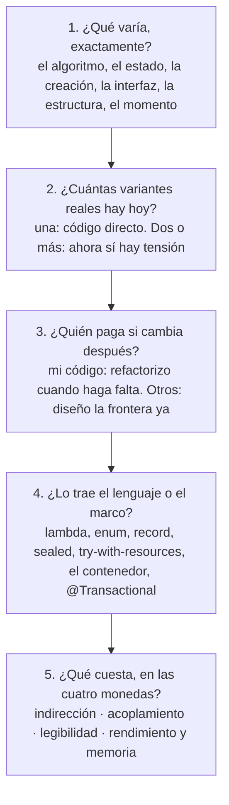
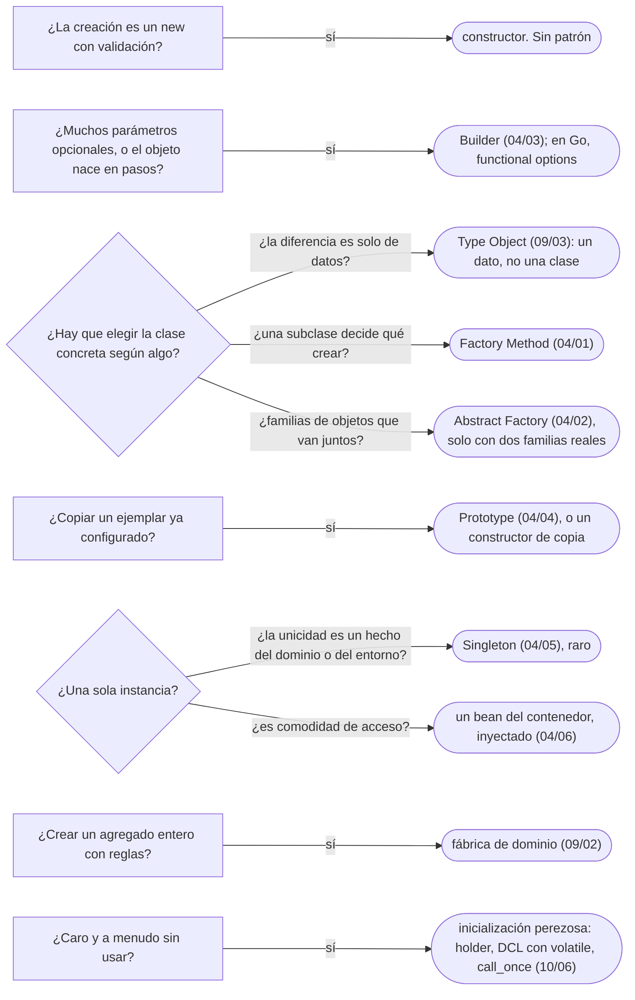
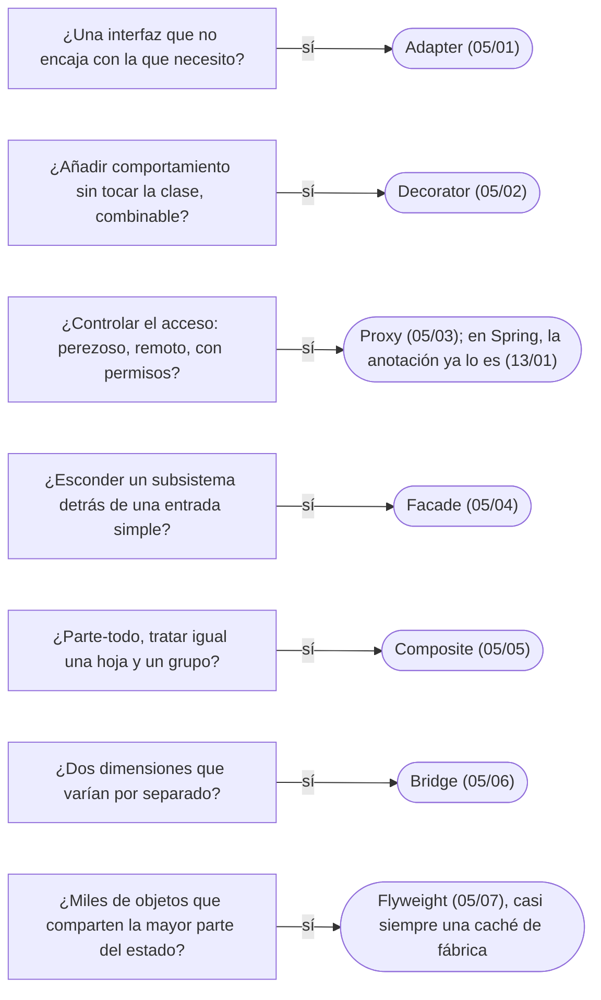
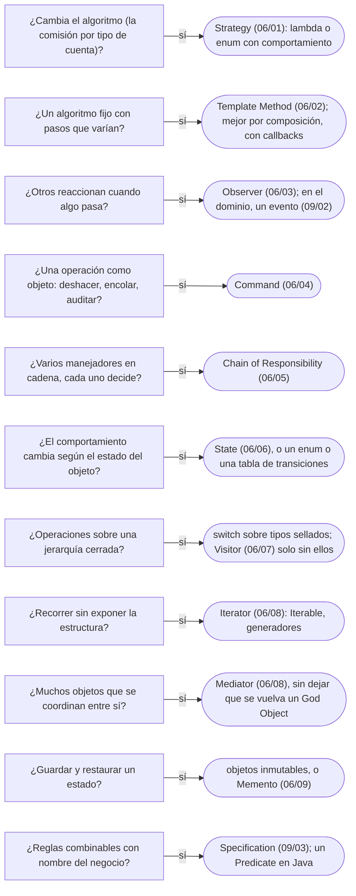
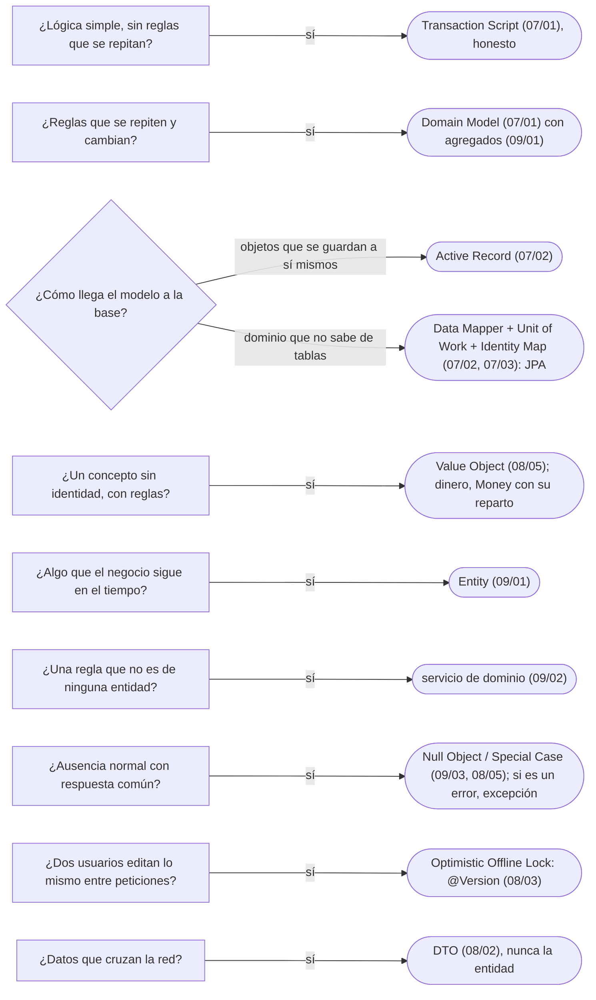
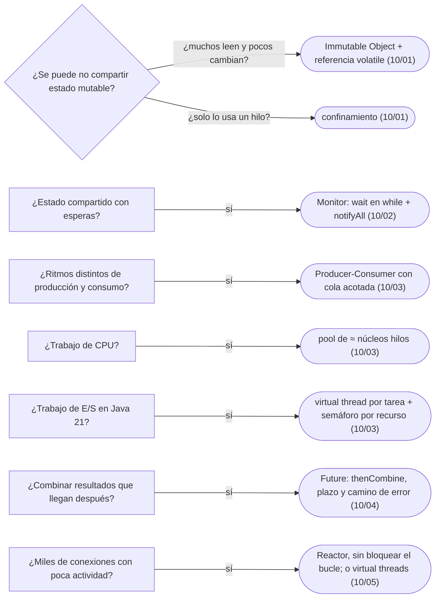
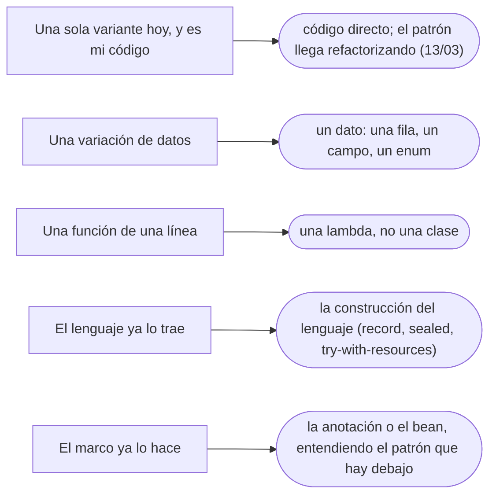

# 04 — Cómo se elige

> El árbol de decisión de todo el corpus, para usarlo **en voz alta**: del síntoma al patrón —o a ninguno—, los pares que se
> confunden y las preguntas que hay que hacer antes de elegir. **Excepción declarada a la plantilla**: es un capítulo sin código;
> todo va en árboles en bloque `text` y tablas, y cada rama enlaza al capítulo dueño. Asume leídos los bloques de patrones, del
> [`04`](../04-creacionales/01-factory-method.md) al [`10`](../10-concurrencia/01-inmutabilidad-y-confinamiento.md).
>
> **Vigencia:** 2026-10-03.

---

## 1. 🎯 El problema

La pregunta de entrevista no suele ser "¿qué es un Decorator?", sino esta: *"tenemos que añadir auditoría a las transferencias, pero
solo para las cuentas empresariales y sin tocar el código que ya funciona. ¿Cómo lo harías?"*. Quien estudió el catálogo de memoria
recorre los 23 nombres buscando uno que encaje. Quien estudió las tensiones hace preguntas: ¿qué varía?, ¿cuántas variantes hay hoy?,
¿quién paga el cambio?, ¿lo trae ya el lenguaje o el marco?

Este capítulo ordena esas preguntas. No sustituye a ningún capítulo: es el índice que se recorre con la cabeza en una entrevista, y
cada hoja remite al capítulo donde está el precio completo.

---

## 2. 🧭 Las cinco preguntas antes de elegir

- La pregunta 4 es la que más patrones elimina: en Java 21, un Strategy de una línea es una lambda, un Visitor es un `switch` sellado,
  un Singleton es un bean y un Value Object es un `record` con validación. La tesis del corpus: parte de los patrones era un rodeo para
  lo que al lenguaje le faltaba ([`11`](../11-los-diferentes/01-go.md) lo muestra en tres lenguajes más).
- "Siempre hay un patrón para cada problema" es la simplificación de este capítulo: muchas veces la respuesta correcta es una función,
  un `enum`, un dato en una tabla, o nada.

---

## 3. 🧭 Crear objetos

---

## 4. 🧭 Componer y envolver

---

## 5. 🧭 Variar el comportamiento

---

## 6. 🧭 El dominio y los datos

---

## 7. 🧭 Concurrencia

---

## 8. ⚖️ Los pares que se confunden

| Par | La diferencia, en una frase |
|---|---|
| Strategy / State | En Strategy elige el cliente; en State, el propio objeto según su estado, y los estados se pasan el control |
| Decorator / Proxy | El Decorator añade comportamiento y se apila; el Proxy controla el acceso a un objeto (`05/03`) |
| Adapter / Facade | El Adapter traduce una interfaz a otra; el Facade simplifica un subsistema entero |
| Factory Method / Abstract Factory | Uno crea un producto con una subclase; la otra crea familias que van juntas |
| Template Method / Strategy | Herencia del algoritmo con pasos redefinidos; composición con el algoritmo entero intercambiable |
| Observer / Mediator | El Observer difunde a quien se suscriba; el Mediator coordina a participantes que conoce |
| Composite / Decorator | Los dos envuelven: el Composite agrupa a muchos hijos; el Decorator, a uno, para añadirle algo |
| Value Object / DTO | El Value Object es un concepto del dominio con reglas; el DTO, un sobre sin reglas para cruzar una frontera |
| Entity / Value Object | La entidad tiene identidad que dura; el valor vale por su contenido y se reemplaza |
| Null Object / `Optional` | El Null Object decide por el llamador; `Optional` obliga a decidir |
| Service Locator / inyección | Con el localizador la clase pide; con inyección, recibe |
| Singleton del GoF / alcance singleton | El del GoF tiene acceso global por cargador de clases; el del contenedor, una instancia por bean, inyectada |

---

## 9. 🧭 Cuando la respuesta es ninguno

**La frase en voz alta:** *"Antes de nombrar un patrón pregunto qué varía y cuántas variantes hay hoy. Si hay una, escribo código
directo; si hay dos y cambian por motivos distintos, elijo el patrón que separa esa variación, y digo lo que cuesta. Y si el lenguaje o
el marco ya lo traen, uso lo que traen."*

---

## ⚠️ Errores frecuentes

| Se dice | Lo preciso |
|---|---|
| "Siempre hay un patrón para cada problema" | Muchas veces la respuesta es una función, un dato, un `enum` o nada |
| "Elegir un patrón es recordar su nombre" | Es identificar qué varía, cuántas variantes hay y qué cuesta separarlas |
| "Strategy y State son lo mismo con otro nombre" | La estructura se parece; quién elige y quién cambia la variante es distinto |
| "Si el patrón existe en el GoF, sigue haciendo falta igual" | Parte del catálogo era un rodeo para lo que a los lenguajes de 1994 les faltaba |
| "Más patrones, diseño más flexible" | Cada patrón añade indirección; solo es flexibilidad si hay una variación real |
| "El marco lo hace, no necesito saber el patrón" | Las trampas del marco son las del patrón: la autoinvocación es la del Proxy |

---

## 📚 Para profundizar

- **Libro** — Gamma, Helm, Johnson y Vlissides, *Design Patterns* (Addison-Wesley, 1994), cap. 1, "Introduction", sección "How to Select
  a Design Pattern". **El que destaca.**
- **Libro** — Freeman y Robson, *Head First Design Patterns*, 2.ª ed. (O'Reilly, 2021), cap. 13, "Patterns in the Real World: Better
  Living with Patterns": los patrones no son una solución mágica, y cuándo no usarlos.
- **Libro** — Ousterhout, *A Philosophy of Software Design*, 2.ª ed. (Yaknyam Press, 2021), cap. 4, "Modules Should Be Deep": el costo
  de la indirección que no esconde nada.
- **Tutorial** — Refactoring Guru, [catálogo de patrones de diseño](https://refactoring.guru/design-patterns/catalog), con sus
  relaciones.

---

## 🧠 Preguntas

Sin respuestas aquí. Todas, con enunciado literal y respuesta en tres capas, en
[`06` — Respuestas](06-respuestas.md#04--cómo-se-elige).

1. ¿Qué preguntas haces antes de elegir un patrón? 🟢
2. ¿Qué patrón eliges si lo que varía es el algoritmo, y qué forma toma en Java 21? 🟢
3. ¿Qué es lo primero que miras para decidir que no hace falta ningún patrón? 🟢
4. ¿Qué diferencia hay entre Strategy y State? 🟡
5. ¿Qué diferencia hay entre Decorator y Proxy? 🟡
6. ¿Qué diferencia hay entre Adapter y Facade? 🟡
7. ¿Qué diferencia hay entre Observer y Mediator? 🟡
8. ¿Por qué "siempre hay un patrón para cada problema" es falso? 🟠
9. ¿Cómo cambia el lenguaje la lista de patrones que hacen falta? 🟠
10. ¿Por qué hay que conocer el patrón aunque el marco lo implemente? 🟠
11. Elige y justifica, con su precio: auditar las transferencias solo de las cuentas empresariales sin tocar el código existente. 🔴
12. Elige y justifica, con su precio: un tipo de documento nuevo por país cada mes, con formato y vigencia propios. 🔴

---

**Anterior:** [`03` — Refactorizar hacia patrones, y desde ellos](03-refactorizar-hacia-patrones.md) ·
**Siguiente:** [`05` — Simulación final](05-simulacion-final.md) ·
**Relacionado:** [`13/01` — Patrones en Spring](01-patrones-en-spring.md)
