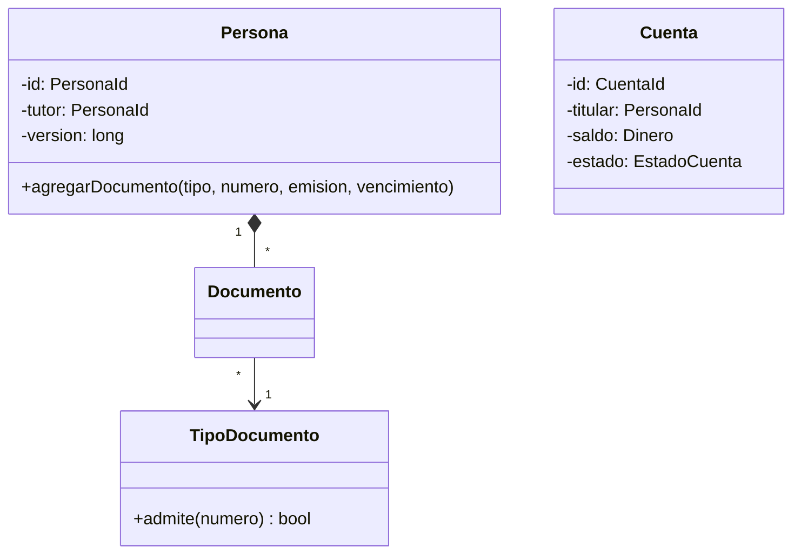

# 06 — Respuestas

> Solucionario del bloque `13-patrones-en-la-practica`: Patrones en la práctica. Cada respuesta en tres capas:
> **⏱️ 30 segundos** (lo que dices primero, sin que te lo pidan), **🗣️ 2 minutos** (lo que
> añades cuando dicen "cuéntame más") y **🔬 El detalle** (para estudiar, no para decir en voz
> alta). Los enunciados están copiados literalmente de su capítulo.
>
> **Vigencia:** 2026-10-03.
>
> **Versiones ejecutadas:** GCC 14.4 (C++23) · JDK 21.0.12, 17.0.20 y 25.0.4 · Spring Boot 4.1.1 (Spring Framework 7.0.9, Hibernate 7.4.5, H2 2.4.240) · Go 1.27.1 · mermaid-cli 11.17.0 (2026-10-04).

**Salto rápido:** [01](#01--patrones-en-spring) · [02](#02--patrones-en-el-jdk-y-en-la-stl) · [03](#03--refactorizar-hacia-patrones-y-desde-ellos) · [04](#04--cómo-se-elige) · [05](#05--simulación-final)

---

# 01 — Patrones en Spring

**01 → 1. ¿Qué patrón hace funcionar a `@Transactional`? 🟢**

⏱️ El Proxy: Spring pone un objeto delante del bean que abre la transacción, llama al método real y confirma o deshace.
🗣️ Quien inyecta el servicio recibe el proxy, no el objeto. Por eso funciona en las llamadas que entran desde fuera y no en las que el
objeto se hace a sí mismo con `this`.
🔬 Spring AOP usa proxies dinámicos del JDK si el objeto implementa interfaces, o CGLIB si no; Spring Boot usa CGLIB por defecto.
`@Cacheable` y `@Async` funcionan igual.

**01 → 2. ¿Qué patrón es `JdbcTemplate`? 🟢**

⏱️ Un Template Method con *callbacks*: Spring fija el algoritmo —conexión, sentencia, ejecución, cierre, traducción de excepciones— y
el llamador pone el paso variable, como el `RowMapper`.
🗣️ La referencia lo describe como la clase central del núcleo JDBC: gestiona los recursos y deja a la aplicación solo el SQL y la
extracción de resultados.
🔬 Es la forma por composición del Template Method: el paso no se hereda, se pasa como función. `TransactionTemplate` es lo mismo para
transacciones.

**01 → 3. ¿Qué patrón es la cadena de filtros de Spring Security? 🟢**

⏱️ Chain of Responsibility: cada filtro hace lo suyo y pasa al siguiente, o corta la cadena con un `401` o un `403`.
🗣️ El `FilterChainProxy` usa un `SecurityFilterChain` para decidir qué filtros de seguridad se invocan en cada petición. Los
`HandlerInterceptor` de Spring MVC forman otra cadena alrededor del controlador.
🔬 Es la variante en que varios eslabones actúan, no la del GoF en que uno solo se queda con la petición.

**01 → 4. ¿Qué es un `FactoryBean`? 🟢**

⏱️ Un bean que fabrica otro bean: el contenedor le pide el objeto y entrega lo que el `FactoryBean` crea.
🗣️ La referencia lo describe como un punto de extensión de la lógica de creación del contenedor, para inicializaciones complejas que se
expresan mejor en Java.
🔬 Hoy casi siempre lo reemplaza un método `@Bean`, que es un Factory Method más simple; `FactoryBean` sigue en librerías que integran
con Spring.

**01 → 5. ¿Qué diferencia hay entre el alcance singleton de Spring y el Singleton del GoF? 🟡**

⏱️ El de Spring es una instancia por bean y por contenedor, que llega por inyección; el del GoF es una instancia por cargador de clases,
con acceso global estático.
🗣️ La referencia de Spring lo distingue de forma explícita. Con el de Spring puede haber dos beans de la misma clase y en las pruebas se
pasa otra instancia; con el del GoF, no.
🔬 Ver `04/05`: el contenedor conserva lo útil (una instancia compartida) y quita lo que cuesta (el acceso global).

**01 → 6. ¿Qué diferencia hay entre `@EventListener` y `@TransactionalEventListener`? 🟡**

⏱️ `@EventListener` corre de forma síncrona en cuanto se publica, dentro de la transacción del que publica; `@TransactionalEventListener`
corre en una fase de la transacción, por defecto después del *commit*.
🗣️ Lo que no se puede deshacer —un correo, una llamada a otro sistema— va con `@TransactionalEventListener`. Lo que debe ocurrir en la
misma transacción, con `BEFORE_COMMIT` o con `@EventListener`.
🔬 Sin transacción activa, `@TransactionalEventListener` no se ejecuta, salvo con `fallbackExecution = true`.

**01 → 7. ¿Qué diferencia hay entre `@Transactional` y `TransactionTemplate`? 🟡**

⏱️ `@Transactional` es declarativa y funciona por proxy; `TransactionTemplate` es programática: un Template Method que ejecuta el
*callback* dentro de una transacción.
🗣️ `TransactionTemplate` no tiene la trampa de la autoinvocación y deja ver en el código dónde empieza y termina la transacción; a
cambio, mezcla la infraestructura con el código.
🔬 Sirve bien para transacciones de una parte de un método, o en código que no es un bean.

**01 → 8. ¿Qué diferencia hay entre un proxy JDK y uno CGLIB? 🟡**

⏱️ El proxy JDK implementa las interfaces del objeto; el CGLIB es una subclase generada. Spring usa el JDK si hay interfaces y CGLIB si
no; Spring Boot, CGLIB por defecto.
🗣️ Con el JDK, quien inyecta la clase concreta en lugar de la interfaz falla; con CGLIB, los métodos `final` y la clase `final` no se
pueden interceptar.
🔬 En los dos casos la autoinvocación sigue sin pasar por el proxy.

**01 → 9. ¿Qué diferencia hay entre un `@Bean` y un `getBean` en el código de negocio? 🟡**

⏱️ El `@Bean` es un Factory Method que el contenedor llama en la configuración; `getBean` en el negocio es pedirle dependencias al
contenedor: un Service Locator.
🗣️ El primero deja las dependencias en las firmas y al contenedor como único sitio que conecta; el segundo las esconde dentro de los
métodos.
🔬 Ver `12/04` §3.

**01 → 10. ¿Por qué la autoinvocación no abre transacción? 🟠**

⏱️ Porque `this.metodo()` llama al objeto real, no al proxy, y la transacción la abre el proxy.
🗣️ En el `cerrarMes` del capítulo, `cobrarComision` con `REQUIRES_NEW` no abre transacciones propias: todo va en la del que llama, o en
ninguna. La salida es mover el método a otro bean.
🔬 Inyectarse a sí mismo o pedir el proxy actual también funcionan, y esconden que la clase tiene dos responsabilidades.

**01 → 11. ¿Por qué `@Cacheable` en un método llamado desde la misma clase no cachea? 🟠**

⏱️ Por la misma razón que `@Transactional`: la caché la consulta el proxy, y la llamada interna no pasa por él.
🗣️ La documentación de la caché lo dice: en modo proxy, solo se interceptan las llamadas externas, y la autoinvocación no produce caché
aunque el método esté anotado. Las tarifas del capítulo van a otro bean.
🔬 El modo AspectJ, que teje el código en lugar de usar proxies, sí intercepta la autoinvocación, a costa de otra configuración.

**01 → 12. ¿Por qué "Spring usa el patrón Singleton" es una simplificación? 🟠**

⏱️ Porque Spring usa un **alcance** singleton, no el patrón: no hay acceso global ni constructor privado, y la instancia llega por
inyección.
🗣️ El patrón del GoF es justo lo que el contenedor permite no escribir. Lo que se obtiene es lo útil del Singleton —una instancia
compartida— sin su costo.
🔬 La referencia lo dice: el GoF fija la instancia por cargador de clases; Spring, por contenedor y por bean.

**01 → 13. ¿Por qué un campo mutable en un `@Service` es un problema? 🟠**

⏱️ Porque el bean es singleton: una sola instancia que comparten todas las peticiones, en todos los hilos. El campo es estado compartido
sin sincronizar.
🗣️ Una lista de "movimientos de la petición actual" en un servicio mezcla los de dos peticiones simultáneas. Lo de una petición va en
variables locales o parámetros.
🔬 Si de verdad hace falta estado compartido, se diseña para hilos: inmutable con referencia `volatile`, o una estructura concurrente
(`10/01`, `10/02`).

**01 → 14. ¿Qué hace Spring cuando hay dos implementaciones de la misma estrategia, y cómo se resuelve? 🟠**

⏱️ Falla al arrancar: no sabe cuál inyectar. Se resuelve marcando una con `@Primary` o diciendo cuál en el punto de inyección con
`@Qualifier`.
🗣️ Si el código necesita todas —una estrategia por tipo—, se inyecta una `List` o un `Map<String, Estrategia>` con todas, y se elige en
ejecución.
🔬 Es el Strategy con el contenedor como quien elige; si la elección depende de datos de la petición, la hace el código, no la
configuración.

**01 → 15. Corrige el `cerrarMes` del §1 para que cada cuenta se cobre en su propia transacción. 🔴**

⏱️ El cobro va a otro bean con `REQUIRES_NEW`, y `cerrarMes` lo llama por la referencia inyectada, que es el proxy.
🗣️

```java
@Service
public class CierreMensual {
    private final CobroComisiones cobros;
    public CierreMensual(CobroComisiones cobros) { this.cobros = cobros; }
    public void cerrarMes(List<CuentaId> cuentas) { cuentas.forEach(cobros::cobrar); }
}

@Service
public class CobroComisiones {
    @Transactional(propagation = Propagation.REQUIRES_NEW)
    public void cobrar(CuentaId id) { /* carga, cobra y guarda la cuenta */ }
}
```

🔬 Lo que preguntará después: qué pasa si falla la cuenta 300 (se deshace solo esa; las demás quedan cobradas, y hay que registrar cuáles
fallaron para reintentar), y si `cerrarMes` debería tener transacción (no: cada cobro es la suya).

**01 → 16. Revisa este código y di qué falla: un `@EventListener` que envía un correo y una transacción que después se deshace. 🔴**

⏱️ `@EventListener` corre dentro de la transacción, en cuanto se publica: el correo sale, la transacción se deshace, y el cliente recibe
un aviso de algo que no pasó.
🗣️ La corrección es `@TransactionalEventListener`, que por defecto corre después del *commit*.
🔬 Lo que preguntará después: qué pasa si el correo falla después del *commit* (se pierde; si importa, se guarda el aviso en la misma
transacción y se envía aparte), y qué pasa si se publica sin transacción (el oyente transaccional no corre, salvo con
`fallbackExecution`).

**01 → 17. Escribe con `JdbcTemplate` la consulta de las cuentas de un titular y señala el paso variable. 🔴**

⏱️ Un `query` con el SQL, un `RowMapper` como lambda —el paso variable— y el parámetro.
🗣️

```java
List<Cuenta> cuentas = jdbc.query(
        "SELECT numero, saldo, moneda FROM cuenta WHERE titular_id = ?",
        (rs, fila) -> new Cuenta(new CuentaId(rs.getString("numero")),
                                 new Dinero(rs.getBigDecimal("saldo"), Currency.getInstance(rs.getString("moneda")))),
        titular.valor());
```

🔬 El `RowMapper` es el paso variable; abrir la conexión, preparar la sentencia, recorrer el `ResultSet`, cerrar y traducir las
excepciones a `DataAccessException` es el algoritmo fijo. Lo que preguntará después: por qué el `?` (para que la base trate el valor como
dato, no como SQL) y qué es `JdbcClient` (la API fluida más reciente, sobre el mismo núcleo).

**01 → 18. Revisa este código y di qué falla: un `@Service` con un campo `List<Movimiento> porConfirmar` que llenan las peticiones. 🔴**

⏱️ El servicio es singleton: todas las peticiones, en todos los hilos, escriben en la misma lista. Se mezclan los movimientos de
peticiones distintas, y un `ArrayList` escrito por varios hilos puede corromperse.
🗣️ La corrección es que lo de una petición sea local: una variable dentro del método, o un objeto que se crea por petición y se pasa como
parámetro.
🔬 Lo que preguntará después: si `@RequestScope` lo arreglaría (sí, con un proxy de alcance que esconde el mecanismo; un parámetro es más
claro), y si una lista sincronizada bastaría (no: seguiría mezclando peticiones).

# 02 — Patrones en el JDK y en la STL

**02 → 1. ¿Qué patrón es `BufferedInputStream`? 🟢**

⏱️ Un Decorator: envuelve a otro `InputStream`, tiene su misma interfaz y le añade un búfer.
🗣️ `java.io` es el ejemplo canónico: `DataInputStream`, `GZIPInputStream` y `BufferedInputStream` se apilan uno sobre otro, cada uno
añadiendo una capacidad, y quien lee solo ve un `InputStream`.
🔬 Ver `05/02`. El precio también está ahí: una pila de envoltorios que hay que cerrar en orden, y cuyo orden importa.

**02 → 2. ¿Qué patrón es `Comparator`? 🟢**

⏱️ Strategy: una forma intercambiable de comparar, que `sort` usa sin saber cuál es.
🗣️ `lista.sort(Comparator.comparing(Persona::fechaNacimiento))`: la estrategia se elige al llamar, y se compone con `thenComparing` o
`reversed`.
🔬 Con lambdas, la estrategia de una línea ya no necesita una clase; la interfaz funcional es el patrón.

**02 → 3. ¿Qué patrón es `InputStreamReader`? 🟢**

⏱️ Un Adapter: convierte un flujo de bytes (`InputStream`) en un flujo de caracteres (`Reader`), con una codificación.
🗣️ El cliente quiere `Reader` y tiene `InputStream`: el adaptador traduce entre las dos interfaces. Su Javadoc lo describe como un
puente de bytes a caracteres.
🔬 `Arrays.asList` es otro: adapta un arreglo a `List`, respaldado por el arreglo y de tamaño fijo.

**02 → 4. ¿Qué es un adaptador de contenedor en la STL? 🟢**

⏱️ Una clase que envuelve un contenedor y expone solo un subconjunto de operaciones con otra interfaz: `std::stack`, `std::queue` y
`std::priority_queue`.
🗣️ `std::stack` usa por defecto un `std::deque` y solo ofrece `push`, `pop` y `top`. cppreference lo describe así: un envoltorio sobre el
contenedor subyacente con un conjunto concreto de funciones.
🔬 Es el Adapter con nombre propio en el estándar, y por composición: lo contrario del `Stack extends Vector` de Java (`12/02`).

**02 → 5. ¿Qué patrón es la pareja `Runnable` y `Executor`? 🟢**

⏱️ Command: `Runnable` es la operación empaquetada como objeto, y el `Executor` decide cuándo y en qué hilo ejecutarla.
🗣️ La Javadoc de `Executor` dice que desacopla el envío de una tarea de cómo se ejecuta, incluidos los hilos y la planificación. Con
una cola, es además el Producer-Consumer de `10/03`.
🔬 `Callable` añade el resultado, y el `Future` que devuelve `submit` es el de `10/04`.

**02 → 6. ¿Qué diferencia hay entre una estrategia en Java y en la STL? 🟡**

⏱️ En Java suele ser un objeto que implementa una interfaz, elegido al ejecutar; en la STL suele ser un parámetro de plantilla —el
comparador, el `std::hash`, el *allocator*—, resuelto al compilar.
🗣️ La de C++ no tiene llamada virtual y se puede integrar en el código; a cambio, cada estrategia distinta es un tipo distinto, y no se
cambia en ejecución.
🔬 Cuando hace falta elegir al ejecutar, la STL también lo ofrece: `std::function` o `std::pmr::polymorphic_allocator`.

**02 → 7. ¿Qué diferencia hay entre `std::function` y una interfaz de Java? 🟡**

⏱️ La interfaz exige que la clase la implemente; `std::function` acepta **cualquier** invocable con la firma —lambda, función, objeto con
`operator()`— sin herencia. Es *type erasure*.
🗣️ La interfaz virtual existe, pero dentro de la librería: el código del usuario no hereda de nada. En Java, una interfaz funcional con
lambdas se le acerca mucho.
🔬 Su precio: una llamada indirecta y, para objetos grandes, una reserva en el montículo. Iglberger le dedica el cap. 8 de *C++
Software Design*.

**02 → 8. ¿Qué diferencia hay entre `Collections.unmodifiableList` y `List.copyOf`? 🟡**

⏱️ `unmodifiableList` es una **vista**: un Decorator de solo lectura sobre la lista original, que ve sus cambios. `List.copyOf` es una
**copia** inmodificable, que no depende del original.
🗣️ Si alguien conserva la lista original y la modifica, la vista cambia; la copia no. Para proteger un agregado (`09/01`), copia.
🔬 Ver `01/03`: no modificable no es inmutable.

**02 → 9. ¿Qué diferencia hay entre el *allocator* clásico y `std::pmr::polymorphic_allocator`? 🟡**

⏱️ El clásico es una estrategia de reserva fijada al compilar, como parámetro de plantilla; el polimórfico (C++17) la elige al ejecutar,
detrás de una interfaz virtual (`memory_resource`).
🗣️ Con el clásico, dos vectores con *allocators* distintos son tipos distintos; con `std::pmr`, son el mismo tipo y el recurso se pasa al
construir.
🔬 Son las dos formas del Strategy en C++, en la misma librería: plantilla o polimorfismo de ejecución.

**02 → 10. ¿Por qué `Runtime.getRuntime()` es un Singleton legítimo? 🟠**

⏱️ Porque la unicidad es un hecho del entorno —hay un solo proceso Java— y no una comodidad de acceso. Su Javadoc dice que toda
aplicación tiene una sola instancia.
🗣️ Es la regla de `04/05`: Singleton cuando la unicidad es una regla del dominio o del entorno. Un catálogo de tipos o una configuración
no lo cumplen.
🔬 Aun así, el código de negocio haría mejor en recibir lo que necesita de `Runtime` por parámetro, para poder probarlo.

**02 → 11. ¿Por qué "los patrones son para el código de aplicación" es falso? 🟠**

⏱️ Porque la librería estándar está hecha de patrones: Decorator en `java.io`, Strategy en `Comparator`, Command en `Executor`,
Iterator en todas las colecciones, Adapter y RAII en toda la STL.
🗣️ Reconocerlos sirve para dos cosas: explicar un patrón con un ejemplo que el entrevistador conoce, y entender por qué la librería se
comporta como se comporta (la vista que cambia, el envoltorio que hay que cerrar).
🔬 Y a la inversa: buena parte de los patrones que ya trae la librería no hay que escribirlos.

**02 → 12. ¿Por qué `Collections.synchronizedList` no basta para recorrer la lista desde varios hilos? 🟠**

⏱️ Porque sincroniza cada operación por separado, no las secuencias: recorrer, o comprobar y luego actuar, son varias operaciones, y otro
hilo puede intercalarse.
🗣️ Su Javadoc obliga a tomar el candado de la lista a mano mientras se recorre. Es el Decorator que añade un candado por llamada, con el
límite de `10/02`: la atomicidad que importa es la de la operación del negocio.
🔬 Para lecturas frecuentes, `CopyOnWriteArrayList` o una lista inmutable publicada con `volatile` (`10/01`).

**02 → 13. Señala todos los patrones de esta línea: `new BufferedReader(new InputStreamReader(new FileInputStream(ruta), UTF_8)).lines().sorted(Comparator.comparing(String::length))`. 🔴**

⏱️ Decorator (`BufferedReader`), Adapter (`InputStreamReader`, de bytes a caracteres), Iterator perezoso (el *stream* de `lines()`),
Strategy (el `Comparator`), y una fábrica estática (`Comparator.comparing`).
🗣️ Y uno que falta: el recurso. La línea no cierra el archivo; va dentro de un `try`-with-resources, el recurso con dueño de `01/04`.
🔬 Lo que preguntará después: en qué orden se cierran los envoltorios (cerrar el exterior cierra los de dentro), y por qué `sorted`
rompe la pereza (necesita todas las líneas antes de devolver la primera).

**02 → 14. Escribe en C++ una estrategia de comisión guardada en `std::function`, y di cuándo usarías una plantilla en su lugar. 🔴**

⏱️ Una `std::function<Dinero(Dinero)>` que acepta una lambda o un objeto con `operator()`, y una plantilla cuando la estrategia se
conoce al compilar y la llamada está en un bucle caliente.
🗣️

```cpp
std::function<Dinero(Dinero)> comision = [](Dinero monto) { return monto.porcentaje(0.5); };
comision = TarifaFija{Dinero::cop(2000)};

template <typename Politica>
Dinero cobrar(Dinero monto, Politica politica) { return politica(monto); }    // resuelta al compilar
```

🔬 Lo que preguntará después: qué cuesta `std::function` (una llamada indirecta y, a veces, una reserva), y cuándo la elección tiene que
ser al ejecutar (la política depende del tipo de cuenta leído de la base: `std::function` o una interfaz virtual).

# 03 — Refactorizar hacia patrones, y desde ellos

**03 → 1. ¿Qué significa refactorizar hacia un patrón? 🟢**

⏱️ Llegar a un patrón en pasos pequeños de refactorización, desde código que ya funciona, cuando un *smell* muestra la tensión que el
patrón resuelve.
🗣️ El patrón es el destino, no el punto de partida: primero el código directo, después la duplicación o el condicional que crece, y
entonces los pasos del catálogo, cada uno con las pruebas en verde.
🔬 Es la idea de Kerievsky en *Refactoring to Patterns*: refactorizar hacia un patrón, en dirección a él, o alejándose de él.

**03 → 2. ¿Qué es una prueba de caracterización? 🟢**

⏱️ Una prueba que fija lo que el código hace hoy, sea correcto o no, para poder cambiar su estructura sabiendo que el comportamiento no
cambia.
🗣️ Antes de refactorizar `comision`: una cuenta de cada tipo, con los resultados actuales, incluido el tipo que lanza.
🔬 Si una prueba de caracterización falla tras un paso, se decide si el comportamiento viejo era un error; nunca se cambia la prueba en
silencio.

**03 → 3. ¿Qué es *Inline Singleton*? 🟢**

⏱️ La refactorización que quita un Singleton cuando el código necesita el objeto pero no un punto de acceso global: lo que ofrecía pasa a
quien guarda y da acceso al objeto, y el Singleton se borra.
🗣️ En Java hoy, ese dueño es el contenedor: crea una instancia y la inyecta por constructor.
🔬 Está en el catálogo de Kerievsky junto a su inversa, *Limit Instantiation with Singleton*.

**03 → 4. ¿Qué diferencia hay entre refactorizar *hacia* un patrón y *en dirección* a él? 🟡**

⏱️ Hacia es llegar al patrón completo; en dirección es dar los pasos que acercan a él y parar cuando la tensión desaparece, aunque el
patrón no esté entero.
🗣️ En `comision`, el destino era un Strategy, y bastó un `enum` con lambdas y una sola clase para la nómina: no hizo falta una clase por
estrategia.
🔬 Parar a mitad es la decisión correcta más a menudo de lo que parece: cada paso de más es indirección sin beneficio.

**03 → 5. ¿Qué diferencia hay entre *Replace Conditional Logic with Strategy* y *Replace Conditional with Polymorphism*? 🟡**

⏱️ La de Fowler mueve cada rama a una subclase del objeto que tiene el condicional; la de Kerievsky la mueve a un objeto estrategia aparte,
en el que el original delega.
🗣️ Con polimorfismo, la variación es del propio objeto (cada tipo de cuenta es una subclase); con Strategy, la variación se compone y
puede cambiarse sin cambiar el tipo del objeto.
🔬 En Java, el `enum` con comportamiento está entre las dos: la variación vive en el tipo, pero sin jerarquía de clases.

**03 → 6. ¿Qué diferencia hay entre refactorizar hacia State y escribir una tabla de transiciones? 🟡**

⏱️ El State reparte el comportamiento de cada estado en su clase; la tabla describe las transiciones como datos (estado, evento, estado
siguiente).
🗣️ Con pocos estados y operaciones distintas por estado, State; con muchos estados y transiciones que cambian sin desplegar, una tabla.
Con tres estados y cuatro operaciones, un `enum` con comportamiento suele bastar.
🔬 Ver `06/06`, que lleva el ciclo de vida de la cuenta en una tabla de transiciones.

**03 → 7. ¿Qué diferencia hay entre un Visitor y un `switch` sobre tipos sellados al añadir un tipo nuevo? 🟡**

⏱️ Con el Visitor, el tipo nuevo obliga a añadir un método a la interfaz del visitante y a todos los visitantes; con el `switch` sellado,
el compilador marca cada `switch` que no lo cubre.
🗣️ Los dos avisan al compilar; el `switch` lo hace con muchas menos piezas: sin `accept`, sin interfaz `Visitor`, sin doble despacho.
🔬 Ver `06/07`: el Visitor existía porque Java solo despachaba por el receptor; con tipos sellados, el lenguaje da lo que el patrón
fingía.

**03 → 8. ¿Por qué "se diseña con patrones desde el principio" es una mala regla? 🟠**

⏱️ Porque convierte el catálogo en requisitos: se paga la indirección de un patrón antes de que exista la tensión que lo justifica, y a
menudo nunca llega.
🗣️ Cinco clases para una regla de comisión que nunca tuvo una segunda variante cuestan lectura, pruebas y saltos en el IDE durante años.
El código directo se convierte en patrón en una tarde cuando hace falta.
🔬 Es la *patternitis* de `12/04` y la Speculative Generality de `12/02`.

**03 → 9. ¿Cuándo sí conviene diseñar un patrón desde el primer día? 🟠**

⏱️ Cuando la tensión es segura y cambiar después cuesta mucho: una API pública con varios implementadores previstos, un punto de
extensión para terceros, una frontera entre módulos.
🗣️ Cambiar una interfaz que usan otros equipos o clientes externos rompe código que no controlas; ahí se paga la abstracción de entrada.
🔬 La pregunta es quién paga el cambio después: si es tu propio código, refactorizar es barato; si son otros, no.

**03 → 10. ¿Por qué se para antes de completar el patrón? 🟠**

⏱️ Porque el objetivo es resolver la tensión, no tener el patrón: cuando la duplicación desaparece y el cambio siguiente es fácil, cada
paso de más es indirección.
🗣️ Las tres políticas de una línea quedaron como lambdas; solo la nómina, con lógica propia, tiene clase. Una clase por estrategia no
habría añadido nada.
🔬 Si mañana una lambda crece, se extrae a una clase en ese momento: es otro paso del mismo camino.

**03 → 11. ¿Por qué quitar un Visitor exige primero sellar la jerarquía? 🟠**

⏱️ Porque sin sellar, el `switch` no puede ser exhaustivo: el compilador no sabe qué tipos existen y obliga a un `default`, y entonces un
tipo nuevo no avisa.
🗣️ Sellar (`sealed interface Movimiento permits ...`) devuelve la garantía que el Visitor daba con su interfaz: un caso por tipo,
comprobado al compilar.
🔬 La JLS exige que las clases permitidas estén en el mismo módulo, o en el mismo paquete si no hay módulos (`06/07`).

**03 → 12. Refactoriza el `comision` del §1 hacia un `enum` con su política, en pasos. 🔴**

⏱️ Caracterizar, extraer cada rama, introducir la interfaz de política, asignarla a cada constante del `enum`, y delegar.
🗣️

```text
1. Prueba con una cuenta de cada tipo, incluida la nómina con saldo alto
2. Extract Function de cada rama: comisionAhorros, comisionCorriente, comisionNomina, comisionEmpresarial
3. Interfaz funcional PoliticaComision(Cuenta, Dinero) → Dinero
4. Constructor del enum TipoCuenta con su política; lambdas para las de una línea, ComisionNomina para la otra
5. comision(c, monto) = c.tipo().politica().comision(c, monto); borrar los if y el throw
```

🔬 Lo que preguntará después: qué pasa con un tipo nuevo (el compilador obliga a darle política en el `enum`), y si las tarifas deberían
estar en código (si el negocio las cambia a menudo, van a datos, y el `enum` guarda solo la forma del cálculo: Type Object, `09/03`).

**03 → 13. Escribe los pasos para quitar un Singleton `CatalogoTipos.instancia()` usado en veinte clases sin romper ninguna. 🔴**

⏱️ En cada clase, un constructor que recibe el catálogo y otro de conveniencia que pasa `instancia()`; migrar llamadores; quitar los de
conveniencia y el acceso estático.
🗣️

```text
1. Registrar CatalogoTipos como bean (el contenedor crea una sola instancia)
2. En cada una de las veinte clases: constructor con CatalogoTipos; el constructor viejo delega pasando instancia()
3. Migrar a quien crea esas clases (o al contenedor) para que use el constructor nuevo
4. Cuando nadie use los constructores viejos, borrarlos
5. Borrar instancia() y hacer público el constructor de CatalogoTipos
```

🔬 Cada paso compila y pasa las pruebas, y se puede repartir en varios *pull requests*. Lo que preguntará después: qué ganan las pruebas
(pasar un catálogo en memoria), y qué pasa si el Singleton tenía estado mutable (ahora se ve: está en un bean compartido entre hilos, y
hay que tratarlo como en `10/01`).

**03 → 14. Reemplaza un Visitor de movimientos que calcula el signo por un `switch` sobre una interfaz sellada. 🔴**

⏱️ Sellar la jerarquía, escribir el `switch` exhaustivo como función, comprobar con las pruebas que da lo mismo que el visitante, cambiar
los llamadores y borrar el Visitor.
🗣️

```java
sealed interface Movimiento permits Deposito, Retiro, TransferenciaEnviada, TransferenciaRecibida, Comision { Dinero monto(); }

static Dinero signo(Movimiento m) {
    return switch (m) {
        case Deposito d -> d.monto();
        case Retiro r -> r.monto().negado();
        case TransferenciaEnviada t -> t.monto().negado();
        case TransferenciaRecibida t -> t.monto();
        case Comision c -> c.monto().negado();
    };
}
```

🔬 En Java 17 el `switch` de patrones no existe: el Visitor o una cadena de `instanceof` con patrón son la alternativa. Lo que preguntará
después: si conviene quitar todos los Visitor (no si añaden un recorrido de una estructura compuesta que el `switch` no hace solo), y qué
pasa con `default` (no se pone: quitaría la exhaustividad).

# 04 — Cómo se elige

**04 → 1. ¿Qué preguntas haces antes de elegir un patrón? 🟢**

⏱️ Qué varía exactamente, cuántas variantes reales hay hoy, quién paga si cambia después, si el lenguaje o el marco ya lo traen, y qué
cuesta en las cuatro monedas.
🗣️ Con una sola variante y código propio, código directo. Con dos que cambian por motivos distintos, el patrón que separa esa
variación. Si el que paga el cambio es otro equipo, la frontera se diseña ya.
🔬 La cuarta pregunta es la que más patrones elimina: lambdas, `enum`, `record`, `sealed`, el contenedor.

**04 → 2. ¿Qué patrón eliges si lo que varía es el algoritmo, y qué forma toma en Java 21? 🟢**

⏱️ Strategy; en Java 21, casi siempre una lambda o un `enum` con comportamiento, y una clase solo para la variante con lógica o estado
propios.
🗣️ La comisión por tipo de cuenta: cada constante del `enum` lleva su política. Si las variantes las añade el negocio sin desplegar, el
algoritmo se vuelve datos: Type Object.
🔬 Ver `06/01` y `13/03` §3.

**04 → 3. ¿Qué es lo primero que miras para decidir que no hace falta ningún patrón? 🟢**

⏱️ Cuántas variantes reales hay hoy. Si hay una, el patrón es especulación: se escribe el código directo y se llega al patrón
refactorizando cuando aparezca la segunda.
🗣️ Después, si la variación es de datos (una fila, un campo) o si el lenguaje ya la resuelve (una lambda): en los dos casos, tampoco hay
patrón que escribir.
🔬 La excepción son las fronteras públicas, donde cambiar después cuesta a otros.

**04 → 4. ¿Qué diferencia hay entre Strategy y State? 🟡**

⏱️ En Strategy elige el cliente qué algoritmo usar; en State, el objeto cambia de comportamiento según su propio estado, y los estados se
pasan el control entre sí.
🗣️ La comisión por tipo de cuenta es Strategy: el tipo no cambia por operar. Abierta, bloqueada y cerrada es State: retirar cambia de
significado según el estado, y algunas operaciones cambian el estado.
🔬 La estructura de clases es casi idéntica; la diferencia está en quién decide y en las transiciones.

**04 → 5. ¿Qué diferencia hay entre Decorator y Proxy? 🟡**

⏱️ El Decorator añade comportamiento y se apila; el Proxy controla el acceso a un objeto —perezoso, remoto, con permisos— y suele ser
uno.
🗣️ `BufferedInputStream` es un Decorator; el bean de `@Transactional` es un Proxy, porque además lo genera el marco y controla cuándo se
llega al objeto.
🔬 Ver `05/03`, que es el dueño de la tabla de los tres que se confunden, con el Adapter.

**04 → 6. ¿Qué diferencia hay entre Adapter y Facade? 🟡**

⏱️ El Adapter traduce una interfaz a otra que el cliente espera; el Facade ofrece una entrada simple a un subsistema entero.
🗣️ `VerificadorIdCheck` adapta el SDK del proveedor a `VerificadorIdentidad`; `AltaPersonas` es la fachada que coordina validación,
verificación y guardado.
🔬 Un Adapter suele envolver un objeto; un Facade, varios.

**04 → 7. ¿Qué diferencia hay entre Observer y Mediator? 🟡**

⏱️ El Observer difunde un aviso a quien se haya suscrito, sin conocerlos; el Mediator coordina a participantes que conoce y decide qué
hace cada uno.
🗣️ `DocumentoVencido` con sus oyentes es Observer; el formulario que habilita un campo cuando otro cambia es Mediator.
🔬 El riesgo del Mediator es crecer hasta ser un God Object (`12/03`); el del Observer, oyentes olvidados y cadenas de eventos que nadie
puede seguir.

**04 → 8. ¿Por qué "siempre hay un patrón para cada problema" es falso? 🟠**

⏱️ Porque muchas veces la respuesta correcta es una función, un dato, un `enum` o nada: un patrón solo paga cuando separa una variación
real.
🗣️ Formatear un saldo, marcar un documento vencido en una pantalla, enmascarar un número de cuenta: las simulaciones del corpus tienen
siempre un ejercicio cuya respuesta es código directo.
🔬 Decir "aquí no usaría ningún patrón, y te digo por qué" es una de las respuestas que más criterio muestran.

**04 → 9. ¿Cómo cambia el lenguaje la lista de patrones que hacen falta? 🟠**

⏱️ Lo que el lenguaje trae, el patrón lo pierde: con lambdas, Strategy y Command son funciones; con tipos sellados, Visitor es un
`switch`; con `record`, el Value Object es casi gratis.
🗣️ El GoF se escribió en 1994 contra C++ y Smalltalk; Java 21 absorbió una parte, y Go, JavaScript y Python absorben más (bloque 11).
La tensión no desaparece; cambia la forma de resolverla.
🔬 Al revés, hay patrones que siguen vivos porque ningún lenguaje los trae: Unit of Work, Repository, el agregado.

**04 → 10. ¿Por qué hay que conocer el patrón aunque el marco lo implemente? 🟠**

⏱️ Porque las trampas del marco son las del patrón: la autoinvocación que no abre transacción es la del Proxy; el evento que sale antes
del *commit*, la del Observer síncrono.
🗣️ Quien sabe que `@Transactional` es un proxy sabe por qué no funciona en un método privado o llamado con `this`; quien solo conoce la
anotación, lo descubre en producción.
🔬 Ver `13/01`.

**04 → 11. Elige y justifica, con su precio: auditar las transferencias solo de las cuentas empresariales sin tocar el código existente. 🔴**

⏱️ Un Decorator del servicio de transferencias que audita y delega, aplicado según el tipo de cuenta; o, si ya hay eventos de dominio,
un oyente de `TransferenciaRealizada` que filtra las empresariales.
🗣️ El Decorator no toca el código existente y la auditoría queda junto a la operación; cuesta una clase y una decisión de dónde se
envuelve. El oyente es más desacoplado y puede ir después del *commit*; cuesta un evento si no existía. Lo que no haría: un `if
(empresarial)` dentro del servicio, que es justo el cambio que se quería evitar.
🔬 Lo que preguntará después: si la auditoría debe fallar la transferencia cuando no se puede registrar (si sí, va en la misma
transacción; si no, después del *commit*), y si un aspecto de Spring sirve (sí, es un Proxy con más magia: se dice).

**04 → 12. Elige y justifica, con su precio: un tipo de documento nuevo por país cada mes, con formato y vigencia propios. 🔴**

⏱️ Type Object: `TipoDocumento` como dato, con su formato y una política de vencimiento elegida de un catálogo pequeño. Un tipo nuevo es
una fila, no una clase.
🗣️ Subclases por tipo significarían una clase y un despliegue al mes. El precio del Type Object: el compilador ya no comprueba los tipos,
y una regla de vigencia de forma nueva obliga a añadir una política al catálogo.
🔬 Ver `09/03` §4 y el ejercicio de Perú de `09/04`. Lo que preguntará después: dónde se valida que un documento apunte a un tipo que
existe (al cargar), y quién administra las filas (una pantalla de catálogos, con su historial).

# 05 — Simulación final

Las `S#` que ya son preguntas de capítulo remiten a su respuesta, con el solucionario del bloque cuando es otro
(`01/10`, `01 → 8` es la respuesta 8 del capítulo `01` en el solucionario del bloque 01); las demás, en tres capas.
Los ejercicios, desarrollados al final.

**05 → S1. ¿Java pasa los objetos por referencia? 🟢**

Ver `01/10`, `01 → 8`.

**05 → S2. ¿Qué pasa si sobrescribes `equals` y no `hashCode`? 🟢**

⏱️ Se rompe el contrato: dos objetos iguales pueden tener hashes distintos, y un `HashMap` o un `HashSet` no los encuentra o los guarda
dos veces.
🗣️ El mapa busca primero por hash, en el cubo que le toca, y solo después compara con `equals`; con hashes distintos, nunca llega a
comparar. Compila y falla en silencio.
🔬 Ver `01/10`, `02 → 4` y `02 → 7`. En C++, sin `std::hash` el `unordered_set` no compila: el error llega antes.

**05 → S3. ¿Por qué un campo usado en `hashCode` no debería cambiar? 🟠**

⏱️ Porque si cambia con el objeto dentro de un `HashSet`, el objeto queda en el cubo del hash viejo: `contains` devuelve `false` aunque
el objeto sigue dentro.
🗣️ La salida es que los campos de `equals` y `hashCode` sean inmutables: la clave natural de un documento, o la identidad de una
entidad.
🔬 Es la autopsia de la clave mutable de `01/02`, con el pasaporte de Ana.

**05 → S4. ¿Qué es el *slicing* en C++ y qué lo evita? 🟡**

⏱️ Copiar un objeto derivado en una variable de la clase base por valor: se copia solo la parte de la base, y el comportamiento derivado
se pierde.
🗣️ Lo evita pasar por referencia o por puntero (`const Base&`, `std::unique_ptr<Base>`), o prohibir la copia en la base polimórfica.
🔬 Ver `01/10`, `05 → 5` y `05 → 19`. Java no lo tiene porque los objetos siempre se manejan por referencia.

**05 → S5. ¿Cuándo usas `Optional`, cuándo un Null Object y cuándo una excepción? 🟠**

Ver `09/05`, `03 → 6` y `03 → 10`; y `01/10`, `08 → 9`.

**05 → S6. ¿Cómo traduces a código una relación uno a varios entre `Persona` y `Documento`? 🟡**

⏱️ Una colección en `Persona` (`Set<Documento>` si no hay duplicados, `List` si el orden importa), privada, con una única puerta para
agregar que mantiene las reglas.
🗣️ No se expone la colección: se devuelve una copia inmodificable. Si la relación es bidireccional, una sola punta es la dueña. Y en
C++, `std::vector<Documento>` por valor si la persona posee los documentos.
🔬 Ver `02/02` y `02/03`; con reglas sobre todos los documentos, la persona es la raíz del agregado (`09/01`).

**05 → S7. ¿Qué es una entidad y qué es un objeto de valor? 🟢**

Ver `02/09`, `06 → 1` y `06 → 8`; y `09/05`, `01 → 1`.

**05 → S8. ¿Qué dice de verdad el principio de responsabilidad única? 🟠**

Ver `03/07`, `02 → 1` y `02 → 20`.

**05 → S9. ¿Qué es la inyección de dependencias, y qué no es? 🟡**

Ver `03/07`, `04 → 3` y `04 → 8`; y `12/07`, `04 → 5`.

**05 → S10. ¿Cuándo usarías un Singleton? 🟠**

⏱️ Casi nunca como patrón: solo cuando la unicidad es un hecho del dominio o del entorno, como `Runtime`. Para "una instancia
compartida", un bean del contenedor, inyectado.
🗣️ El Singleton promete dos cosas: una instancia y acceso global. La primera es útil; la segunda esconde dependencias y rompe las
pruebas.
🔬 Ver `04/09`, `05 → 1` y `05 → 5`.

**05 → S11. ¿Qué diferencia hay entre Proxy, Decorator y Adapter? 🟡**

Ver `05/09`, `03 → 5` y `03 → 6`.

**05 → S12. ¿Qué reemplaza al Visitor en Java 21? 🟡**

Ver `06/11`, `07 → 5` y `07 → 12`.

**05 → S13. ¿Cuándo un Strategy es solo una lambda? 🟢**

Ver `06/11`, `01 → 3` y `01 → 9`.

**05 → S14. ¿Por qué un Observer puede ser una fuga de memoria? 🟠**

Ver `06/11`, `03 → 10`.

**05 → S15. ¿Transaction Script o Domain Model? 🟠**

Ver `07/07`, `01 → 5` y `01 → 10`.

**05 → S16. ¿Qué es el `EntityManager` en términos de patrones? 🟡**

⏱️ Una Unit of Work con un Identity Map: registra los cambios de los objetos que carga y los escribe juntos al confirmar, y garantiza un
solo objeto por fila dentro del contexto.
🗣️ Por eso no hay un `update` explícito, y por eso cargar dos veces a Ana en el mismo contexto devuelve el mismo objeto. Las asociaciones
`LAZY` son Lazy Load con un Proxy.
🔬 Ver `07/07`, `03 → 1` y `03 → 2`. La `Session` de SQLAlchemy es lo mismo en Python (`11/03`).

**05 → S17. ¿Cómo evitas la actualización perdida entre dos peticiones? 🟠**

Ver `08/07`, `03 → 1` y `03 → 9`.

**05 → S18. ¿Cómo repartes 1 000 COP entre tres titulares sin perder centavos? 🟠**

Ver `08/07`, `05 → 12` y `05 → 17`.

**05 → S19. ¿Qué es un agregado y cómo lo delimitas? 🟠**

Ver `09/05`, `01 → 2`, `01 → 7` y `01 → 10`.

**05 → S20. ¿Dónde va una regla que cruza dos cuentas? 🟡**

Ver `09/05`, `02 → 12`.

**05 → S21. ¿Por qué el DCL sin `volatile` está roto? 🟠**

Ver `10/08`, `06 → 8`.

**05 → S22. ¿Pool de hilos o *virtual threads*? 🟠**

Ver `10/08`, `03 → 9` y `03 → 10`.

**05 → S23. ¿Por qué `wait` va en un `while`? 🟠**

Ver `10/08`, `02 → 10`.

**05 → S24. ¿Por qué el *embedding* de Go no es herencia? 🟡**

Ver `11/05`, `01 → 5`.

**05 → S25. ¿Qué garantiza TypeScript al ejecutar? 🟠**

Ver `11/05`, `02 → 10`.

**05 → S26. ¿Es el `@decorator` de Python el patrón Decorator? 🟡**

Ver `11/05`, `03 → 5`.

**05 → S27. ¿Cómo sales de un God Object? 🟠**

Ver `12/07`, `03 → 11` y `03 → 17`.

**05 → S28. ¿Por qué un Service Locator no es inyección de dependencias? 🟡**

Ver `12/07`, `04 → 5`.

**05 → S29. ¿Por qué no se reescribe un sistema que es un Big Ball of Mud? 🟠**

Ver `12/07`, `05 → 9`.

**05 → S30. ¿Por qué `@Transactional` no funciona en una llamada interna? 🟠**

Ver `01 → 10`.

**05 → S31. ¿Spring usa el patrón Singleton? 🟡**

Ver `01 → 12`.

**05 → S32. ¿Se diseña con patrones desde el principio? 🟠**

Ver `03 → 8` y `03 → 9`.

**05 → S33. "Nombra los 23 patrones del GoF." ¿Qué haces? 🔴**

⏱️ Nombro los que uso y por familias —creacionales, estructurales, de comportamiento—, sin fingir que los recito, y propongo hablar de
cuándo usaría uno y cuándo no.
🗣️ "Los que más veo son Strategy, Decorator, Proxy, Observer, Template Method y Builder; otros, como Flyweight o Memento, los reconozco
y sé qué los reemplazó." Recitar los 23 demuestra memoria; elegir y costear, criterio.
🔬 Si el entrevistador insiste, no se inventa: se dice cuáles no se recuerdan. Es la misma respuesta de `08/06` S27 con los patrones de
Fowler.

**05 → S34. "Nuestro código no usa patrones; ¿es malo?" 🔴**

⏱️ No por sí mismo. Si el código es directo, se lee bien y los cambios son baratos, no le faltan patrones. Lo malo sería una tensión sin
resolver: el mismo `switch` en diez sitios, una clase que cambia por cinco motivos.
🗣️ Además, casi seguro usa muchos sin nombrarlos: el `try`-with-resources, los iteradores, el proxy de `@Transactional`, las lambdas como
estrategias. El patrón está en el lenguaje y en el marco.
🔬 La pregunta útil no es cuántos patrones hay, sino cuánto cuesta el próximo cambio.

**05 → S35. El entrevistador defiende que la herencia es la mejor forma de reutilizar código. ¿Cómo lo manejas sin chocar? 🔴**

⏱️ Le doy la razón donde la tiene —la herencia sirve cuando la subclase es un subtipo de verdad— y matizo con un ejemplo: reutilizar
implementación por herencia acopla a la base y produce casos como `Stack extends Vector`.
🗣️ Propongo el criterio: herencia para "es un" que cumple todo lo que la base promete, composición para "usa". Y pregunto qué casos
tiene en mente, porque en una jerarquía corta y estable la herencia puede ser lo más simple.
🔬 El tono importa: no es una discusión que haya que ganar, es mostrar criterio y escuchar. Ver `01/06` y `12/02`.

**05 → S36. "¿Cuál es el patrón más importante?" 🔴**

⏱️ No hay uno; si tengo que elegir una idea, es la composición antes que la herencia, porque está detrás de Strategy, Decorator, Bridge y
casi todos los demás.
🗣️ En lo práctico, los que más uso a diario son Strategy (como lambdas), Proxy (por Spring), Repository y Unit of Work (por JPA), y el
objeto de valor. Pero el patrón más útil es saber cuándo no usar ninguno.
🔬 El GoF lo dice en su introducción con dos principios: programar contra una interfaz, y favorecer la composición de objetos sobre la
herencia de clases.

**05 → E1. El alta de punta a punta.**

**Enunciado.** El alta de una persona con documentos, tutor si es menor y su primera cuenta, con aviso por correo.

**El primer diseño que sale.** Un controlador que recibe la entidad `Persona`, un `@Service` con todas las reglas en `if`, y el correo
enviado en el mismo método.

**El bueno.**



- **Agregados**: `Persona` con sus documentos (protege "uno por tipo"), y `Cuenta` (protege el saldo y el estado). Entre ellos,
  `PersonaId`. `TipoDocumento` es un Type Object, dato de referencia.
- **Entrada**: un DTO (`SolicitudAltaDto`) validado en forma en el borde; las reglas, en el dominio (`08/02`).
- **Creación**: una fábrica de dominio (`FabricaPersonas`), porque crear a un menor exige cargar al tutor y comprobar que es mayor
  (`09/02`); la cuenta, con su constructor: nace `ABIERTA` y con `Dinero.cero`.
- **Coordinación**: un servicio de aplicación con `@Transactional` que crea la persona, crea la cuenta y guarda los dos. Son dos agregados
  en una transacción: se declara, porque el alta los crea juntos y ninguno existe sin el otro.
- **Aviso**: la persona registra `PersonaDadaDeAlta`; un oyente con `@TransactionalEventListener` envía los correos después del *commit*,
  al titular y al tutor con su notificador, nulo si no hay tutor (`09/03`).
- **Concurrencia**: dos altas con el mismo documento a la vez no chocan en ningún objeto en memoria; las detiene una restricción única en
  la base (tipo, número), y el servicio traduce la violación a un `409`.

**Lo que cuesta.** Un DTO, una fábrica, un evento y su oyente, y una restricción en la base. Cada pieza resuelve una regla; ninguna está
"por si acaso".

**Lo que preguntará después.** Por qué la restricción en la base y no una comprobación previa (la comprobación y la inserción no son
atómicas entre dos peticiones), qué pasa si el correo falla (se pierde, o se guarda sin enviar en la misma transacción), y cómo
se prueba (la fábrica y las entidades, en memoria; el servicio, con integración).

**05 → E2. El *pull request* con tres antipatrones.**

**Enunciado.** `GestorTransferencias` con Singleton perezoso, caché en un `HashMap`, `double` y *setters*, llamado por doscientos hilos.

**El primer diseño que sale.** Añadir `synchronized` a `getInstance` y a `transferir`.

**El bueno.** Los defectos, por prioridad:

1. **Dinero en `double`** (Primitive Obsession, `12/01`): pierde centavos.
2. **Caché de cuentas compartida y sin sincronizar** (concurrencia, `10/01` y `10/02`): un `HashMap` modificado por doscientos hilos se
   corrompe, y además guarda **copias viejas** de las cuentas: dos transferencias sobre la misma cuenta trabajan sobre el mismo objeto
   sin protección, o sobre un saldo que otro proceso ya cambió. La caché sobra: se carga en cada operación, con bloqueo optimista
   (`08/03`).
3. **Sin transacción**: si falla el segundo `guardar`, el dinero sale de una cuenta y no llega a la otra.
4. **Modelo anémico** (`12/03`): `setSaldo` sin comprobar saldo ni estado. La regla, en `Cuenta.retirar` y `depositar`.
5. **Singleton perezoso sin sincronizar** (`04/05`, `10/06`): dos hilos pueden crear dos instancias, y además es acceso global. Un bean del
   contenedor, inyectado.

El primer paso: quitar la caché y meter la operación en una transacción con `Dinero`, porque son los que pierden dinero hoy.

**Lo que cuesta.** Reescribir un método de diez líneas y añadir dos métodos a `Cuenta`. El `synchronized` que sale primero arreglaría
la carrera del mapa y dejaría todo lo demás.

**Lo que preguntará después.** Por qué no basta con `ConcurrentHashMap` (arregla el mapa, no las copias viejas ni la falta de
transacción), y cómo se protege la transferencia entre dos cuentas (las dos raíces en una transacción, en orden fijo, con su versión:
`09/01`).

**05 → E3. Tres requisitos nuevos.**

**Enunciado.** Comisiones por tipo y canal; deshacer un bloqueo con registro; avisos de bloqueo a un número creciente de interesados.

**El primer diseño que sale.** Un `switch` anidado por tipo y canal; un campo `estadoAnterior` en la cuenta; una lista fija de llamadas
en el método `bloquear`.

**El bueno.**

1. **Comisiones por tipo y canal**: dos dimensiones que varían por separado. Si la comisión es una combinación de datos (porcentaje y
   cargo fijo por tipo y canal), una **tabla de tarifas** con clave (tipo, canal) y **ningún patrón**. Si cada canal tiene una regla
   distinta de cálculo, una estrategia por canal que se compone con la del tipo (Bridge, `05/06`). Precio: una tabla y un cargador;
   o dos jerarquías pequeñas.
2. **Deshacer un bloqueo con registro**: el bloqueo como **Command** con su inverso (`06/04`): `BloqueoCuenta` guarda quién, cuándo y por
   qué, y deshacer es ejecutar el desbloqueo compensatorio, que también queda registrado. Nunca borrar el registro. Precio: una clase
   por operación y un almacén de comandos.
3. **Avisos a interesados crecientes**: **evento de dominio** `CuentaBloqueada` con un oyente por interesado (`09/02`), después del
   *commit*. Un interesado nuevo es un oyente nuevo, sin tocar `Cuenta`. Precio: seguir un evento hasta sus oyentes al depurar.

**Lo que cuesta.** Lo dicho en cada uno; en el primero, la decisión más barata es la que no usa patrón.

**Lo que preguntará después.** Qué pasa si el área de riesgo debe enterarse aunque falle el correo al titular (oyentes separados:
uno que falla no detiene a los otros), y si el Command no es excesivo para un desbloqueo (lo justifica el requisito de registro y de
quién deshizo qué).

**05 → E4. La edad de Luis.**

**Enunciado.** Saber si una persona es menor de edad a una fecha; se propone una estrategia por país, una fábrica y un Singleton.

**El primer diseño que sale.** La estrategia, la fábrica y el Singleton.

**El bueno.** Un método en `Persona`, sin patrón:

```java
public boolean esMenorEn(LocalDate fecha) { return fechaNacimiento.plusYears(18).isAfter(fecha); }
```

- Luis, nacido el 2013-09-02, es menor el 2026-10-03; Ana no. Los dos países que existen tienen la misma regla.
- Si mañana entra un país con otra mayoría de edad, la edad pasa a ser un dato de `Pais` (`pais.mayoriaDeEdad()`): una fila, no una
  jerarquía. Y solo si la regla dejara de ser un número, una estrategia.

**Lo que cuesta.** Nada que valga la pena discutir.

**Lo que preguntará después.** Por qué la fecha es un parámetro (para probarlo sin depender del reloj), y qué responderías al "podría ser
distinta" (que el cambio, si llega, cuesta una línea y un dato, y la estrategia cuesta tres clases desde hoy).

**05 → E5. De un lenguaje a otro.**

**Enunciado.** El servicio de avisos en Java con Observer, Strategy por canal y Singleton de configuración, reescrito en Go.

**El primer diseño que sale.** Traducir clase por clase: una interfaz `Observer`, *structs* por estrategia con un "Template Method" por
*embedding*, y un Singleton con DCL.

**El bueno.**

- **Queda**: la separación entre el hecho (el vencimiento) y sus reacciones, y la variación por canal.
- **Cambia de forma**: el Observer pasa a ser una lista de funciones o un *channel* al que se suscriben los oyentes; el Strategy por
  canal, una interfaz pequeña definida donde se usa, o un tipo función.
- **Desaparece**: el Singleton de configuración, que pasa a ser un valor que se construye en `main` y se pasa a quien lo necesita.

```go
type Canal interface {
	Enviar(destino, texto string) error
}

type Aviso func(ctx context.Context, e DocumentoVencido) error

type Avisos struct{ oyentes []Aviso }

func (a *Avisos) Suscribir(f Aviso) { a.oyentes = append(a.oyentes, f) }

func (a *Avisos) Publicar(ctx context.Context, e DocumentoVencido) {
	for _, f := range a.oyentes {
		if err := f(ctx, e); err != nil {
			log.Printf("aviso fallido: %v", err)        // un oyente que falla no detiene a los demás
		}
	}
}
```

**Lo que cuesta.** Perder la publicación ligada a la transacción que daba Spring: en Go, el código que guarda decide publicar después
de confirmar.

**Lo que preguntará después.** Por qué no *embedding* para compartir lógica entre canales (no despacha hacia el exterior: `11/01`), y
cómo harías los avisos asíncronos (una *goroutine* por oyente con un `context`, o un *channel* con un *worker pool*).
