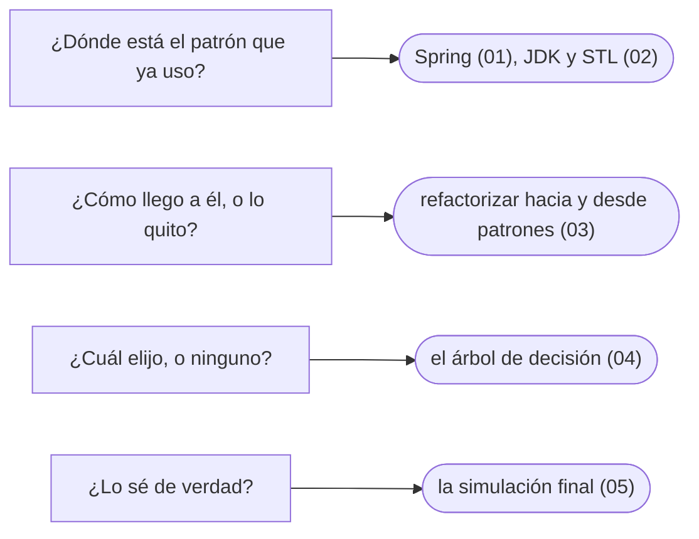

# 13 — Patrones en la práctica

> El cierre: los patrones donde el lector trabaja —Spring, el JDK, la STL—, la refactorización hacia ellos y desde ellos, el árbol de decisión de todo el corpus y la simulación final.
>
> **Vigencia:** 2026-10-03.

---

## 1. 🗺️ Índice

| | Documento | Tipo |
|---|---|---|
| [`01`](01-patrones-en-spring.md) | Patrones en Spring | Capítulo |
| [`02`](02-patrones-en-el-jdk-y-la-stl.md) | Patrones en el JDK y en la STL | Capítulo |
| [`03`](03-refactorizar-hacia-patrones.md) | Refactorizar hacia patrones, y desde ellos | Capítulo |
| [`04`](04-como-se-elige.md) | Cómo se elige | Capítulo |
| [`05`](05-simulacion-final.md) | Simulación final | Simulación |
| [`06`](06-respuestas.md) | Respuestas | Solucionario |

**Orden de lectura.** En orden numérico. `01` está en la ruta "entrevista esta semana" y se lee solo; `04` es el repaso de todo el corpus en una hora. Al terminar los capítulos, la simulación con cronómetro, y solo después el solucionario.

---

## 2. 🧠 Mapa mental

---

## 3. 🚫 Qué NO está aquí

Los patrones de arquitectura de Spring (módulos, microservicios); el corpus se queda en el diseño de objetos.

---

**Versiones ejecutadas:** JDK 21.0.12, 17.0.20 y 25.0.4 · Spring Boot 4.1.1 (Spring Framework 7.0.9, Hibernate 7.4.5, H2 2.4.240) · GCC 14.4 (C++23) · Go 1.27.1 · mermaid-cli 11.17.0 (2026-10-04).

---

**Anterior:** [`12` — Antipatrones](../12-antipatrones/README.md) ·
**Siguiente, opcional:** [`14` — Talleres](../14-talleres/README.md) ·
**Corpus:** [README](../README.md)
