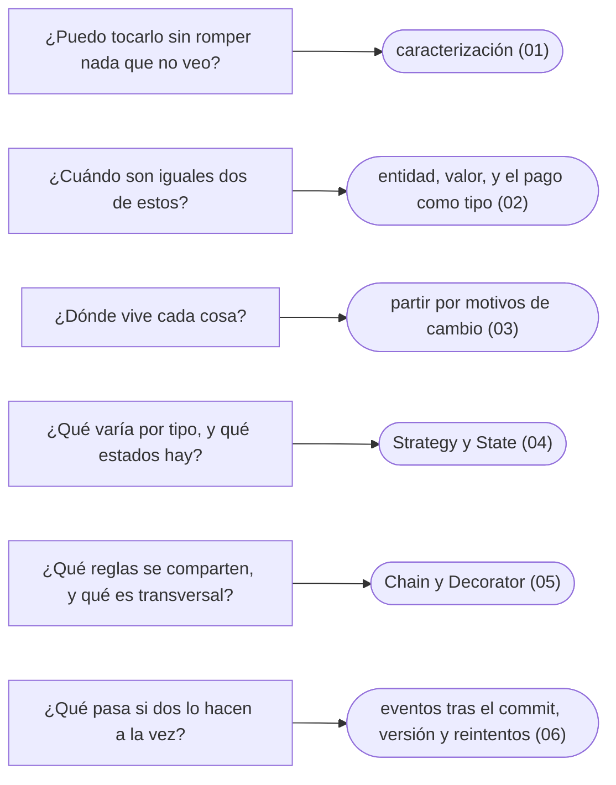

# 14 — Talleres

> El bloque **opcional**: una kata de refactorización en seis talleres sobre un módulo legado de cuentas y movimientos, en
> Java. Cada taller reproduce un defecto con una prueba, lo corrige en pasos pequeños con la suite como red, y mide lo que
> costó. El código compila y corre: está en `laboratorio/`.
>
> **Vigencia:** 2026-10-04.

---

## 1. 🗺️ Índice

| | Documento | Patrones y técnicas | Corrige |
|---|---|---|---|
| [`01`](01-caracterizacion.md) | Caracterización | Pruebas de caracterización | Nada: congela seis defectos |
| [`02`](02-igualdad-hash-e-inmutabilidad.md) | Igualdad, hash e inmutabilidad | Value Object, Money, `record` | El doble abono, la comisión con fracciones de centavo, el extracto viejo |
| [`03`](03-partir-el-god-object.md) | Partir el God Object | Extract Class, Repository, Facade | Nada: es una refactorización pura |
| [`04`](04-strategy-y-state.md) | Strategy y State | Strategy, Type Object, State | La transferencia a una cuenta cerrada, la cuenta cerrada y bloqueada |
| [`05`](05-chain-y-decorator.md) | Chain y Decorator | Chain of Responsibility, Decorator | El menor que transfiere más del tope |
| [`06`](06-eventos-y-bloqueo-optimista.md) | Eventos y bloqueo optimista | Domain Event, Observer, Optimistic Lock | Las actualizaciones perdidas y la transferencia a medias |
| [`07`](07-respuestas.md) | Respuestas | — | Las preguntas y los ejercicios de los seis |

**Orden de lectura.** En orden numérico: cada taller parte del estado en que dejó el anterior. Para empezar uno sin haber
hecho los previos, copia `laboratorio/estados/NN/` del taller anterior. Las preguntas y los ejercicios se responden antes de
abrir el solucionario.

---

## 2. 🧰 El laboratorio

```text
laboratorio/
├── legado/          el punto de partida: 561 líneas, 5 clases, ninguna prueba
└── estados/
    ├── 01/          + 20 pruebas de caracterización
    ├── 02/          + Dinero, igualdades corregidas            25 pruebas
    ├── 03/          + repositorios, servicios, fachada         25 pruebas
    ├── 04/          + políticas de comisión, EstadoCuenta      28 pruebas
    ├── 05/          + reglas en cadena, auditoría decorada     30 pruebas
    └── 06/          + eventos, transacciones, versión          33 pruebas
```

Se copia fuera del corpus y se corre con Docker, sin instalar Java ni Maven:

```bash
cp -R 14-talleres/laboratorio/legado ~/kata-cuentas
cd ~/kata-cuentas
docker run --rm -v "$PWD":/trabajo -w /trabajo -v "$HOME/.m2":/root/.m2 \
  maven:3.10.0-eclipse-temurin-21 mvn -B test
```

El desglose de cada parte del comando está en [`01` §2](01-caracterizacion.md#2--punto-de-partida).

---

## 3. 🧠 Mapa mental



---

## 4. 🚫 Qué NO está aquí

- **C++ y los lenguajes secundarios.** Los talleres son solo en Java; las formas en C++, Go, JavaScript, Python y C# están en
  los capítulos y en el bloque [`11`](../11-los-diferentes/README.md).
- **Data Mapper, Unit of Work e Identity Map escritos a mano.** El taller `06` usa una transacción, no un Unit of Work
  completo; los tres patrones, con su código, están en [`07/02`](../07-fowler-dominio-y-datos/02-fuentes-de-datos.md) y
  [`07/03`](../07-fowler-dominio-y-datos/03-comportamiento-objeto-relacional.md).
- **Visitor.** Los eventos usan tipos sellados y `switch` de patrones, que es lo que lo reemplaza; la comparación está en
  [`06/07`](../06-comportamiento/07-visitor.md).
- **Un marco.** No hay Spring: los patrones se escriben a mano, como se piden en una entrevista. Dónde los trae Spring está en
  [`13/01`](../13-patrones-en-la-practica/01-patrones-en-spring.md).

---

**Versiones ejecutadas:** JDK 21.0.12 · Maven 3.10.0 (`maven:3.10.0-eclipse-temurin-21`) · JUnit 6.1.3 · H2 2.5.252 (2026-10-04).

---

**Anterior:** [`13` — Patrones en la práctica](../13-patrones-en-la-practica/README.md) ·
**Corpus:** [README](../README.md)
