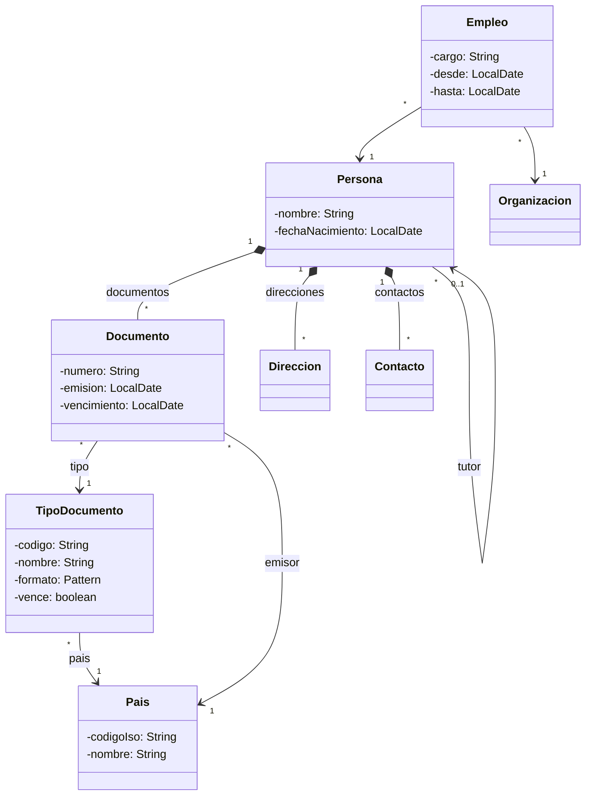

# ✍️ Guía de estilo, tono y convenciones

## POO y patrones de diseño — repaso para entrevistas de Backend Senior, Arquitecto y Tech Lead

Esta guía es la fuente de verdad editorial de `03-poo-y-patrones/` y manda sobre **los trece bloques
del hilo principal**:

- **la base:** `01-modelo-de-objetos`, `02-modelado-oo`, `03-principios-de-diseno`;
- **los patrones:** `04-creacionales`, `05-estructurales`, `06-comportamiento`,
  `07-fowler-dominio-y-datos`, `08-fowler-presentacion-distribucion-y-base`,
  `09-ddd-tactico-y-otros`, `10-concurrencia`;
- **los contrastes y el cierre:** `11-los-diferentes`, `12-antipatrones`,
  `13-patrones-en-la-practica`.

Manda también sobre el bloque opcional `14-talleres` (§13.2), que declara sus propias divergencias.
Cualquier sesión que produzca o edite un `.md` de este corpus la sigue.

Su objetivo es que todos los documentos se lean como escritos por la misma mano y apunten al mismo
lugar: **que puedas reconocer la tensión del código, nombrar el patrón que la resuelve —o decir que
no hace falta ninguno—, escribirlo en C++ y en Java, y defender lo que cuesta delante de alguien que
lo está revisando**.

**Linaje.** Deriva de la guía de `bases/01-bases` del repositorio de origen (la **guía madre**),
y hereda de ella el tono, la pedagogía del andamio, la plantilla de capítulo, las tres capas de
respuesta y las reglas de enlace. **No la enlaza ni la asume leída**, porque este corpus se publica
como repositorio independiente (§1.2): todo lo heredado está reescrito aquí. Diverge en ocho puntos,
declarados donde aparecen:

| Punto | De qué a qué |
|---|---|
| §4.2 | El precio deja de ser tiempo y espacio y pasa a ser el **precio del diseño** |
| §4.4 | Se ancla en el **código real** —JDK, STL, Spring—, no solo en la librería estándar |
| §5 | De cinco lenguajes comparados a **dos fijos (C++ · Java)** más secundarios por capítulo o inserto |
| §5.6 | Dominio de negocio propio, **personas y documentos**, en lugar de datos de juguete |
| §5.7 | **Mermaid** como lenguaje de diagramas |
| §6 | Cinco plantillas de capítulo en lugar de una |
| §8.1 | Banda de preguntas partida: 20–30 en la base, 12–20 en el resto |
| §12 | **Rutas de estudio** como parte del producto |

La revisión del 2026-10-05, a pedido explícito del autor, **amplió §5.7**: además de las clases y las
secuencias, van en Mermaid los árboles de decisión, los mapas mentales, los flujos y los diagramas de
memoria (§3, "Diagramas"). Es la misma divergencia, con más alcance; no cuenta como una novena.

Si dudas entre dos formas de escribir algo, gana la que le sirva más a alguien que mañana tiene una
entrevista donde le van a pedir "modela esto" o "¿qué patrón usarías aquí?", y pasado mañana tiene
que revisar el *pull request* de un compañero que metió un Singleton.

> **Vigencia:** 2026-10-05.

**Salto rápido:** [1](#1--principio-rector) · [2](#2--tono) · [3](#3-️-idioma-y-forma-de-la-narrativa) · [4](#4--pedagogía-como-para-un-bebé) · [5](#5--código-lenguajes-dominio-y-diagramas) · [6](#6--plantillas-de-los-capítulos) · [7](#7--los-tipos-de-documento) · [8](#8--preguntas-y-respuestas) · [9](#9--vocabulario-visual-reglas-y-callouts) · [10](#10--bibliografía-referencias-y-enlaces) · [11](#11--coherencia-entre-documentos) · [12](#12-️-rutas-de-estudio) · [13](#13--verificación-del-código-y-talleres) · [14](#14--checklist-antes-de-dar-por-cerrado-un-md)

---

## 1. 🧭 Principio rector

**Todo lo que se escribe apunta a que alguien reconozca la tensión, elija el diseño, diga lo que le
cuesta y lo escriba —y pueda defenderlo en voz alta mientras lo teclea.**

No enseñamos el catálogo para recitarlo. Recitar los 23 del GoF es la señal más clara de que alguien
estudió para el examen y no sabe cuándo un patrón sobra. Repasamos los mecanismos, las confusiones y
los matices que separan a quien entiende el modelo de objetos de quien memorizó los diagramas.

```text
Un libro de patrones → te da el catálogo y la estructura de clases.
Este repaso          → te dice qué tensión resuelve cada patrón, cuánto le quedó vivo
                       en el lenguaje actual, y cómo se escribe y se defiende hoy.
```

El filtro para cada párrafo es este: **¿esto ayuda a reconocer, elegir, costear o escribir?** Si no,
sobra. Aunque esté muy bien escrito y aunque sea cierto.

Y el corolario, repetido tantas veces como haga falta:

> Cada patrón cierra con un veredicto. Cada decisión de diseño se nombra con lo que cuesta. Cada
> elección responde a "¿por qué esta y no la otra, y qué pierdo al elegirla?". Y **"no usaría
> ningún patrón"** es una respuesta válida que el corpus enseña a dar.

**La tesis que recorre el corpus:** un patrón es la respuesta a una tensión concreta del código, y en
parte es un rodeo para lo que al lenguaje le faltaba. El GoF se escribió en 1994 contra C++ y
Smalltalk; el C++ y el Java de hoy absorbieron una parte, y los lenguajes dinámicos absorben más.
Cada capítulo de patrón dice **qué sigue haciendo falta, qué cambió de forma y qué desapareció**.

### 1.1 Qué NO es este corpus

- **No es un curso de UML.** Se usa el UML justo para pensar y discutir (§5.7), de forma informal.
- **No trata patrones de arquitectura ni de integración**: microservicios, CQRS, Event Sourcing,
  Saga, Strangler Fig y los patrones de mensajería de Hohpe quedan fuera. Solo diseño de objetos.
- **No es un libro.** Compite con el calendario de alguien que tiene la entrevista cerca; el techo de
  longitud de §4.6 es real, y las rutas de §12 existen para no tener que leerlo entero.

### 1.2 Independencia: un repositorio que se lee solo

**Este corpus se publica como repositorio independiente**, para lectores que no tienen ningún otro
curso de la serie. Aunque al final el repositorio público sea `repaso-entrevistas/` entero, el corpus
**se escribe igual de independiente**: nunca depende de nada que esté fuera de su carpeta, y menos de
lo que esté por encima de `repaso-entrevistas/`. De ahí cuatro reglas duras:

- **Ningún documento asume leído nada de fuera del corpus.** Lo que haga falta de otro tema
  (bases de datos, concurrencia general, Spring) se resume aquí en lo mínimo.
- **Ningún enlace sale del corpus**, salvo a fuentes externas de §10. Ni a otros cursos, ni a bancos
  de preguntas, ni a la raíz del repositorio de origen.
- **La repetición con otros cursos no se evita.** Si otro curso trata el Repository o el Value
  Object, aquí se trata entero igual.
- **El material personal de búsqueda de empleo no existe para este corpus**: nunca se cita, ni se
  usa como ejemplo, ni se menciona un proceso de selección concreto.

---

## 2. 🎤 Tono

El tono es **semi formal, cálido y directo**, de colega a colega. Piensa en alguien que ya pasó por
esto —el `HashSet` que "perdió" un objeto porque alguien cambió un campo usado en `hashCode`, el
`StackOverflowError` de un `toString` con relación bidireccional, la jerarquía de seis niveles que
nadie se atrevía a tocar, el Singleton que hizo imposible el test— y te lo explica con paciencia y
sin solemnidad de manual.

- **Tuteo latinoamericano, siempre.** *"Cuando te pregunten por el contrato de `equals`, lo primero
  que quieren oír es `hashCode`"*. Nada de voseo, nada de "usted", nada de impersonal permanente.
- **Semi formal.** Cercano, pero no chat. Frases completas y cero abreviaturas de mensajería.
- **Humor mínimo y seco.** Como mucho **un desdramatizador por documento**, y si no fluye solo, se
  borra.
- **Honesto sobre la ceremonia.** Cuando un patrón sobra, se dice que sobra. *"Un Abstract Factory
  para crear dos objetos que nunca van a cambiar es ceremonia: un constructor y listo"* es contenido;
  *"el Abstract Factory desacopla la creación"* es un folleto.
- **Honesto sobre las simplificaciones.** Cuando la respuesta común de entrevista es una
  sobregeneralización —"la herencia es para reutilizar código", "el Singleton garantiza una
  instancia", "Java pasa los objetos por referencia", "los getters y setters encapsulan", "Visitor
  es para recorrer árboles"— **se nombra la simplificación y se da la versión precisa**. Es el
  recurso pedagógico central del corpus; la sección `## ⚠️ Errores frecuentes` existe para esto.
- **Honesto sobre el precio.** Todo diseño se nombra con lo que cuesta, en las cuatro monedas de
  §4.2. Nada de "agrega algo de complejidad": se dice cuántas clases, qué acopla y qué se vuelve
  difícil de leer o de probar.
- **Sin absolutos falsos.** Nada de "siempre" ni "nunca" salvo cuando es literalmente cierto
  (*un `equals` sobrescrito sin `hashCode` rompe el `HashMap`*; *en Java la sobrecarga se resuelve
  al compilar*).
- **Cálido sin condescendencia.** "Como para un bebé" significa **cero ambigüedad**, no menos
  profundidad (§4).
- **Sin relleno motivacional.** Quien lee ya sabe por qué está repasando.

---

## 3. 🗣️ Idioma y forma de la narrativa

- **Español latinoamericano neutro**, técnico y claro, para todo lo que no sea código.
- **Los nombres de patrón se quedan en inglés**, porque son el nombre real de la cosa y lo que se oye
  en la entrevista: *Strategy*, *Decorator*, *Unit of Work*, *Value Object*, *Aggregate*. Los
  términos del oficio con traducción asentada se usan en español —herencia, sobrecarga,
  sobrescritura, despacho, clase base, interfaz, inmutable—, y los que no la tienen se quedan en
  inglés: *slicing*, *mixin*, *trait*, *duck typing*, *code smell*, *double dispatch*. **La primera
  vez que aparece un término en inglés, se da su traducción o su sentido entre paréntesis**; después
  ya no. El glosario fijo está en §11.2.
- **Markdown siempre.** Nada de HTML embebido.
- **Estructura visual primero, pero el porqué va en prosa.** El orden de preferencia para exponer una
  relación es diagrama → tabla → lista → párrafo. Pero el **porqué** de una decisión de diseño se
  escribe en prosa: un diagrama no puede explicar por qué la composición le gana a la herencia en
  este caso concreto.
- **Nada de prosa telegrama.** **Una frase aislada por sección, dos si la sección es larga.**
- **Diagramas: lo que tiene nodos y flechas, en Mermaid; lo que es posición o tiempo, en `text`.**
  - **En ` ```mermaid `** (§5.7): la estructura de clases y el orden de llamadas; **todos los árboles de
    decisión** de `🧭 Cómo se elige`, también los de un solo nivel; los **mapas mentales** de los
    README; los **flujos** entre pasos o componentes (validación, Front Controller, DCL); y los
    **diagramas de memoria** —variables a la izquierda, objetos a la derecha, una flecha por
    referencia—, incluidos la vtable y el *slicing*.
  - **En ` ```text `**: las trazas en el tiempo (dos hilos intercalados), las tablas alineadas en
    columnas, el pseudocódigo, los árboles de archivos de los talleres, las salidas de consola, la
    "Regla de dibujo" de `01/01` y las reglas de §9.1. Mermaid no alinea columnas ni ordena en el tiempo.
  - **Bloque mixto, dos bloques.** Si el dibujo traía al lado sus pasos o su código (el `HashMap` de
    `01/02`, la vtable de `01/05`, el registro de Prototype), el dibujo va en Mermaid y lo demás justo
    debajo, en su propio bloque `text`, sin prosa entre los dos.
  - **Una nota suelta no va en el diagrama.** Una línea como "Y en toda asociación: multiplicidad en las
    dos puntas" sale del bloque y queda como párrafo debajo.
- **Tablas solo para comparar o mapear**, con tres a cinco columnas. **Si necesitas explicar una
  celda, ya no es una tabla.**
- **Encabezados con emoji funcional en cada `##` numerado, ninguno en `###`**, sin excepciones. La
  lista cerrada de emojis de encabezado:

  | Emoji | Tipo de sección |
  |---|---|
  | 🎯 | El problema |
  | 🧱 | Mecanismo o concepto |
  | 📐 | Estructura: diagrama y participantes |
  | 🏛️ | Cómo nació (C++98, GoF) |
  | 💻 | Implementación |
  | 🔀 | Variantes |
  | ⚖️ | Comparación o "con qué se confunde" |
  | 🏷️ | Lo que cuesta, y cuándo no |
  | 🧭 | Cómo se elige |
  | 🩺 | Diagnóstico o autopsia de un bug |
  | 🔭 | Dónde aparece de verdad |
  | 🪦 | Lo que ya no se usa, y qué lo reemplazó |
  | 🧬 | En los lenguajes (tabla comparativa) |
  | 🏚️ | Un antipatrón (bloque 12) |
  | ⚠️ | Errores frecuentes |
  | 🧠 | Preguntas |
  | 📚 | Para profundizar |

---

## 4. 🎓 Pedagogía: "como para un bebé"

> **"Como para un bebé" significa cero ambigüedad, no menos profundidad.**

No es escribir más simple: es no dejar ningún hueco donde el lector tenga que adivinar. Se explica
qué pasa exactamente en memoria cuando dos variables apuntan al mismo `Documento`, qué método se
llama cuando la sobrecarga y la sobrescritura se cruzan, y quién es dueño de cada objeto en C++. No
se dice "el Decorator añade responsabilidades" y se sigue adelante.

### 4.1 La regla del andamio

Todo concepto nuevo se presenta en tres tiempos, en este orden:

1. **El problema primero.** El dolor, en el dominio de §5.6, con el código que lo sufre. *"Cada tipo
   de documento valida su número a su manera, y `Documento.validar()` ya es un `switch` de doce
   casos que crece cada vez que el negocio acepta un país nuevo."*
2. **El mecanismo después.** El nombre y la definición mínima.
3. **El código que lo demuestra**, con las viñetas que dicen qué mirar en él.

Presentar el patrón antes que el problema produce gente que sabe recitar "el Strategy encapsula
algoritmos intercambiables" y no sabe cuándo *no* usarlo. Por eso **`## 1. 🎯 El problema` abre
todo capítulo**.

### 4.2 Ningún bloque de código sin desglose, y ningún diseño sin precio

**Divergencia declarada.** En la guía madre el precio era tiempo y espacio. Aquí el precio
es **el del diseño**.

**Primera mitad: el código.** Ningún bloque aparece sin una frase antes que diga qué demuestra y sin
viñetas después que digan qué mirar.

```java
// La clave mutable: Documento usa numero en equals y hashCode
Set<Documento> vistos = new HashSet<>();
vistos.add(pasaporte);
pasaporte.corregirNumero("AQ482916");   // cambia el hash con el objeto ya dentro
vistos.contains(pasaporte);             // false: se busca en el cubo equivocado
```

- Fíjate en que **el objeto sigue dentro del conjunto**: `vistos.size()` es 1. No se borró: quedó en
  el cubo del hash viejo, donde ninguna búsqueda va a mirar.
- El error no está en `HashSet`: está en usar como clave un campo que puede cambiar. La salida es que
  los campos de `equals`/`hashCode` sean inmutables.

Ese nivel es el estándar. Los bloques se mantienen **mínimos**: las líneas que importan, no la clase
completa con su `main`. Si un bloque introduce tres cosas desconocidas, se parte en tres.

**Segunda mitad: el precio.** Toda afirmación de beneficio lleva su contrapartida en la misma sección,
en las cuatro monedas del diseño:

```text
indirección (clases y saltos de más) · acoplamiento · legibilidad · rendimiento y memoria
```

*"El Decorator te deja componer auditoría y reintentos sin tocar la clase, y lo pagas con una clase
por comportamiento, con una pila de llamadas que hay que atravesar para depurar, con identidad
rota —el decorado no es `==` al original— y con un orden de composición que importa y nadie
documenta"* está completo. *"El Decorator es flexible"* no lo está.

> ⚠️ **Advertencia.** La moneda que más se olvida es **la legibilidad para quien llega después**. Un
> diseño que ahorra un `if` a costa de cuatro clases y una indirección que el IDE no sigue no es más
> limpio: es más caro. Decirlo tú antes de que te lo pregunten vale más que el patrón.

### 4.3 Explica el porqué, no solo el cómo

Cada decisión relevante lleva su porqué, aunque sea media línea: por qué `String` es inmutable, por
qué el holder idiom es seguro entre hilos sin `synchronized`, por qué `clone()` está roto. Cuando el
porqué es histórico, se dice: *"Visitor existe porque C++ y Java solo despachan por el tipo del
receptor; con sealed types y `switch` exhaustivo, el compilador te da lo que Visitor fingía"*.

### 4.4 Ancla en el código real

**Divergencia declarada**: el anclaje no es solo la librería estándar sino **el código que el lector
ya usa**, y se hace **en el mismo párrafo en que aparece el concepto**:

- Decorator es `BufferedInputStream` envolviendo un `FileInputStream`.
- Proxy es el bean de Spring que hace que `@Transactional` funcione, y por eso no funciona en la
  llamada interna.
- Template Method es `JdbcTemplate` y `AbstractList`.
- Iterator es `Iterable` en Java y el par `begin()`/`end()` en C++.
- Unit of Work e Identity Map son el `EntityManager` de JPA.
- Flyweight es `Integer.valueOf` con su caché de −128 a 127.

Un patrón sin anclaje conocido se explica igual, **pero se declara que no lo tiene**.

### 4.5 Analogías con fecha de caducidad

Las analogías se usan **una vez, para abrir la puerta**, y se abandonan diciendo dónde se rompen. Las
cuatro más peligrosas del temario se desmontan en el mismo párrafo en que aparecen:

- **"Un objeto es como una cosa del mundo real"**: hasta que el objeto es un `Repository`, un
  `Visitor` o una `Transferencia`, que no son cosas.
- **"La herencia es una relación es-un"**: un cuadrado *es un* rectángulo en geometría y no lo es en
  código mutable (LSP).
- **"Java pasa los objetos por referencia"**: pasa referencias por valor, y por eso reasignar el
  parámetro no cambia nada fuera.
- **"Un patrón es una plantilla de código"**: es una solución a una tensión, y la misma tensión tiene
  formas de código distintas en cada lenguaje.

### 4.6 Densidad calibrada, con techo de longitud

- **Banda objetivo: 200 a 350 líneas por capítulo.** Los capítulos de **un solo patrón de nivel A**
  tienen banda de **250 a 400**, porque llevan C++ en dos tiempos y Java. Un capítulo que pasa de 450
  se poda o se parte, y la decisión se declara en el README del bloque.
- Un concepto nuevo por vez.
- Repetir lo importante está bien: el contrato `equals`/`hashCode`, la composición antes que la
  herencia y la propiedad en C++ reaparecen con otras palabras.
- Ninguna sección supera las dos pantallas sin un diagrama, una tabla, un bloque de código o un
  veredicto.
- **Todo documento de más de ~400 líneas abre con un índice de salto rápido** (§6.6). Por
  definición, los solucionarios.

### 4.7 Cierra los bucles

Si abres un paréntesis —*"esto se ve en `09/03`"*— tiene que cerrarse en algún documento del corpus,
con enlace real. **Mientras un documento no exista, la mención va en prosa** y se anota en la deuda
de enlaces del plan de producción; nunca se enlaza a un archivo que no está escrito.

---

## 5. 💻 Código, lenguajes, dominio y diagramas

### 5.1 Idioma del código

> **Regla normativa: el dominio va en español, los nombres canónicos de patrón y la API real en
> inglés, y los comentarios siempre en español.**

| Elemento | Idioma | Ejemplo |
|---|---|---|
| Clases, campos y métodos del dominio | **Español, sin tildes ni eñes** | `Persona`, `Documento`, `TipoDocumento`, `agregarDocumento()`, `fechaNacimiento` |
| Sufijo o rol canónico del patrón | Inglés, pegado al nombre de dominio | `PersonaBuilder`, `DocumentoFactory`, `ValidadorDocumentoChain`, `CuentaState` |
| Interfaces genéricas del patrón cuando no hay dominio | Inglés | `Visitor<R>`, `Command`, `Observer` |
| Tipos y métodos de la librería estándar o de frameworks | Inglés (son API real) | `HashMap`, `std::unique_ptr`, `Optional`, `@Transactional` |
| Comentarios dentro del código | Español | `// así no se pierde en el HashSet` |
| Narrativa | Español | todo el texto fuera de los bloques |

**Sin tildes ni eñes en identificadores** (`Direccion`, `Pais`, `Organizacion`, `anio`): compilan en
Java y en C++ modernos, pero rompen herramientas, *diffs* y teclados ajenos. **Nunca** `foo`, `bar`,
`MyClass`, `doSomething()`, `Animal`, `Perro`, `Figura`, `Circulo` ni `Cuadrado` (§5.6).

### 5.2 Los dos lenguajes fijos: C++ · Java

**Divergencia declarada.** La guía madre comparaba cinco lenguajes en pie de igualdad. Este
fija **dos, siempre en este orden: C++ · Java**.

| Lenguaje | Papel | Espacio |
|---|---|---|
| **C++23** | Donde nació el GoF, y el contraste más rico: **propiedad** explícita (`unique_ptr`, `shared_ptr`, referencias que no poseen), semántica de valor, *slicing*, regla de 0/3/5, movimiento, polimorfismo estático (CRTP, *concepts*, *deducing this*), *type erasure* (`std::function`), `std::variant` + `std::visit`, RAII, `std::optional` y `std::expected` | Completo en los niveles A y B |
| **Java 21** | Lo que se escribe delante del entrevistador. Records, sealed types, pattern matching de `switch`, lambdas, `Optional`, virtual threads | Completo en los niveles A y B |

**C++ va primero porque cuenta la historia; Java no pierde peso por ir segundo.** En un capítulo de
patrón GoF de nivel A, C++ aparece en **dos tiempos**: `🏛️ Cómo nació` (C++98 como en el libro,
breve, solo para ver el problema original) y `💻 C++ moderno` (completo).

**Excepciones declaradas al reparto**, porque el lenguaje del ecosistema manda:

| Bloque | Reparto | Por qué |
|---|---|---|
| `07` y `08` (Fowler) | **Java primero y completo; C++ solo donde aporta** (Value Object, Money, propiedad del Identity Map), declarado en el capítulo | *PoEAA* está escrito con ejemplos en Java y C#, y el ecosistema ORM de C++ es marginal. El inserto de C# (§5.4) es natural aquí |
| `09` (DDD táctico) | Igual que `07`–`08` | El ecosistema DDD es Java y .NET |
| `11` (los diferentes) | El lenguaje del capítulo, con Java como punto de comparación | Es su razón de ser |
| `12` (antipatrones) | Java por defecto; C++ cuando el antipatrón es propio de C++ o cambia de forma | Los antipatrones son de diseño, no de lenguaje |
| `13/01` | Solo Java | Es Spring |

### 5.3 Versiones y callouts de versión

- **C++23** de base. Lo que exige solo C++20 o menos no se marca; lo que es C++23 (*deducing this*,
  `std::expected`, `std::print`) se dice la primera vez en cada capítulo. El compilador de referencia
  se fija en la tanda técnica (§13.1).
- **Java 17 y Java 21 son las versiones de trabajo**, porque son las que corren hoy en la mayoría de
  los equipos. El código se escribe en **Java 21**, y la documentación oficial se cita contra su API
  (§10.1). **Todo lo que no existe en Java 17** —pattern matching de `switch`, record patterns,
  virtual threads, *sequenced collections*— lleva su alternativa en un callout 📝 **"En Java 17:"**,
  siempre, no solo cuando es cómodo.
- **Java 25 aparece solo en callouts** 📝 **"En Java 25:"**, donde cambia algo del patrón: `_` en
  patrones (JEP 456), Scoped Values (JEP 506), flexible constructor bodies (JEP 513), `synchronized`
  sin *pinning* (JEP 491), Stable Values (JEP 502, en *preview*). Nunca en el código principal.
- **C#, en su última versión estable**, la que publique Microsoft el día de la tanda técnica T24, que
  la fija y la declara en el README. Los insertos se escriben contra esa versión.
- Las versiones de los demás secundarios (Go, Node, TypeScript, Python) se fijan también en la tanda
  técnica y se declaran en el README del corpus.

### 5.4 Los lenguajes secundarios: capítulo o inserto

**La regla de reparto:** si el lenguaje **cambia el modelo de objetos**, tiene capítulo propio en
`11-los-diferentes`; si el modelo es el mismo y **solo divergen algunos patrones**, aparece como
**inserto** dentro del patrón.

| Lenguaje | Forma | Dónde diverge |
|---|---|---|
| **Go** | Capítulo `11/01` | Sin herencia: *embedding*, interfaces implícitas, functional options, `sync.Once`, channels |
| **JavaScript / TypeScript** | Capítulo `11/02` | Prototipos, closures, módulos, `Proxy`, `EventEmitter`, event loop, mixins; TS solo donde el tipo cambia la respuesta |
| **Python** | Capítulo `11/03` | Duck typing, `Protocol`, MRO C3, `@decorator`, context managers, `dataclass`, metaclases |
| **C#** | Inserto | `event` y delegates, expression trees, `DbContext`, `record` con `with`, genéricos reificados, extension methods, `IDisposable` |

**El inserto** es un callout 📝 con etiqueta **"En C#:"** (o el lenguaje que toque). Reglas:

- **Solo cuando cambia la respuesta.** Que el lenguaje tenga otra sintaxis para lo mismo no cuenta.
- **Como mucho un inserto de lenguaje por patrón**, y cuenta como el callout de su sección (§9.3).
- **Go, JS y Python pueden aparecer dentro de un patrón solo como una línea con enlace** a su
  capítulo de `11`: *"en Go esto se resuelve con functional options → ver `11/01`"*, con el código
  `11/01` como enlace relativo a `../11-los-diferentes/01-go.md`.

```markdown
> 📝 **En C#:** Observer está en el lenguaje. `event EventHandler<DocumentoVencido>` da la lista
> de suscriptores, la suscripción con `+=` y la notificación; lo que no da es la desuscripción
> automática, y el suscriptor olvidado es la fuga de memoria clásica de .NET.
```

### 5.5 La tabla comparativa de lenguajes

En los bloques `01`–`03`, la igualdad, la copia, la herencia múltiple o la inmutabilidad tienen
semánticas distintas en cada lenguaje, y ahí va una sección `## N. 🧬 En los lenguajes` con una
tabla de formato fijo:

- **Una fila por lenguaje, nunca una columna por lenguaje**, en este orden: **C++ · Java · C# ·
  Python · JavaScript · TypeScript · Go**. TypeScript solo cuando su fila no diga "igual que JS".
- **Nunca más de tres columnas además del lenguaje.**
- **El código completo sigue siendo C++ · Java**; la tabla dice qué hace cada uno de los demás y
  cuál es el detalle que muerde.

```markdown
| Lenguaje | Igualdad de valor | Clave de un mapa hash | El detalle que muerde |
|---|---|---|---|
| **C++** | `operator==`, por defecto desde C++20 | Especializar `std::hash<T>` | Sin `std::hash`, no compila |
| **Java** | `equals` | `equals` + `hashCode` | Sobrescribir uno solo compila y rompe el mapa |
| ...
```

### 5.6 El dominio de los ejemplos

**Divergencia declarada.** La guía madre usaba arreglos y grafos de juguete. Aquí el
contenido *es* el modelo, y el dominio es fijo para todo el corpus: **no se inventan clases nuevas
por capítulo**.

**Cosas comunes, sin ser de juguete.** Nada de "el perro ladra" ni de círculos y cuadrados: esos
ejemplos no tienen asociaciones reales, ni identidad, ni datos que cambien, y por eso no enseñan nada
de lo que cuesta en un sistema de verdad. La única excepción es el contraejemplo clásico de LSP
(cuadrado y rectángulo), que en `01/06` se **nombra** en prosa porque el lector lo va a oír, y se
demuestra con el dominio.

**El núcleo: personas y sus documentos** (bloques `01`–`03` y todo ejemplo general):



**Nombres fijos.** Clases: `Persona`, `Documento`, `TipoDocumento`, `Pais`, `Direccion`,
`TipoDireccion` (`DOMICILIO`, `LABORAL`), `Contacto` (`Email`, `Telefono`), `Organizacion`,
`Empleo`. **La extensión para los patrones** que necesitan estado, dinero y concurrencia: la persona
es titular de cuentas, con `Cuenta`, `EstadoCuenta` (`ABIERTA`, `BLOQUEADA`, `CERRADA`),
`Movimiento`, `Transferencia` y `Dinero` (el *Money* de Fowler: `BigDecimal` más moneda).

**Datos fijos.** Una traza o un ejemplo se sigue mejor cuando las personas son las mismas que el
lector ya vio. Se usan estos, y ninguno más sin declararlo:

| Dato | Valor |
|---|---|
| Persona 1 | **Ana Rojas Medina**, nacida el 1988-03-14, Colombia |
| Sus documentos | Cédula de ciudadanía `CC` `1020304050` (CO, no vence) · Pasaporte `PAS-CO` `AQ482915` (CO, emitido 2021-06-01, vence 2031-05-31) |
| Persona 2 | **Luis Rojas Paz**, nacido el 2013-09-02, menor de edad; **tutora: Ana** |
| Su documento | Tarjeta de identidad `TI` `1098765432` (CO, vence a los 18 años) |
| Persona 3 | **Carmen Díaz Ortega**, nacida el 1975-11-30, México; pasaporte `PAS-MX` `N04857312` |
| Tipos de documento | `CC` (CO, `\d{6,10}`, no vence) · `TI` (CO, `\d{10}`, vence) · `PAS-CO` (CO, `[A-Z]{2}\d{6}`, vence) · `PAS-MX` (MX, `[A-Z]\d{8}`, vence) |
| Organización | **Transportes Andinos S.A.S.**; Ana es *Jefa de sistemas* desde el 2019-02-01 |
| Contacto | `ana.rojas@example.com` · `+57 301 555 0101` (el dominio `example.com` está reservado para ejemplos) |
| Cuentas | `CTA-0001`, de Ana, en COP, saldo 1 500 000,00 · `CTA-0002`, de Carmen, en USD, saldo 2 300,00 · `CTA-0003`, de Luis, administrada por su tutora |
| Transferencia de ejemplo | 250 000,00 COP de `CTA-0001` a `CTA-0003` |

**Qué enseña cada pieza** —el mapa que cada capítulo usa para elegir su ejemplo—:

| Pieza | Qué enseña | Dónde |
|---|---|---|
| `TipoDocumento` es una clase cuyas instancias son tipos | ¿Subclases `Cedula extends Documento` o un objeto tipo? | `02/06`, `09/03` |
| `Documento` → `TipoDocumento`, sin vuelta | Navegabilidad en un solo sentido | `02/03` |
| `Persona` → `Documento`, uno a varios | La colección como atributo, y no exponerla | `02/02`, `02/04` |
| La igualdad de `Documento` | Identidad o clave natural (tipo, número, país); la clave mutable | `01/02` |
| `Direccion` por `TipoDireccion` | La asociación calificada → `Map` | `02/02` |
| `Direccion` y `Contacto` | Objetos de valor inmutables contra primitivos | `01/03`, `02/06` |
| `Pais` | ¿`enum`, objeto compartido o fila de tabla? | `01/03`, `05/07` |
| `Empleo` | La clase de asociación que se vuelve objeto | `02/02` |
| `Persona` → `Persona` (tutor) | Asociación reflexiva; un invariante que cruza objetos | `02/03`, `03/05` |
| El documento principal | Redundancia controlada | `02/05` |
| Persona y organización | ¿Superclase común "parte"? Herencia contra composición | `01/06` |
| `Cuenta` y su estado | State; `enum` con comportamiento | `06/06` |
| `Transferencia` | Command, Unit of Work, bloqueo optimista | `06/04`, `07/03`, `08/03` |
| `Dinero` | Value Object, Money, igualdad con `BigDecimal` | `01/02`, `08/05` |

### 5.7 Diagramas: Mermaid

**Divergencia declarada.** **Todo diagrama de estructura o de secuencia se escribe en Mermaid**, dentro
del `.md`, porque GitHub lo renderiza sin pasos extra, es texto que se versiona y se revisa en un
*diff*, y no hay imágenes que regenerar. **No se publican imágenes de diagramas** ni se usa PlantUML.

- **`classDiagram`** para estructura. **Como mucho doce clases por diagrama**, y solo los atributos y
  métodos que el punto necesita: un diagrama con todo es un diagrama que nadie lee.
- **`sequenceDiagram`** para los patrones cuyo sentido está en el orden de llamadas: Observer, Chain
  of Responsibility, Proxy, Unit of Work, Template Method.
- **La notación que se usa, y solo esa:**

  | Relación | Mermaid |
  |---|---|
  | Herencia / realización | `<\|--` / `..\|>` |
  | Asociación navegable en un sentido / sin dirección | `-->` / `--` |
  | Agregación / composición | `o--` / `*--` |
  | Dependencia | `..>` |
  | Multiplicidad | `Persona "1" --> "*" Documento` |

- **Lo que Mermaid no dibuja** —el extremo explícitamente no navegable (la `x` de UML), la asociación
  calificada, la clase de asociación con su notación propia— **se explica en texto, diciendo que es
  una limitación de la herramienta y no del concepto**, y se aproxima con una clase y una etiqueta.
- **UML informal, "lo justo"**: para pensar y discutir en una pizarra, no como especificación. El
  capítulo `02/01` es dueño de la notación; los demás la usan sin volver a explicarla.
- **Un diagrama con error de sintaxis se ve en GitHub como un bloque rojo**, así que se comprueba en
  dos tiempos, como el código (§13.1). **Al escribir**, solo con la notación de la tabla de arriba,
  sin extensiones ni estilos, y releído contra ella. **En la tanda técnica**, todos los diagramas del
  corpus se renderizan con `mermaid-cli` en un contenedor; el que falla se corrige ahí. Si Oskar
  previsualiza un capítulo en su editor o en GitHub antes, mejor, pero no es requisito para cerrar.
- **`flowchart`** para todo lo demás que va en Mermaid (§3): decisiones, mapas, flujos y memoria. Sus
  convenciones, para que todos los diagramas parezcan de la misma mano:
  - **`LR`** para los árboles de decisión y los mapas, con la condición escrita en la arista
    (`q1 -->|"¿Solo lo leo?"| r1`); **`TD`** solo para las cadenas de sí/no (`02/05`, el DCL de
    `10/06`) y los flujos que bajan.
  - **Formas, nunca color:** decisión que abre ramas `{…}`, resultado `([…])`, paso o concepto `[…]`.
    Una pregunta suelta que no abre ramas (`¿…? → X`) va en caja `[…]` con la arista `sí`, no en
    rombo: una pila de rombos se vuelve kilométrica. Sin `style`, `classDef`, `linkStyle` ni
    `%%{init}%%`.
  - **Etiquetas entre comillas dobles**, con `#quot;`, `#lt;`, `#gt;` y `#124;` para `"`, `<`, `>` y `|`
    (`Map#lt;Clave, B#gt;`, `B #lt;#124;-- A`); salto de línea con `<br/>`. Identificadores cortos y
    neutros (`q1`, `r2`, `n3`).
  - **En los mapas mentales, la arista no lleva `sí`**: la respuesta es un capítulo, no una afirmación.
    Si la respuesta empieza por "si no", la arista dice `no`.
  - **Subgrafos solo para agrupar** (variables y heap, superficial y profunda, dominio e
    infraestructura). Mermaid apila en `LR` el último subgrafo declarado arriba: se declaran en orden
    inverso al de lectura, y se comprueba dibujándolo.

---

## 6. 🧱 Plantillas de los capítulos

**Divergencia declarada.** La guía madre tenía una plantilla; este tiene cinco, porque un
capítulo de modelo de objetos, uno de patrón, uno de lenguaje y uno de antipatrones no enseñan lo
mismo. Todas comparten el **esqueleto común**:

1. **Título** — `# NN — Tema` (dos dígitos, sin emoji).
2. **Blockquote de encabezado** — qué cubre en una o dos líneas; **qué asume leído, con enlace y
   solo dentro del corpus**; en los capítulos de patrones, **el nivel de cada patrón** (A, B o C);
   y **`Vigencia:`**. Tras la tanda técnica, también **`Versiones ejecutadas:`** (§13.1).
3. **Índice de salto rápido** — si pasa de ~400 líneas (§6.6).
4. **`## 1. 🎯 El problema`** — apertura obligatoria (§4.1).
5. **Secciones `##` numeradas**, una por concepto o por paso de la plantilla, con el emoji de §3.
   **Numeración arábiga continua.**
6. **`## N. 🧭 Cómo se elige`** — obligatoria cuando el capítulo presenta alternativas: un árbol de
   decisión en bloque `mermaid` (§5.7) y la frase que se dice en voz alta.
7. **`## ⚠️ Errores frecuentes`** — obligatoria. Tabla **"Se dice" contra "Lo preciso"**, cinco a
   ocho entradas.
8. **`## 📚 Para profundizar`** — obligatoria, máximo ocho entradas (§10).
9. **`## 🧠 Preguntas`** — obligatoria, sin respuestas (§8).
10. **Pie de navegación** — una línea con **Anterior**, **Siguiente** y **Relacionado**.

### 6.1 Capítulo de concepto (bloques `01`–`03`)

Dentro de cada sección `##` de concepto, el orden no varía:

```text
Qué es      → la definición mínima, en una o dos frases
Cómo va     → el mecanismo, con código C++ · Java o con el diagrama de memoria
Qué cuesta  → el precio en las cuatro monedas de §4.2. NUNCA se omite.
Cuándo sí   → los casos donde se paga solo
Cuándo no   → los casos donde es ceremonia o es un error. NUNCA se omite.
Veredicto   → la frase que resume el criterio, en blockquote
```

Y además:

- **`## N. 🧬 En los lenguajes`** (§5.5) cuando el concepto tiene semántica distinta según el
  lenguaje. Obligatoria en `01/02`, `01/03`, `01/04`, `01/05` y `01/06`.
- **Una autopsia de bug** (§9.4) como sección `## N. 🩺` en los capítulos donde el error frecuente
  merece cinco pasos: la clave mutable, el `equals` asimétrico, el *slicing*, el `toString` con ciclo.

### 6.2 Capítulo de un patrón de nivel A

El capítulo dedicado a **un solo patrón de nivel A** —la mayoría de `04`–`06`— sigue este orden fijo
de secciones:

```text
1. 🎯 El problema             → el dolor en el dominio de §5.6, con el código SIN el patrón
2. 📐 La estructura           → diagrama Mermaid, participantes, la intención en una frase
3. 🏛️ Cómo nació              → C++98 como en el GoF, breve. Solo patrones GoF
4. 💻 C++ moderno             → la implementación de hoy, con lo que el lenguaje cambió
5. 💻 Java                    → la implementación que se defiende en la entrevista
6. 🔀 Variantes               → las formas que toma, y la que el lenguaje ya trae
7. ⚖️ Con qué se confunde     → el patrón vecino y la diferencia en una frase
8. 🔭 Dónde aparece de verdad → JDK, STL, Spring
9. 🏷️ Lo que cuesta, y cuándo no → precio en las cuatro monedas, los casos de ceremonia, y el Veredicto
```

- **"Cómo nació" es solo para los patrones del GoF.** Un patrón de Fowler, de DDD o de concurrencia
  no tuvo una versión C++98 canónica, y la sección se omite sin declararlo.
- **El inserto de lenguaje** (§5.4), si lo hay, va en `🔀 Variantes` o en `🏷️`, como el callout de
  esa sección.
- **"Qué cuesta" no es complejidad algorítmica**: es el precio del patrón —clases extra, indirección,
  lo que cuesta leerlo y probarlo— y, cuando importa, el costo en tiempo de ejecución (una llamada
  virtual, una asignación en el heap, un objeto por petición).

### 6.3 Capítulo de varios patrones (niveles A, B y C mezclados)

Cuando un capítulo agrupa varios patrones —los de Fowler, los de nivel B y C—, **cada patrón ocupa
una sección `##`**, y dentro de ella el orden va en párrafos que empiezan con etiqueta en negrita,
sin `###`:

| Nivel | Etiquetas, en este orden |
|---|---|
| **A** | **Problema** · **Estructura** (diagrama) · **Código** (los lenguajes del bloque, §5.2) · **Con qué se confunde** · **Dónde aparece** · **Cuándo no** · **Veredicto** |
| **B** | **Problema** · **Mecanismo** · **Código** (Java completo, C++ como contraste salvo excepción de §5.2) · **Cuándo sí y cuándo no** · **Veredicto** |
| **C** | **Intención** (dos frases) · **Ejemplo mínimo** (un solo bloque) · **Por qué hoy es raro** · **Qué lo reemplazó** |

**Los patrones de nivel C no se saltan.** Una ficha bien hecha responde "¿conoces Memento?" con más
criterio que un capítulo entero. Y no llevan veredicto: su "qué lo reemplazó" ya lo es.

### 6.4 Capítulo de lenguaje (bloque `11`)

```text
1. 🎯 El problema                 → qué se rompe si escribes Java en este lenguaje
2. 🧱 El modelo de objetos        → cómo se define, se compone y se despacha
3. 🧱 Lo que el lenguaje ya trae  → los patrones que son una característica del lenguaje
4. 🔀 Los patrones que cambian de forma
5. 🪦 Los patrones que desaparecen, y por qué
6. 🩺 Las trampas                 → lo que muerde a quien viene de Java
7. 🧭 Cómo se traduce             → la tabla patrón → forma idiomática en este lenguaje
```

El código va en el lenguaje del capítulo, con Java al lado solo cuando el contraste es el punto.
**Los patrones de poco uso actual no aparecen.**

### 6.5 Capítulo de antipatrones (bloque `12`)

Un antipatrón **no es un error tonto**: es una solución que parecía correcta cuando se tomó y que con
el tiempo cuesta más de lo que resolvió. Cada antipatrón ocupa una sección `## N. 🏚️ Nombre` con este
orden, en párrafos con etiqueta:

```text
Síntoma          → cómo se ve en el código o en el diagrama
Por qué aparece  → la presión real que lo produjo: plazo, miedo, moda, desconocimiento
Qué cuesta       → qué se vuelve caro o imposible, en las cuatro monedas
Cómo se detecta  → qué buscar en una revisión de código, o qué métrica lo delata
Salida           → la refactorización en pasos pequeños, con código antes y después,
                   y el patrón al que lleva, si lleva a alguno
Veredicto        → en blockquote
```

Los *code smells* de `12/01` y `12/02` son más ligeros: **síntoma, por qué importa, refactorización
que lo quita** (con el nombre del catálogo de *Refactoring*), en una entrada cada uno.

### 6.6 Índice de salto rápido y anclas

Justo después del blockquote de encabezado:

```markdown
**Salto rápido:** [1](#1--el-problema) · [4](#4--c-moderno) · [9](#9--lo-que-cuesta-y-cuándo-no)
```

**Cómo se calcula un ancla de GitHub**: se pasa el encabezado a minúsculas, se eliminan los
caracteres que no son letra, número, espacio, guion o guion bajo —el punto de la numeración, el
emoji, los backticks, los `+` de C++, los paréntesis— y los espacios restantes se convierten en
guiones. Cada carácter borrado **deja su espacio**, de ahí los guiones dobles:

| Encabezado | Ancla |
|---|---|
| `## 1. 🎯 El problema` | `#1--el-problema` |
| `## 4. 💻 C++ moderno` | `#4--c-moderno` |
| `## 9. 🏷️ Lo que cuesta, y cuándo no` | `#9--lo-que-cuesta-y-cuándo-no` |
| `## 🧠 Preguntas` | `#-preguntas` |

Fíjate en el segundo: `C++` pierde sus dos `+` y queda una sola `c`. Las anclas se comprueban con el
verificador del corpus (§11.4), no a ojo.

### 6.7 Excepciones declaradas a las plantillas

- **`README.md` del corpus**: qué es, a quién sirve, **las rutas de estudio** (§12), el mapa de
  bloques, las versiones de los lenguajes y la sección "qué NO está aquí".
- **`README.md` de cada bloque**: índice, orden de lectura, mapa mental, niveles de cada patrón y
  "qué NO está aquí", que remite a los otros bloques.
- **`NN-simulacion-de-entrevista.md`** (§7.2) y **`NN-respuestas.md`** (§7.3).

---

## 7. 📐 Los tipos de documento

Cada bloque tiene exactamente tres tipos de documento: capítulos, una simulación y un solucionario.
El bloque `13` cierra con la **simulación final** del corpus. Los talleres son la única excepción: talleres
y un solucionario, sin simulación (§13.2).

### 7.1 Capítulos `NN-tema.md`

Siguen la plantilla de §6 que les toca. Son **independientes en lectura** pero acumulativos en
vocabulario: cada uno declara qué asume leído **dentro del corpus**, y no vuelve a explicar lo que
ya explicó su dueño (§11.1).

### 7.2 Simulación `NN-simulacion-de-entrevista.md`

El examen del bloque, y lo que más se parece a la entrevista real. Lleva:

- **Una sección de método**: cronómetro, en voz alta, tecleando o dibujando de verdad, y solo después
  el solucionario.
- **Preguntas `S#` transversales**, entre 30 y 45, agrupadas por tema, con un bloque final de **"las
  que descolocan"**: las de criterio, las de "¿y si te digo que no quiero ese patrón?", las de
  conflicto con el entrevistador.
- **Ejercicios de diseño**, entre cuatro y seis, de veinte minutos. Formas admitidas: **modelar**
  (un enunciado → diagrama Mermaid y clases), **refactorizar** (un fragmento → el diseño corregido),
  **elegir** (un problema → el patrón o ninguno, con su precio), **revisar** (un *pull request*
  simulado → los defectos nombrados y priorizados). **Cada ejercicio declara en una línea
  `**Fuerza:**` qué decisión obliga a tomar**, y **uno de ellos, obligatoriamente, se resuelve sin
  ningún patrón**, porque el código directo es la respuesta correcta.
- **Las frases que hay que tener listas**: dos o tres, en blockquote, al cierre.

**La simulación del bloque `12` es una revisión de código en vivo**: sus ejercicios son todos de la
forma "revisar". **La simulación final (`13/05`) cruza el corpus entero.**

Las `S#` ya cubiertas por una pregunta de capítulo no se responden de nuevo: el solucionario remite.
Los ejercicios de diseño **sí** llevan solución desarrollada: enunciado, el primer diseño que sale,
el bueno, lo que cuesta, y lo que el entrevistador preguntará después.

### 7.3 Solucionario `NN-respuestas.md`

Uno por bloque. **Es lo que permite estudiar sin ver la respuesta al lado de la pregunta.**

- Abre con índice de salto rápido, siempre.
- Un encabezado `# NN — Tema` por capítulo y por la simulación.
- **El enunciado se copia literalmente**, con su emoji de dificultad.
- Formato de cada entrada: `**NN → P.** Enunciado literal en negrita.`
- **Respuesta en tres capas, siempre las tres y en este orden** (§8.3).

---

## 8. 🧠 Preguntas y respuestas

**Todo el peso evaluador vive en las preguntas y en los ejercicios de diseño de las simulaciones.**
No hay sección de ejercicios en los capítulos.

```text
capítulo de los bloques 01–03 →  20 a 30 preguntas numeradas, sin respuesta visible
capítulo de los bloques 04–13 →  12 a 20 preguntas numeradas, sin respuesta visible
simulación                    →  30 a 45 preguntas S# + 4 a 6 ejercicios de diseño
solucionario                  →  todas las respuestas, en tres capas, enunciado literal
```

### 8.1 Las preguntas de capítulo

**Divergencia declarada**: la banda se parte en dos. Los bloques de la base enseñan muchas cosas que se
comprueban por separado; los de patrones son más homogéneos y repetir el mismo molde veinticinco
veces no comprueba nada nuevo.

- **Cantidad: 20 a 30 en `01`–`03`; 12 a 20 en `04`–`13`.** Calibrada por cuántas cosas distintas
  enseña el capítulo, nunca por su longitud.
- **Numeración arábiga continua**, reiniciada en cada capítulo.
- **Dificultad al final del enunciado**, con un solo emoji:

  | | Nivel | Qué pide |
  |---|---|---|
  | 🟢 | Definición | Reproducir un concepto o la intención de un patrón |
  | 🟡 | Distinción | Diferenciar dos conceptos o dos patrones que se confunden |
  | 🟠 | Decisión | Elegir entre diseños y justificar el precio, o explicar un porqué no obvio |
  | 🔴 | Diseño o diagnóstico | Modelar, refactorizar, encontrar el bug o el antipatrón en un fragmento |

- **Reparto orientativo:** 25 % 🟢, 25 % 🟡, 30 % 🟠, 20 % 🔴, con un escalón de margen. **Dos
  capítulos vecinos con idéntico reparto es señal de copia.**
- **Orden: de menor a mayor dificultad.** Las 🔴 al final.
- **Directas y verificables**, con respuesta localizable en el capítulo o derivable de él. Nunca
  "reflexiona sobre…".
- **Las 🔴 piden un artefacto**: *"escribe `equals` y `hashCode` de `Documento` y di qué campos
  usas"*, *"dibuja en Mermaid el modelo de `Empleo`"*, *"di qué antipatrón hay en este fragmento y
  el primer paso para salir"*.
- **Comparación de lenguajes:** al menos **dos** preguntas por capítulo en `01`–`03`, al menos
  **una** en `04`–`13` (C++ contra Java, o un secundario).

### 8.2 La regla de sincronía

**Quien agregue, elimine o reordene una pregunta refleja el mismo cambio en el solucionario del bloque
en la misma edición**, con el enunciado copiado literalmente. La comprobación es mecánica y la hace
el verificador del corpus (§11.4).

### 8.3 Las tres capas de la respuesta

**Siempre las tres, siempre en este orden, siempre con su emoji.**

```text
⏱️ 30 segundos  → lo que dices primero, sin que te lo pidan. Una o dos frases.
🗣️ 2 minutos    → lo que añades cuando dicen "cuéntame más". Tres a cinco frases.
🔬 El detalle   → para estudiar, no para decir en voz alta: el matiz, la excepción,
                  la diferencia entre lenguajes, el caso que solo usas si te aprietan.
```

- **La capa de 30 segundos se escribe como se diría.** Si no cabe en una respiración, está mal. En
  este corpus casi siempre empieza por la tensión: *"Strategy, porque lo que varía es el cálculo de
  la comisión y no quiero un `switch` que crezca con cada tipo de cuenta"*.
- **La capa de 2 minutos añade, no repite**: el mecanismo y el porqué.
- **El detalle es donde va la honestidad incómoda**: cuándo el patrón sobra, qué cambió en Java 21,
  qué hace C++ distinto.
- En las 🔴, la capa de 2 minutos suele llevar un bloque de código mínimo o un diagrama, y el detalle
  enumera lo que el entrevistador preguntará después.

---

## 9. 🧷 Vocabulario visual: reglas y callouts

### 9.1 Regla o mnemotecnia (bloque `text`)

Para una asociación mental que vale la pena aislar, etiquetada antes con "Regla:", "Regla mental:" o
"Regla de entrevista:". Si alguna línea abre ramas, o el bloque es el de `🧭 Cómo se elige`, ya es un
árbol de decisión y va en Mermaid (§3).

```text
¿Cambia el algoritmo?            → Strategy
¿Cambia el comportamiento según
 el estado del propio objeto?    → State
¿Cambia la abstracción Y la
 implementación por separado?    → Bridge
```

### 9.2 Frase de respuesta correcta (blockquote)

La única frase que deberías decir en voz alta. Sirve para blindar ("Nunca respondas: > …") y para dar
la buena ("Mejor: > …"). El **veredicto** es un caso particular y usa siempre `**Veredicto:**`:

```markdown
> **Veredicto:** Singleton solo cuando la unicidad es una regla del dominio y no una comodidad de
> acceso. Para "una sola instancia compartida", deja que la cree el contenedor y pídela por
> constructor.
```

### 9.3 Callouts admitidos

En blockquote, con negrita en la etiqueta, solo cuando aportan. **Como mucho uno por sección `##`, y
nunca dos seguidos.**

- ⚠️ **Advertencia.** Ignorarlo produce una respuesta objetivamente incorrecta o un bug real.
- 🧠 **Modelo mental.** La frase que hay que llevarse.
- 💡 **Truco.** El matiz que casi nadie dice y que sube la nota.
- 🩺 **Diagnóstico.** Cómo se confirma o descarta la hipótesis.
- 🏷️ **Precio.** Lo que cuesta un diseño cuando no es obvio, o cuando el costo en tiempo de ejecución
  importa (la llamada virtual en un bucle caliente, la asignación por petición).
- 📝 **Contexto.** Qué cambió en el lenguaje o por qué la respuesta clásica ya no aplica. **Es
  también el inserto de lenguaje y el callout de versión**, con etiqueta: **"En C#:"**, **"En Java
  25:"**, **"En Java 17:"** (§5.3, §5.4).
- 📚 **Referencia inline.** El enlace útil justo donde nace la duda.

**Escala de dificultad 🟢🟡🟠🔴**: solo en el enunciado de las preguntas. **✅ y ❌**: solo dentro de
tablas y bloques `text` de comparación. **Fuera de esta lista, de la escala, de ✅/❌, de los emojis
de encabezado de §3 y de las tres capas ⏱️ 🗣️ 🔬 de los solucionarios, no se usan otros emojis.**
Nada de 🚨, 💸, ⭐ ni 🎉.

### 9.4 Autopsia de un bug

Cuando un capítulo documenta un error frecuente que merece desarrollo, la estructura es:

1. **El código que escribe todo el mundo**, tal cual y sin caricaturizar.
2. **Por qué parece correcto**: casi siempre pasa los casos que el autor probó.
3. **La entrada o la secuencia que lo rompe**, concreta y mínima, con los datos de §5.6.
4. **El código correcto**, con la línea que cambió señalada.
5. **La generalización**: qué clase de error es y dónde más aparece.

Candidatos del corpus: la clave mutable en un `HashSet`; el `equals` asimétrico entre clase y
subclase; el *slicing* al pasar por valor en C++; el `toString` con relación bidireccional; el método
sobrescribible llamado desde el constructor; el DCL sin `volatile`; el `@Transactional` en la llamada
interna; el Observer que nunca se desuscribe.

---

## 10. 📚 Bibliografía, referencias y enlaces

### 10.1 Enlaces externos y orden de autoridad

El cierre `## 📚 Para profundizar` admite, **en este orden y marcando el tipo**:

1. **Libro**, con autor, título, editorial, año y **capítulo o sección concreta**, sin URL. **Todo
   capítulo cita al menos uno**, y si uno destaca se dice cuál.
2. **Documentación oficial del lenguaje o de la plataforma**, con URL específica:
   `docs.oracle.com` (**Java 21 en la ruta**, `/en/java/javase/21/docs/api/...`), `learn.microsoft.com`
   (C#), `go.dev` y `pkg.go.dev`, `docs.python.org`, `developer.mozilla.org`, `typescriptlang.org`,
   `docs.spring.io`.
3. **Estándar o propuesta con autoridad**: `openjdk.org/jeps`, `docs.oracle.com/javase/specs`, el
   borrador del estándar de C++ (`eel.is/c++draft`) y las propuestas de `open-std.org`.
4. **Referencia establecida del lenguaje**: `cppreference.com` para C++ (de facto la documentación
   que usa todo el mundo, aunque no la publique el comité), las *C++ Core Guidelines* de
   `isocpp.github.io`.
5. **El sitio del autor del patrón**: `martinfowler.com` para los patrones de Fowler, de *Refactoring*
   y de su bliki. Es fuente primaria, no tutorial.
6. **Tutorial aplicado** —Refactoring Guru, Baeldung—, **al final y marcado como tutorial**.
   **Baeldung se cita por título entre comillas angulares y sin URL**: su CDN responde `403` a la
   verificación automática.
7. **Curso o video, como material suplementario**, al final y marcado así: plataforma o canal, autor y
   título (Coursera, Udemy, YouTube, CppCon). **Sin URL**, salvo la página de un curso comprobada por
   código de estado en la misma edición; los videos sueltos, nunca con URL. **Como mucho dos por
   capítulo.**

**Máximo ocho entradas por capítulo.**

**La bibliografía del corpus.** Edición, editorial y año de cada libro se **comprobaron en `P7`
(2026-10-03)** por la ficha de la editorial o por catálogos bibliográficos. El capítulo concreto se
comprueba el día en que se escribe el capítulo que lo cita. Ningún capítulo cita un libro fuera de
estas tablas sin añadirlo antes aquí, comprobado.

**El canon**, empezando por el GoF:

| Libro | Para qué |
|---|---|
| Gamma, Helm, Johnson y Vlissides, *Design Patterns: Elements of Reusable Object-Oriented Software* (Addison-Wesley, 1994) | **El GoF.** Bloques `04`–`06`. Si solo lees uno, es este |
| Booch, Maksimchuk, Engle, Conallen, Houston y Young, *Object-Oriented Analysis and Design with Applications*, 3.ª ed. (Addison-Wesley, 2007) | El modelo de objetos (cap. 2, "The Object Model"): los cuatro elementos mayores y los tres menores, contra la lista popular de los cuatro pilares (`01/01`). Añadido tras T5 (2026-10-03), comprobado en el catálogo de Pearson |
| Fowler, *Patterns of Enterprise Application Architecture* (Addison-Wesley, 2002) | Bloques `07`–`08` |
| Fowler, *Refactoring*, 2.ª ed. (Addison-Wesley, 2018) | *Code smells* y refactorizaciones de `12` y `13/03`; sus ejemplos son en JavaScript |
| Fowler, *Refactoring* (Addison-Wesley, 1999), 1.ª ed. | Solo por los nombres de *smells* que la 2.ª ed. cambió o quitó (*Switch Statements*, *Inappropriate Intimacy*, *Parallel Inheritance Hierarchies*), que se siguen oyendo (`12/01`, `12/02`). Añadido en T20 (2026-10-03), comprobado por su índice |
| Kerievsky, *Refactoring to Patterns* (Addison-Wesley, 2004) | `13/03` |
| Feathers, *Working Effectively with Legacy Code* (Prentice Hall, 2004) | Las pruebas de caracterización de `14/01` (cap. 13) y el legado sin pruebas de `14-talleres`. Añadido en T26 (2026-10-04), comprobado por su índice |
| Brown, Malveau, McCormick y Mowbray, *AntiPatterns* (Wiley, 1998) | Bloque `12` |
| Evans, *Domain-Driven Design* (Addison-Wesley, 2003) | Bloque `09` |
| Vernon, *Implementing Domain-Driven Design* (Addison-Wesley, 2013) | Bloque `09`, del lado de la implementación |
| Martin, Riehle y Buschmann (eds.), *Pattern Languages of Program Design 3* (Addison-Wesley, 1998) | Woolf, "Null Object" (pp. 5–18), el origen del patrón (`09/03`). Añadido en T16 (2026-10-03), comprobado en InformIT |
| Schmidt, Stal, Rohnert y Buschmann, *Pattern-Oriented Software Architecture, vol. 2* (Wiley, 2000) | Bloque `10` |
| Fowler, *UML Distilled*, 3.ª ed. (Addison-Wesley, 2003) | El UML justo de `02/01` |
| Larman, *Applying UML and Patterns*, 3.ª ed. (Prentice Hall, 2004) | GRASP (`03/03`) y el modelado de `02` |
| Meyer, *Object-Oriented Software Construction*, 2.ª ed. (Prentice Hall, 1997) | Diseño por contrato (`03/05`); el autor lo publica entero en PDF |

**Diseño orientado a objetos de hoy**, la mirada moderna sobre lo mismo:

| Libro | Para qué |
|---|---|
| Freeman y Robson, *Head First Design Patterns*, 2.ª ed. (O'Reilly, 2021) | El GoF en Java contado desde los principios; puerta de entrada |
| Ousterhout, *A Philosophy of Software Design*, 2.ª ed. (Yaknyam Press, 2021) | Complejidad, módulos profundos y "señales de alarma" de diseño (`03`, `12`) |
| Metz, *Practical Object-Oriented Design*, 2.ª ed. (Addison-Wesley, 2018) | Dependencias, interfaces, *duck typing*, herencia y composición, con ejemplos en Ruby (`01/06`, `03`) |
| Nystrom, *Game Programming Patterns* (2014; libre en línea en el sitio del autor) | El GoF revisitado con una mirada crítica y moderna: Singleton, State, Flyweight, Prototype, Object Pool |
| Seemann y van Deursen, *Dependency Injection Principles, Practices, and Patterns* (Manning, 2019) | Inyección de dependencias, raíz de composición y Service Locator como antipatrón (`03/04`, `04/06`, `12/04`); ejemplos en C# |
| Martin, *Clean Architecture* (Prentice Hall, 2017) | SOLID con el SRP como "un actor" (caps. 7–11) y las métricas de acoplamiento entre componentes (cap. 14, "Component Coupling"); `03/02`, `03/04`. Añadido en T5 (2026-10-03), comprobado en el catálogo de Pearson |

**Patrones por lenguaje**, para profundizar en uno concreto:

| Lenguaje | Libros |
|---|---|
| **C++** | Iglberger, *C++ Software Design* (O'Reilly, 2022): **el de referencia** para patrones en C++ moderno (*type erasure*, Visitor con `std::variant`, Strategy y Command con valores) · Nesteruk, *Design Patterns in Modern C++20*, 2.ª ed. (Apress, 2021) · Pikus, *Hands-On Design Patterns with C++*, 2.ª ed. (Packt, 2023) · Alexandrescu, *Modern C++ Design* (Addison-Wesley, 2001): *policy-based design*, histórico · Stroustrup, *A Tour of C++*, 3.ª ed. (Addison-Wesley, 2022) · Meyers, *Effective Modern C++* (O'Reilly, 2014): propiedad, movimiento y *smart pointers* |
| **Java** | Bloch, *Effective Java*, 3.ª ed. (Addison-Wesley, 2018; salió en diciembre de 2017): igualdad, inmutabilidad, creación de objetos, herencia · Goetz y otros, *Java Concurrency in Practice* (Addison-Wesley, 2006): bloque `10` · Freeman y Robson (arriba) |
| **C#** | Nesteruk, *Design Patterns in .NET 6*, 3.ª ed. (Apress, 2022): C# y F# · Seemann y van Deursen (arriba) |
| **Python** | Ramalho, *Fluent Python*, 2.ª ed. (O'Reilly, 2022), en especial el cap. 10, "Design Patterns with First-Class Functions" · Ayeva y Kasampalis, *Mastering Python Design Patterns*, 3.ª ed. (Packt, 2024) · Percival y Gregory, *Architecture Patterns with Python* (O'Reilly, 2020; libre en línea como *Cosmic Python*): Repository, Unit of Work y DDD en Python |
| **JavaScript / TypeScript** | Osmani, *Learning JavaScript Design Patterns*, 2.ª ed. (O'Reilly, 2023) · Mammino y Casciaro, *Node.js Design Patterns*, 4.ª ed. (Packt, 2025) · Vanderkam, *Effective TypeScript*, 2.ª ed. (O'Reilly, 2024) · Hallie y Osmani, *Learning Patterns* (libre en línea, `patterns.dev`) |
| **Go** | Bodner, *Learning Go*, 2.ª ed. (O'Reilly, 2024): los idiomas y patrones de Go, con genéricos · Castro Contreras, *Go Design Patterns* (Packt, 2017): los 23 del GoF y la concurrencia CSP en Go, **anterior a los genéricos** · Cox-Buday, *Concurrency in Go* (O'Reilly, 2017) · Harsanyi, *100 Go Mistakes and How to Avoid Them* (Manning, 2022) |

**Material suplementario**: cursos y videos, por nombre, para quien aprende mejor con otro formato.
Se citan con la regla 7 de arriba:

| Formato | Material |
|---|---|
| Curso, gratuito para auditar | Coursera, Universidad de Alberta: *Design Patterns* y *Object-Oriented Design*, de la especialización *Software Design and Architecture* |
| Curso, de pago | Udemy, Dmitri Nesteruk: *Design Patterns in Modern C++*, *Design Patterns in Python* y *Design Patterns in Go* |
| Video | YouTube, Christopher Okhravi: la lista de patrones de diseño, que sigue *Head First Design Patterns* |
| Video | YouTube, ArjanCodes: diseño, SOLID y patrones en Python |
| Charla | CppCon, Klaus Iglberger: *Breaking Dependencies: Type Erasure – A Design Analysis* (2021) y *Breaking Dependencies: The Visitor Design Pattern* (2022) |
| Tutorial en línea | Refactoring Guru: catálogo de patrones y de *code smells* con ejemplos en varios lenguajes |

**La investigación sigue en cada tanda**: si al escribir un capítulo aparece un libro, curso o charla
mejor para ese tema —sobre todo de patrones en un lenguaje secundario—, se comprueba y se añade a
estas tablas en la misma edición, con la fecha en la bitácora del plan.

**Reglas duras:**

- **No se inventan URLs.** Un enlace que no se pudo verificar no se escribe: se cita el nombre exacto
  de la página sin enlace.
- **Se comprueban por código de estado, no a ojo, y en la misma edición.** Aterrizar en la portada del
  sitio en vez de en la página concreta cuenta como roto.
- **Una URL por concepto**, específica.
- **Java siempre contra la API de Java 21**, sin mezclar versiones.

### 10.2 Enlaces internos

- **Formato:** enlace relativo, con el número del documento en el texto visible. Dentro del bloque,
  con ancla cuando la sección destino es estable, y entre bloques con ruta relativa:

  ```markdown
  ver [`03` — Proxy](03-proxy.md)
  ver [`02` §4](02-igualdad-identidad-y-hash.md#4--el-contrato-equals-y-hashcode)
  ver [`01/02`](../01-modelo-de-objetos/02-igualdad-identidad-y-hash.md)
  ```
- **Cada capítulo enlaza al menos a los dos capítulos con los que más se toca**, y cierra con el pie
  de navegación.
- **Al renombrar un archivo o un encabezado se revisan los enlaces entrantes en la misma edición.**
- **Ningún enlace sale del corpus** salvo los externos de §10.1 (§1.2).

### 10.3 Vigencia

El README de cada bloque declara la fecha de revisión general y **cada documento la repite en su
encabezado**. Lo que es reciente —records y sealed types, `std::expected`, Scoped Values— se marca
con 📝, para quien llega con respuestas "clásicas" de fuentes viejas.

---

## 11. 🔗 Coherencia entre documentos

### 11.1 Un concepto, un dueño

El capítulo que introduce un concepto lo explica entero; los demás lo usan y enlazan. Los dueños
fijos:

| Concepto | Dueño | Quién lo usa |
|---|---|---|
| Valor contra referencia, *aliasing* | `01/01` | todo el corpus |
| Contrato `equals`/`hashCode`, igualdad por lenguaje | `01/02` | `02/06`, `07/03`, `09/01` |
| Inmutabilidad, `String`, enums | `01/03` | `02/06`, `08/05`, `10/01` |
| Copia, regla de 0/3/5, RAII como idea | `01/04` | `04/04`, `04/07` |
| Despacho, *double dispatch* | `01/05` | `06/07` |
| Herencia vertical y horizontal, composición antes que herencia | `01/06` | `03/02`, `05/02`, `06/02` |
| Notación UML en Mermaid | `02/01` | todo el corpus |
| Navegabilidad y coherencia de las dos puntas | `02/03` | `07/04`, `09/01` |
| Objeto de valor como concepto | `02/06` | `08/05` (el patrón), `09/01` |
| Tipo como objeto (adelanto) | `02/06` | `09/03` (el patrón Type Object) |
| Inyección de dependencias como idea | `03/04` | `04/06` (el contenedor) |
| Singleton | `04/05` | `10/06`, `12/04` |
| Proxy contra Decorator contra Adapter | `05/03` | `13/01` |
| Unit of Work e Identity Map | `07/03` | `11/03`, `13/01` |
| Null Object (adelanto en `01/08`) | `09/03` | `08/05` (Special Case) |
| Double-Checked Locking | `10/06` | `04/05` |
| Nombres de antipatrones y *code smells* | `12` | todo el corpus los nombra y enlaza |

### 11.2 Terminología estable

| Se dice | No se dice |
|---|---|
| sobrescribir, sobrescritura (*override*) | sobreescribir, overridear |
| sobrecarga (*overload*) | sobrecargar como sinónimo de sobrescribir |
| despacho (*dispatch*) | dispatching, despachado |
| clase base, clase derivada | clase padre o hija, salvo citando |
| interfaz, interfaces | interface, interfase |
| objeto de valor (la idea) · Value Object (el patrón) | se alternan sin criterio |
| propiedad (*ownership*) en C++ | posesión |
| agregación, composición | se usan como sinónimos |
| navegabilidad | dirección, sentido, como término técnico |
| *code smell* | olor de código, hedor |

### 11.3 Reglas de coherencia

- **No contradecir documentos anteriores**: se matizan, con enlace.
- **Los datos de §5.6 mandan.** Una desviación se declara en el documento que la introduce.
- **Los bloques no se repiten entre sí**: cuando un bloque roza el territorio de otro, lo dice y
  enlaza.
- **Fuentes de verdad, en orden:** (1) esta guía y los demás documentos de `prompts/`; (2) el
  `README.md` del corpus, para alcance y rutas; (3) el `README.md` del bloque, para orden de lectura;
  (4) los documentos ya publicados, que no se contradicen; (5) las decisiones explícitas de la sesión
  actual.

### 11.4 El verificador del corpus

[`verificar-corpus.py`](verificar-corpus.py) comprueba lo que se puede comprobar sin leer: enlaces
internos y anclas, que ningún enlace relativo salga del corpus, el conteo de preguntas de cada
capítulo contra su solucionario y la literalidad de cada enunciado, las tres capas, la banda de
preguntas, los ejercicios de los talleres, los emojis de `###`, los callouts fuera de la lista, la
longitud de cada capítulo y las rutas del README (§12). Es una subclase de
[`verificador_base.py`](verificador_base.py), la copia en este `prompts/` del verificador común de
los cursos (desde el 2026-10-07): lo común viene de allí y aquí van los valores de esta guía. Se corre
**desde la raíz del corpus** al cerrar cada tanda:

```bash
python3 -B prompts/verificar-corpus.py
```

- Sin argumentos recorre todo el corpus; con la ruta de un bloque, solo ese bloque.
- `-B` evita que Python deje un `__pycache__` en `prompts/`.
- Sale con código distinto de cero si encuentra un error, y separa **errores** (rompen el corpus) de
  **avisos** (a revisar a mano: una longitud fuera de banda, un capítulo sin solucionario todavía).
- Las anclas de los encabezados con ⚠️ o 🏷️ llevan el carácter invisible U+FE0F, que GitHub
  conserva: `## 2. ⚠️ Errores` → `#2-️-errores`. El error `ANCLA-FE0F` lo señala, y
  `python3 -B prompts/verificar-corpus.py --corregir-fe0f` reescribe esos enlaces.

---

## 12. 🛤️ Rutas de estudio

**Divergencia declarada.** El corpus es largo a propósito, y **las rutas son parte del producto**: quien
solo necesita POO, SOLID o patrones recorre su ruta, no el corpus.

- **El `README.md` del corpus declara las rutas**, cada una con su lista ordenada de capítulos y sus
  horas. Las rutas iniciales, con sus capítulos, están en el `prompt-base.md` §16: completa, POO rápida, SOLID y
  diseño rápida, patrones rápida, entrevista esta semana, persistencia, concurrencia y políglota.
- **Una ruta temática incluye sus prerrequisitos**: si un capítulo de la ruta asume leído otro, ese
  otro entra en la ruta, aunque la alargue.
- **La ruta "entrevista esta semana" es la excepción**: sus capítulos se escriben **autocontenidos**,
  con un párrafo de recordatorio de lo que asumen, porque cada uno tiene que poder leerse suelto.
  La ficha de cada uno en el `prompt-base.md` lo marca con **Ruta corta: sí**.
- **Formato en el README**, para que se pueda comprobar: una sección `### Ruta <nombre>` por ruta, con
  sus capítulos como códigos `NN/MM` en el orden de lectura. El nombre de la ruta corta contiene
  "esta semana".
- **El verificador comprueba las rutas** (§11.4): que cada capítulo de una ruta exista y que los
  enlaces de su línea "asume leído" apunten a capítulos de la misma ruta, salvo en la ruta corta.

---

## 13. 🧪 Verificación del código y talleres

### 13.1 El código se escribe para compilar, y se compila después

**En dos tiempos:**

1. **En la escritura**, el código se escribe revisado pero **sin ejecutar**. Cada bloque se escribe
   para que compile dentro de un archivo con sus `#include` e `import` (que el bloque puede omitir si
   son obvios), y **sin `...` que oculten partes necesarias** para entenderlo. **Ninguna salida se
   pega como si fuera real**: si el texto necesita mostrar qué imprime algo, la salida se marca con
   el comentario `// salida esperada, sin correr` y queda en la deuda de ejecución del plan.
2. **En la tanda técnica**, el código de cada capítulo se arma en un archivo compilable, se compila y
   se ejecuta en un **contenedor temporal** con los toolchains fijados: GCC 14 o posterior; **JDK 17 y
   21** para el código Java y sus alternativas, y JDK 25 solo para los callouts; y los secundarios. Las salidas del texto se confirman o se corrigen con lo que dio la corrida,
   el comentario `sin correr` se quita, y el encabezado del capítulo gana su línea
   **`Versiones ejecutadas:`**. Lo que no se pudo ejecutar **se dice**.

- **Los bloques que a propósito no compilan** —el error que el capítulo enseña— empiezan con el
  comentario `// no compila: <motivo>`, y la tanda técnica comprueba que el error del compilador es
  el que el texto dice.
- **El corpus no entrega los archivos de la corrida.** Los arneses viven fuera del corpus y se
  descartan con el contenedor; lo que queda es el texto verificado.
- **Usar Docker y bajar imágenes queda a confirmación de Oskar** el día de la tanda técnica. Nada se
  instala en la máquina.

### 13.2 Los talleres: el bloque opcional `14-talleres`

**Decididos el 2026-10-04**, con el corpus teórico completo, en su **versión intermedia**: seis talleres,
solo en Java, sobre un módulo legado de cuentas y movimientos (la extensión de §5.6). Del boceto de trece
del `prompt-base.md` §18 quedan fuera los que los capítulos ya cubren con código (Data Mapper a mano,
Visitor, C++ y los secundarios). El bloque es **opcional**: ninguna ruta salvo la completa lo incluye, y
ningún capítulo lo asume leído.

**Qué es.** Una kata de refactorización. `14-talleres/laboratorio/legado/` es el punto de partida: un
proyecto Maven de unas 600 líneas, feo a propósito, **sin pruebas**. El lector lo copia y lo transforma
taller a taller; `laboratorio/estados/NN/` es el laboratorio **al cerrar el taller `NN`**, completo,
compilable y con sus pruebas en verde, para quien quiera empezar un taller sin haber hecho los anteriores.

**Divergencias declaradas** respecto de los capítulos:

| Punto | En los capítulos | En los talleres |
|---|---|---|
| §13.1 | Se escribe para compilar y se compila después | **Se compila y se corre en la escritura**: toda salida pegada es real, de la corrida de ese día |
| §13.1 | El corpus no entrega los archivos de la corrida | **El corpus entrega `laboratorio/`**: el legado y los seis estados |
| §5.2 | C++ · Java | **Solo Java** 21, sin alternativa en Java 17 (el laboratorio fija su versión) |
| §6 | Las cinco plantillas | La plantilla de taller, abajo |
| §3 | La lista cerrada de emojis | Se añaden 🧰 (punto de partida) y 🧪 (evidencia y ejercicios), solo en talleres |
| §8 | 12–20 preguntas, sin ejercicios | **8–12 preguntas y 3–5 ejercicios** graduados, sobre el código del taller |

**Las reglas del taller:**

- **Primero se rompe.** Antes de tocar el código, una prueba reproduce el defecto que el taller corrige y
  se ve fallar —o, en el taller de caracterización, se ve pasar **con el defecto congelado**—, con su
  salida pegada.
- **Las pruebas son la red.** Ningún paso se da con la suite en rojo, salvo la prueba que reproduce el
  defecto. Cuando un cambio de comportamiento es **querido**, la prueba de caracterización que lo
  congelaba se cambia en el mismo paso, y el texto dice cuál y por qué.
- **Pasos pequeños.** Una sección `##` por paso, y después de cada uno, la corrida. Un paso que no deja la
  suite en verde se parte en dos.
- **El comando se escribe entero y se explica** (§4.2): la imagen exacta de Docker, los volúmenes y la
  orden de Maven, con desglose de cada parte la primera vez que aparece en un taller.
- **El precio se mide.** La sección de evidencia compara antes y después con números: clases, líneas,
  pruebas, y lo que costó en tiempo de corrida si importa.
- **Nada se borra a mano.** Los estados se escriben enteros; la carpeta `target/` de Maven no se publica
  (`laboratorio/.gitignore`).

**La plantilla del taller:**

```text
# NN — Título
> Qué se hace y qué queda al terminar · de qué estado parte · qué capítulos ejercita, con enlace ·
> que es opcional · Vigencia · Versiones ejecutadas
Salto rápido
## 1. 🎯 El problema               → el dolor, con el fragmento real del estado de partida
## 2. 🧰 Punto de partida          → de qué estado se parte, qué cambia, cómo se corre
## 3. 🩺 El defecto, reproducido    → la prueba que lo muestra antes de tocar nada, y su salida
## 4… 💻 Paso N — <qué>            → el cambio, su desglose y la corrida
## N. 🧪 Evidencia                 → la corrida final y el antes y después medido
## N. 🏷️ Lo que costó, y cuándo no → el precio en las cuatro monedas, y cuándo no se haría
## ⚠️ Errores frecuentes           → "Se dice" contra "Lo preciso", 5–8 entradas
## 📚 Para profundizar
## 🧠 Preguntas                    → 8–12, graduadas, sin respuesta
## 🧪 Ejercicios                   → 3–5, "**E#.** Enunciado 🟢", sobre el código del taller
Pie de navegación
```

**El solucionario del bloque** es `07-respuestas.md`. Las preguntas siguen §7.3 (`**NN → P.**`, enunciado
literal, tres capas). Los ejercicios van como `**NN → E#.**`, con enunciado literal y la solución en
cuatro partes: **el primer intento que sale**, **la solución** —con el código, compilado y corrido
contra el estado del taller—, **lo que cuesta** y **lo que preguntará después**.

**Banda de líneas**: 300 a 650 por taller; el solucionario no tiene techo. El verificador lo comprueba
junto con la sincronía de preguntas y de ejercicios.

---

## 14. ✅ Checklist antes de dar por cerrado un `.md`

**Estructura**

- [ ] Sigue la plantilla de §6 que le toca, o está declarado como excepción (§6.7).
- [ ] Encabezado con objetivo, qué asume leído **con enlace y dentro del corpus**, niveles de los
      patrones si los hay, y **`Vigencia:`**.
- [ ] Índice de salto rápido si pasa de ~400 líneas, con anclas comprobadas.
- [ ] Abre con `## 1. 🎯 El problema`, en el dominio de §5.6 (§4.1).
- [ ] Numeración `##` arábiga y continua; emoji de la lista de §3 en `##`, **ninguno en `###`**.
- [ ] Cierra con pie de navegación: Anterior, Siguiente y Relacionado.

**Contenido**

- [ ] Cada concepto o patrón sigue el orden de su plantilla, y **ninguno se queda sin precio, sin
      "cuándo no" ni sin veredicto** (los de nivel C, sin "qué lo reemplazó").
- [ ] Toda afirmación de beneficio lleva su precio en las cuatro monedas (§4.2).
- [ ] Ningún bloque de código sin frase antes y viñetas después; bloques mínimos.
- [ ] Lenguajes según §5.2 —C++ · Java, en ese orden, o la excepción del bloque— y a lo sumo un
      inserto de lenguaje por patrón (§5.4).
- [ ] Todo concepto anclado en código real donde exista, y declarado cuando no (§4.4).
- [ ] Todo lo que no existe en Java 17 lleva su alternativa en 📝 **"En Java 17:"**; Java 25 solo en
      callouts (§5.3).
- [ ] Se nombra explícitamente cuando una respuesta común de entrevista es una sobregeneralización.
- [ ] `## ⚠️ Errores frecuentes` con tabla "Se dice / Lo preciso", 5–8 entradas.
- [ ] `## N. 🧭 Cómo se elige` si el capítulo presenta alternativas.
- [ ] `## N. 🧬 En los lenguajes` donde §6.1 la exige.
- [ ] Dominio y datos de §5.6; ningún `foo`, `Animal`, `Figura` ni `MyClass`.
- [ ] Diagramas en Mermaid, con doce clases como mucho, solo con la notación de §5.7 y releídos contra
      ella; árboles de decisión, mapas, flujos y memoria en `flowchart`; trazas, tablas, pseudocódigo y
      árboles de archivos en `text` (§3). Todo `.md` con Mermaid se dibuja con `mmdc` antes de cerrar.
- [ ] Dentro de la banda de líneas de §4.6.

**Forma**

- [ ] Tono semi formal y cálido, tuteo latinoamericano, humor casi ausente (§2).
- [ ] Sin prosa telegrama (§3).
- [ ] Tablas solo para comparar o mapear.
- [ ] Como mucho un callout por sección `##`, nunca dos seguidos, solo los de §9.3.
- [ ] Dominio en español sin tildes en identificadores; roles de patrón y API en inglés; comentarios
      en español (§5.1). Terminología de §11.2.

**Evaluación**

- [ ] Preguntas en la banda de su bloque (§8.1), graduadas 🟢🟡🟠🔴, de menor a mayor, sin respuesta.
- [ ] Al menos dos preguntas que comparan lenguajes en `01`–`03`, al menos una en el resto.
- [ ] Reparto de dificultad distinto al del capítulo vecino.
- [ ] **Si tocaste alguna pregunta, actualizaste el solucionario en la misma edición**, con el
      enunciado literal y las tres capas ⏱️ 🗣️ 🔬.

**Código**

- [ ] Escrito para compilar: sin `...` que oculten lo necesario; los que no compilan a propósito,
      marcados con `// no compila: <motivo>`.
- [ ] Ninguna salida pegada como real sin corrida; las esperadas, marcadas `// salida esperada, sin
      correr` y anotadas en la deuda de ejecución del plan.

**Referencias y enlaces**

- [ ] `## 📚 Para profundizar` presente, máximo ocho entradas, por orden de autoridad, con al menos un
      libro del canon con capítulo concreto.
- [ ] URLs verificadas por código de estado **en esta edición**; Java contra la API de 21.
- [ ] Ningún enlace fuera del corpus salvo los externos de §10.1 (§1.2).
- [ ] Al menos dos enlaces internos a capítulos vecinos; ninguno a un documento que no existe.
- [ ] `python3 prompts/verificar-corpus.py` sin errores.

**Coherencia**

- [ ] No contradice ningún documento anterior; respeta los dueños de §11.1.
- [ ] Ningún bucle abierto sin cerrar.

**Talleres** (además de lo anterior que les aplique, según §13.2)

- [ ] Sigue la plantilla de taller, y el defecto queda reproducido (§3 del taller) antes de cualquier cambio.
- [ ] Cada paso termina con la corrida, y toda salida pegada es de la corrida de ese día.
- [ ] `laboratorio/estados/NN/` compila y pasa sus pruebas con la imagen fijada.
- [ ] Cada prueba de caracterización que cambió por un cambio querido está nombrada en el texto.
- [ ] Preguntas y ejercicios en `07-respuestas.md`, con el código de las soluciones corrido.
