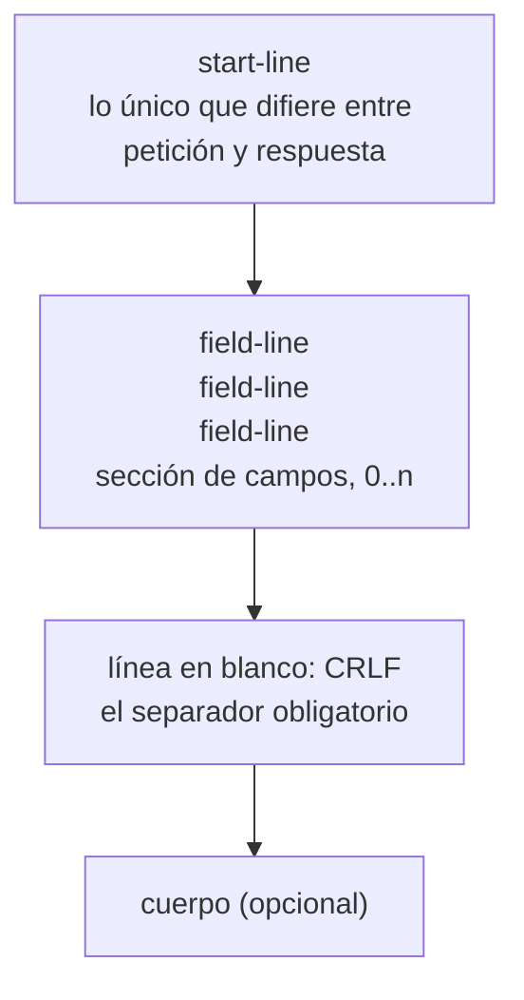

# 02 — El mensaje y los encabezados

> Qué viaja exactamente por el cable cuando tu cliente hace una petición: la línea de inicio, la
> sección de campos, la línea en blanco que nadie ve y el cuerpo. Por qué un espacio de más devuelve
> `400`, por qué el servidor necesita saber dónde termina el cuerpo antes de leerlo, y cómo se
> agrupan los cincuenta encabezados que hay que conocer en seis familias que se recuerdan.
>
> Todas las trazas de este capítulo están **capturadas de verdad** contra un servidor real, no
> escritas a mano.
>
> **Vigencia:** 2026-09-17. · **Requisito:** [`01` — Los RFC](01-los-rfc-fuente-de-verdad.md).

---

## 1. 🎯 El problema

Casi todo el mundo ha usado HTTP miles de veces sin ver nunca un mensaje HTTP: el cliente lo
construye, el framework lo parsea, y en medio una capa de objetos —`HttpServletRequest`, `Response`,
`context.Request`— oculta el hecho básico. **HTTP/1.1 es texto y se puede escribir a mano:**

```bash
# Petición HTTP cruda, escrita byte a byte, sin cliente HTTP de por medio
printf 'GET / HTTP/1.1\r\nHost: example.com\r\nConnection: close\r\n\r\n' | nc example.com 80
```

- `printf` en vez de `echo` porque hacen falta **`\r\n` exactos** —retorno de carro más salto de
  línea—, y `echo` solo pone `\n`.
- `nc` (netcat) abre un socket TCP al puerto 80 y vuelca lo que reciba. No sabe nada de HTTP: solo
  mueve bytes.
- `Host:` es obligatorio en HTTP/1.1 y la sección 5 explica por qué.
- `Connection: close` pide al servidor que cierre al terminar, para que `nc` no se quede esperando.
- La secuencia `\r\n\r\n` final es **la línea en blanco**: marca el fin de los encabezados. Sin ella
  el servidor sigue esperando más campos.

Respuesta real, recortada a los encabezados:

```text
HTTP/1.1 200 OK
Date: Fri, 18 Sep 2026 02:22:22 GMT
Content-Type: text/html
Transfer-Encoding: chunked
Connection: close
Server: cloudflare
Last-Modified: Tue, 15 Sep 2026 23:41:26 GMT
Allow: GET, HEAD
Accept-Ranges: bytes
Age: 11346
cf-cache-status: HIT
CF-RAY: a3cce1ec5bb97c03-MIA
```

Ahí hay ya media docena de cosas que este corpus explica: por qué el cuerpo viene `chunked` y no con
`Content-Length`, qué hace `Age` en una respuesta, qué significa `Allow: GET, HEAD` y por qué
`cf-cache-status` está en minúsculas.

> **Veredicto:** si puedes escribir una petición a mano y explicar cada línea, entiendes el
> protocolo. Si solo sabes usar el cliente, entiendes el cliente.

---

## 2. 🧱 Anatomía de un mensaje

Los dos mensajes —petición y respuesta— tienen la misma estructura de cuatro partes; solo cambia la
primera línea.



**La línea de inicio de una petición** — *request-line*:

```text
POST /pedidos/PED-00042/pagos HTTP/1.1
└──┘ └───────────────────────┘ └──────┘
método      target              versión
```

**La línea de inicio de una respuesta** — *status-line*:

```text
HTTP/1.1 201 Created
└──────┘ └─┘ └─────┘
versión  código  razón
```

Dos detalles que se preguntan:

- **La frase de motivo no significa nada.** `HTTP/1.1 201 Created` y `HTTP/1.1 201 Todo bien` son
  equivalentes: lo que procesa el cliente es el número. En HTTP/2 y HTTP/3 la frase **ni siquiera
  existe**, lo que confirma que era decorativa. Nunca escribas lógica que la lea.
- **El *target* no siempre es una ruta.** Hacia un proxy se envía la URL absoluta
  (`GET http://api.ejemplo.com/pedidos HTTP/1.1`), y `CONNECT` usa `host:puerto`. Es la razón por la
  que el campo se llama *request-target* y no *path*.

> ⚠️ **El error de la primera vez.** La separación de líneas es **CRLF**, no `\n`. Muchos servidores
> toleran `\n` solo, pero la norma pide `\r\n`, y en un cliente escrito a mano —o en una cabecera
> construida por concatenación— esa diferencia es la que produce el fallo que nadie encuentra.

---

## 3. 🧱 La sección de campos: sintaxis

La norma ya no dice "header": dice **campo** (*field*), porque los mismos campos pueden ir antes del
cuerpo (*header section*) o después (*trailer section*).

```text
field-line = field-name ":" OWS field-value OWS
```

- `OWS` es *optional whitespace*: espacios opcionales alrededor del valor, que **no forman parte del
  valor**. `Content-Type:   text/html   ` y `Content-Type: text/html` son idénticos.
- **El nombre no distingue mayúsculas.** `Content-Type`, `content-type` y `CONTENT-TYPE` son el
  mismo campo. Por eso `cf-cache-status` en minúsculas de la traza anterior es perfectamente legal —
  y en HTTP/2 y HTTP/3 los nombres van **obligatoriamente en minúscula**.
- **El valor sí distingue mayúsculas**, salvo donde su definición particular diga lo contrario —y
  muchas lo dicen: los tipos de medio, las codificaciones de contenido y las opciones de `Connection`
  se comparan sin distinguir.

**No se permite espacio entre el nombre y los dos puntos.** Y esto no es una recomendación:

```bash
# Reproducimos el error a propósito: un espacio antes de los dos puntos
printf 'GET / HTTP/1.1\r\nHost : example.com\r\nConnection: close\r\n\r\n' | nc example.com 80
```

```text
HTTP/1.1 400 Bad Request
Server: cloudflare
Connection: close
```

RFC 9112 §5.1 obliga: *"A server **MUST** reject, with a response status code of 400 (Bad Request),
any received request message that contains whitespace between a header field name and colon"*. El
motivo está escrito al lado, y es de seguridad: dos intermediarios que trataran ese espacio de forma
distinta interpretarían la petición de forma distinta, que es exactamente la puerta al
*request smuggling*.

**Campos repetidos.** Un mismo nombre puede aparecer varias veces, y la regla es:

```text
Accept: text/html
Accept: application/json      ≡     Accept: text/html, application/json
```

- Solo vale **si la definición del campo admite lista separada por comas**. Repetir un campo que no
  la admite —como `Content-Length`— es un mensaje mal formado, no una lista.
- **`Set-Cookie` es la excepción famosa**: no se puede combinar con comas porque su valor contiene
  comas (en la fecha de expiración). Por eso todas las APIs de servidor tratan `Set-Cookie` aparte, y
  por eso `getHeader("Set-Cookie")` devuelve basura y hay que usar la variante de lista.
- **El orden entre campos distintos no importa**; el orden entre repeticiones del mismo campo **sí**,
  y hay que preservarlo.

**Continuación de línea (`obs-fold`).** Partir un valor largo en varias líneas indentadas fue legal
en HTTP/1.1 y **está deprecado** desde RFC 9112: un servidor que lo recibe responde `400` o lo
sustituye por espacios. Si tu código lo genera, está generando HTTP de 1999.

---

## 4. 🧱 Las seis familias de encabezados

El registro de IANA tiene cientos de campos: memorizarlos es inútil, y agruparlos por **qué pregunta
responden** hace que se deduzcan.

| Familia | Qué responde | Ejemplos |
|---|---|---|
| **Representación** | ¿Cómo es este cuerpo? | `Content-Type`, `Content-Length`, `Content-Encoding`, `Content-Language`, `Content-Disposition` |
| **Negociación** | ¿Qué prefiere el cliente? | `Accept`, `Accept-Encoding`, `Accept-Language`, `Accept-Charset` |
| **Condicionales** | ¿Hazlo solo si…? | `If-None-Match`, `If-Match`, `If-Modified-Since`, `If-Unmodified-Since` |
| **Caché** | ¿Cuánto vale esto y hasta cuándo? | `Cache-Control`, `ETag`, `Age`, `Expires`, `Vary` |
| **Contexto y ruta** | ¿Quién pregunta y por dónde vino? | `Host`, `User-Agent`, `Referer`, `Forwarded`, `Via` |
| **Control de conexión** | ¿Cómo se gestiona el canal? | `Connection`, `Transfer-Encoding`, `Upgrade`, `Keep-Alive` |

Las tres cosas que esta tabla deja claras y que se preguntan:

- **`Content-*` describe el cuerpo que va en ESTE mensaje; `Accept-*` describe preferencias para el
  que vendrá.** Es la confusión más común: `Content-Type` en una petición dice qué estás enviando,
  no qué esperas recibir. Lo que esperas es `Accept`.
- **`Content-Encoding` y `Transfer-Encoding` no son lo mismo.** El primero es una propiedad de la
  representación —el recurso *es* gzip, y su `ETag` corresponde a esa forma—; el segundo es solo
  cómo se empaqueta para este salto, y el siguiente intermediario puede quitarlo.
- **La familia de conexión es *hop-by-hop*.** Esos campos valen para un salto, no de extremo a
  extremo, y un proxy los consume en vez de reenviarlos. Ahí vive la diferencia entre "mi cliente
  mandó `Connection: keep-alive`" y lo que realmente llega al servidor de origen.

**El caso `Vary`,** que casi nadie usa bien: si tu respuesta depende de un encabezado de la
petición —típicamente `Accept-Language` o `Authorization`— **tienes que declararlo en `Vary`**, o
una caché intermedia servirá la versión en inglés al que pidió español. Es el bug de caché más caro
y más silencioso que existe.

---

## 5. 🧱 Dónde termina el cuerpo

Los encabezados terminan con una línea en blanco, pero el cuerpo no tiene marca de fin. Sobre una
conexión reutilizada, **el servidor tiene que saber cuántos bytes leer antes de leerlos** o no sabrá
dónde empieza la siguiente petición. Solo hay dos mecanismos:

```text
Content-Length: 348          ← "vienen 348 octetos exactos"
Transfer-Encoding: chunked   ← "vienen trozos; cada uno dice su tamaño; el de tamaño 0 cierra"
```

Así se ve un cuerpo troceado, que es lo que devolvió `example.com` en la traza de la sección 1:

```text
1a\r\n                    ← 0x1a = 26 octetos en este trozo
<html>…26 octetos…\r\n
0\r\n                     ← trozo de tamaño cero: fin del cuerpo
\r\n                      ← sección de trailers, normalmente vacía
```

- **El tamaño va en hexadecimal.** Leerlo en decimal es un clásico de los parsers escritos a mano.
- **`chunked` existe para contenido que no se conoce entero al empezar**: un informe generado al
  vuelo, una consulta que se transmite mientras se lee. Sin él habría que materializar todo en
  memoria solo para poder contar los bytes.

**Y el punto que se pregunta en entrevistas de seguridad:** ¿qué pasa si llegan los dos?

RFC 9112 §6.1 lo resuelve así: **`Transfer-Encoding` sobrescribe a `Content-Length`**, y el servidor
*MAY* rechazar la petición, pero en cualquier caso **MUST cerrar la conexión** después de responder.
La razón está escrita en la propia norma: si un intermediario toma la longitud y el siguiente toma
los trozos, uno de los dos se queda con bytes sobrantes en el buffer, y esos bytes se convierten en
**la siguiente petición** — que el atacante escribió. Eso es *request smuggling*, y toda su familia
de ataques nace de esta ambigüedad de dos encabezados.

- Un `GET` sin cuerpo no lleva ninguno de los dos, y está bien.
- Una respuesta a `HEAD` lleva `Content-Length` **describiendo el cuerpo que habría tenido**, pero no
  envía cuerpo. Es la única situación donde el campo miente por diseño.
- `204 No Content` y `304 Not Modified` **nunca llevan cuerpo**, y por tanto tampoco framing.

---

## 6. 🧱 Texto en el cable, o no

HTTP/1.1 es texto; HTTP/2 y HTTP/3 no. Y sin embargo son el mismo protocolo, porque lo que cambia es
la codificación, no el significado —la separación de RFC 9110 del capítulo `01`.

```text
HTTP/1.1   texto ASCII, un mensaje por conexión a la vez
HTTP/2     tramas binarias, multiplexadas, nombres en minúscula, cabeceras comprimidas (HPACK)
HTTP/3     lo mismo sobre QUIC/UDP, cabeceras con QPACK
```

- **El mismo mensaje lógico** —método, target, campos, cuerpo— existe en las tres; lo que se
  compacta es su representación. Por eso `curl --http2` muestra exactamente los mismos encabezados:
  los está descomprimiendo para ti.
- **En HTTP/2 y HTTP/3 no hay línea de inicio.** El método, el target, el esquema y la autoridad
  viajan como **pseudo-campos**: `:method`, `:path`, `:scheme`, `:authority`, que sustituye a `Host`.
- Qué ganó cada versión es el capítulo [`06`](06-versiones-proxies-y-tiempo-real.md); aquí basta la
  conclusión: **lo que aprendes sobre semántica no caduca al cambiar de versión.**

**Texto frente a binario, en general.** Es la decisión que reaparece al elegir formato de API —JSON
frente a Protocol Buffers, capítulo [`04`](04-codificacion-y-formatos.md)— y el compromiso es
siempre el mismo:

| | Texto | Binario |
|---|---|---|
| Depurar | se lee con `nc`, `curl`, `tcpdump` | hace falta herramienta que lo decodifique |
| Tamaño | redundante; se comprime bien | compacto de origen |
| Parseo | costoso, y **ambiguo en los bordes** | barato y determinista |
| Evolución | tolerante y explícita | necesita esquema y disciplina de versiones |

> 💡 **Lo que la tabla no dice.** El coste real del texto no es el tamaño —eso lo arregla gzip— sino
> la **ambigüedad de parseo**: los `400` de este capítulo y toda la familia del *smuggling* existen
> porque dos implementaciones pueden leer el mismo texto de dos formas. Un formato binario con
> longitudes explícitas no tiene esa clase de bug. Ese es el argumento real de HTTP/2, no la
> velocidad.

---

## 7. 📜 Lo que dice la norma

| Afirmación | Fuente | ¿Obliga o es convención? |
|---|---|---|
| Los nombres de campo no distinguen mayúsculas | RFC 9110 §5.1 | **Norma** |
| Un espacio entre nombre y `:` → el servidor **MUST** responder `400` | RFC 9112 §5.1 | **Norma** |
| Un cliente **MUST** enviar `Host` en toda petición HTTP/1.1 | RFC 9112 §3.2 | **Norma** |
| Campos repetidos se combinan con coma si la definición admite lista | RFC 9110 §5.3 | **Norma** |
| `Set-Cookie` no se puede combinar así | RFC 6265 | **Norma**, excepción conocida |
| `Transfer-Encoding` sobrescribe a `Content-Length` | RFC 9112 §6.1 | **Norma** |
| Con ambos presentes, el servidor **MUST** cerrar la conexión al responder | RFC 9112 §6.1 | **Norma** |
| `obs-fold` (continuación de línea) está deprecado | RFC 9112 §5.2 | **Norma** |
| La frase de motivo no tiene significado | RFC 9112 §4 | **Norma** |
| El separador de líneas es CRLF | RFC 9112 §2.1 | **Norma** |
| Un solo `SP` antes del valor, por legibilidad | RFC 9112 §5.1 | **Recomendación** |
| Escribir los nombres en `Kebab-Case-Capitalizado` | Ninguna | **Convención** |

---

## 8. 🔭 Dónde aparece de verdad

En el `400` que devuelve el gateway y no el servicio, y que no aparece en ningún log de aplicación
porque el mensaje ni llegó a parsearse; en la respuesta que se sirve en el idioma equivocado a la
mitad de los usuarios porque faltaba `Vary`; en el informe de pentesting que dice *"desincronización
de petición en el balanceador"* y que hay que saber leer; en la integración con un tercero que envía
`Content-Type: application/json;charset=UTF-8` sin espacio y rompe un parser estricto; y en la
entrevista, cuando piden dibujar en la pizarra qué viaja exactamente por el socket — que es la
pregunta de calentamiento más habitual de todo este temario.

---

## ⚠️ Errores frecuentes

| Se dice | Lo preciso |
|---|---|
| "`Content-Type` dice qué espero recibir" | Dice qué estoy **enviando**. Lo que espero es `Accept` |
| "Los encabezados distinguen mayúsculas" | El **nombre** no; el valor sí, salvo donde su definición diga lo contrario |
| "`Content-Encoding` y `Transfer-Encoding` son sinónimos" | Uno es propiedad del recurso; el otro, del salto |
| "El cuerpo termina cuando se cierra la conexión" | Solo en HTTP/1.0. Con conexiones reutilizadas hace falta `Content-Length` o `chunked` |
| "Mandar los dos encabezados de longitud es redundante pero inofensivo" | Es la base del *request smuggling*; la norma obliga a cerrar la conexión |
| "`404 Not Found` — la frase importa" | La frase es decorativa y no existe en HTTP/2 ni HTTP/3 |
| "En HTTP/2 los encabezados son otros" | Son los mismos; cambia la codificación y aparecen pseudo-campos |
| "Un campo repetido es un error" | Es una lista, si su definición la admite |

---

## 📚 Para profundizar

- **RFC** — [RFC 9110 §5 — *Fields*](https://www.rfc-editor.org/rfc/rfc9110.html#section-5): la sección
  que define nombre, valor, orden y combinación. Diez páginas que valen por cualquier tutorial.
- **RFC** — [RFC 9112 — *HTTP/1.1*](https://www.rfc-editor.org/rfc/rfc9112.html) (STD 99): la sintaxis en
  el cable. Las secciones 5 y 6 son las de este capítulo.
- **RFC** — [RFC 9112 §11 — *Security Considerations*](https://www.rfc-editor.org/rfc/rfc9112.html#section-11):
  *request smuggling* y *response splitting* explicados por quienes escribieron la norma.
- **Registro** — [IANA — HTTP Field Name Registry](https://www.iana.org/assignments/http-fields/http-fields.xhtml):
  la lista viva. Útil para comprobar si un campo que te encuentras está registrado o es inventado.
- **Referencia** — [MDN — HTTP headers](https://developer.mozilla.org/en-US/docs/Web/HTTP/Reference/Headers):
  el índice práctico, con ejemplos y compatibilidad de navegadores.
- **Referencia** — [MDN — HTTP Messages](https://developer.mozilla.org/en-US/docs/Web/HTTP/Guides/Messages):
  la anatomía del mensaje con diagramas, incluida la diferencia con HTTP/2.
- **Herramienta** — `curl -v` y `curl --trace-ascii -`: el segundo muestra **los bytes exactos**,
  incluidos los CRLF, que `-v` esconde.
- **Vídeo** — [*HTTP/1 to HTTP/2 to HTTP/3* — ByteByteGo](https://www.youtube.com/watch?v=a-sBfyiXysI):
  seis minutos con buenos diagramas de multiplexación y de qué cambia entre versiones.

---

## 🧠 Preguntas

Sin respuestas aquí. Todas, con enunciado literal y respuesta en tres capas, en
[`08` — Respuestas](08-respuestas.md).

1. ¿Cuáles son las cuatro partes de un mensaje HTTP? 🟢
2. ¿Qué separa los encabezados del cuerpo? 🟢
3. ¿Los nombres de encabezado distinguen mayúsculas y minúsculas? ¿Y los valores? 🟢
4. ¿Qué diferencia hay entre `Accept` y `Content-Type`? 🟢
5. ¿Para qué sirve `Content-Length`? 🟢
6. ¿Qué es `Transfer-Encoding: chunked` y cuándo se usa? 🟢
7. ¿Por qué `Host` es obligatorio en HTTP/1.1? 🟢
8. ¿Qué significa la frase de motivo de la línea de estado? 🟢
9. Escribe a mano una petición `GET` completa y explica cada línea. 🟡
10. ¿Qué pasa si envías un espacio entre el nombre del encabezado y los dos puntos? 🟡
11. ¿Qué diferencia hay entre `Content-Encoding` y `Transfer-Encoding`? 🟡
12. Un encabezado aparece dos veces en el mensaje. ¿Es válido? 🟡
13. ¿Por qué `Set-Cookie` es la excepción a la regla anterior? 🟡
14. ¿Qué son los encabezados *hop-by-hop* y qué les pasa al atravesar un proxy? 🟡
15. ¿Para qué sirve `Vary` y qué rompe su ausencia? 🟡
16. ¿Qué cuerpo lleva una respuesta a `HEAD`, y qué dice su `Content-Length`? 🟡
17. Llegan `Content-Length` y `Transfer-Encoding` en la misma petición. ¿Qué manda la norma? 🟠
18. Explica el mecanismo del *request smuggling* a partir de la pregunta anterior. 🟠
19. ¿Por qué el tamaño de cada trozo de `chunked` va en hexadecimal y qué falla si lo lees en
    decimal? 🟠
20. Si HTTP/2 es binario y HTTP/1.1 es texto, ¿por qué se dice que son el mismo protocolo? 🟠
21. ¿Qué son los pseudo-campos de HTTP/2 y qué pasó con `Host`? 🟠
22. Compara texto y binario como formato de protocolo. ¿Cuál es el coste real del texto? 🟠
23. Una respuesta se sirve en el idioma equivocado al 50 % de los usuarios y solo detrás del CDN.
    Diagnostica. 🔴
24. Diseñas un parser HTTP/1.1 desde cero. Enumera las cinco decisiones donde una lectura laxa se
    convierte en vulnerabilidad. 🔴
25. Escribe a mano el intercambio completo —petición y respuesta— de una subida `PUT` de 348 octetos
    con su framing, y señala cada línea que la norma hace obligatoria. 🔴
26. Un `400` aparece solo detrás del CDN y nunca llega a los logs de la aplicación. Da tres
    hipótesis ordenadas por probabilidad y cómo descartarías cada una. 🔴
27. Defines el contrato de un endpoint que devuelve CSV o JSON según el cliente. Escribe los
    encabezados exactos de petición y respuesta, incluido lo que evita el bug de caché. 🔴
---

**Anterior:** [`01` — Los RFC: la fuente de verdad](01-los-rfc-fuente-de-verdad.md) ·
**Siguiente:** [`03` — Métodos, semántica e idempotencia](03-metodos-semantica-e-idempotencia.md)
