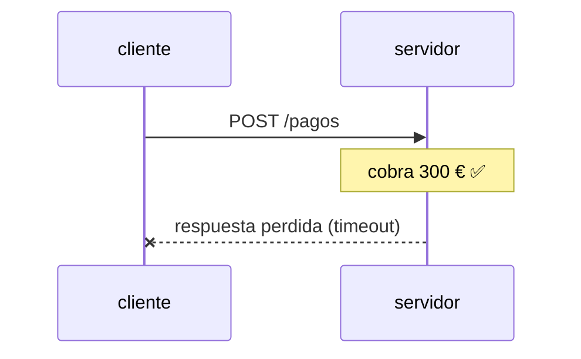
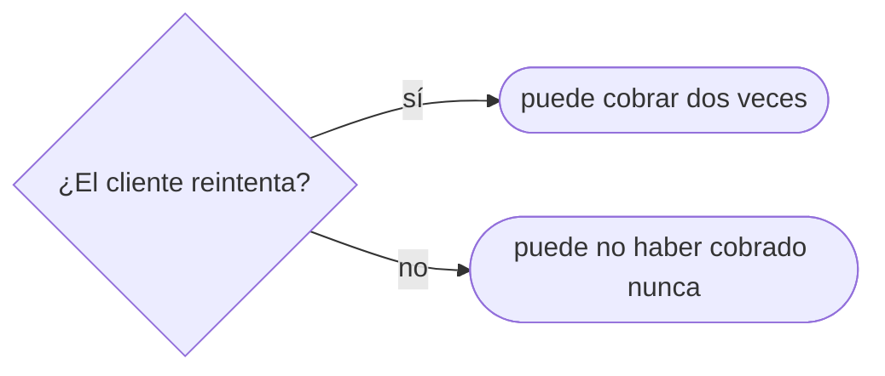

# 03 — Métodos, semántica e idempotencia

> Las tres propiedades que definen un método —seguro, idempotente, cacheable— y por qué son
> ortogonales; `PUT` frente a `POST` frente a `PATCH` decidido por semántica y no por costumbre; qué
> significa de verdad que una operación sea idempotente cuando la red pierde respuestas; y qué obliga
> REST, que es mucho menos de lo que se le atribuye.
>
> El capítulo con más preguntas de entrevista por línea de todo el corpus.
>
> **Vigencia:** 2026-09-17. · **Requisito:** [`01` — Los RFC](01-los-rfc-fuente-de-verdad.md).

---

## 1. 🎯 El problema

Un equipo expone la operación de borrado como enlace:

```text
GET /pedidos/PED-00042?accion=eliminar
```

Funciona. Pasa los tests. Y un martes desaparecen cuatrocientos pedidos, porque alguien indexó el
panel de administración: el rastreador siguió todos los enlaces, como está diseñado para hacer, y
cada enlace borró un pedido.

Este incidente es tan clásico que **está escrito en la propia norma**, con nombre y ejemplo:

> *"it is common for Web-based content editing software to use actions within query parameters, such
> as `page?do=delete`. If the purpose of such a resource is to perform an unsafe action, then the
> resource owner **MUST** disable or disallow that action when it is accessed using a safe request
> method."* — RFC 9110 §9.2.1

El método no es una etiqueta decorativa: es **un contrato con toda la infraestructura que hay entre
tu cliente y tu servidor**. Rastreadores, cachés, proxies, reintentos automáticos del balanceador,
prefetch del navegador y reintentos de tu propio cliente HTTP toman decisiones a partir del método
**sin mirar tu código**. Elegir mal el verbo no es una imprecisión de estilo: es mentirle a todo el
sistema.

> **Veredicto:** la pregunta correcta al elegir método nunca es *"¿cuál me deja hacer esto?"* — casi
> todos te dejan. Es *"¿qué le estoy prometiendo a la red?"*.

---

## 2. 🧱 Tres propiedades, ortogonales

**Qué es.** RFC 9110 define tres propiedades de un método, y la mitad de los errores viene de
tratarlas como una sola.

| Propiedad | Qué promete | Quién la aprovecha |
|---|---|---|
| **Seguro** (*safe*) | Es esencialmente de solo lectura: el cliente no pide ni espera cambio de estado | Rastreadores, prefetch, prerenderizado |
| **Idempotente** | El efecto de **N peticiones idénticas es el mismo que el de una** | Reintentos automáticos de clientes y proxies |
| **Cacheable** | La respuesta puede almacenarse y reutilizarse | Cachés de navegador, CDN, proxies inversos |

```text
seguro ⊂ idempotente          todo método seguro es idempotente; lo contrario no
cacheable                     es ortogonal a las otras dos
```

La tabla completa, que conviene poder escribir de memoria:

| Método | Seguro | Idempotente | Cacheable | Cuerpo en la petición |
|---|---|---|---|---|
| `GET` | ✅ | ✅ | ✅ | no (sin semántica definida) |
| `HEAD` | ✅ | ✅ | ✅ | no |
| `OPTIONS` | ✅ | ✅ | ❌ | no |
| `TRACE` | ✅ | ✅ | ❌ | no |
| `PUT` | ❌ | ✅ | ❌ | sí |
| `DELETE` | ❌ | ✅ | ❌ | opcional |
| `POST` | ❌ | ❌ | solo si es explícito | sí |
| `PATCH` | ❌ | ❌ | ❌ | sí |

Cuatro detalles que se preguntan sobre esta tabla:

- **"Seguro" no significa "sin efectos secundarios".** La norma es explícita: un `GET` puede escribir
  en el log, calentar una caché o —su propio ejemplo— **cargar un anuncio a una cuenta publicitaria**.
  Lo que define lo seguro es que **el cliente no pidió ese efecto y no es responsable de él**.
- **`POST` es cacheable**, aunque casi nadie lo use: la norma lo permite si la respuesta lleva
  información explícita de frescura. Es el único caso donde "cacheable" depende de la respuesta y no
  del método.
- **`DELETE` es idempotente pero no devuelve lo mismo.** Borrar dos veces deja el sistema en el mismo
  estado —el recurso no está—; la segunda respuesta puede ser `404` en vez de `204`. La idempotencia
  es del **efecto**, no de la respuesta.
- **`PATCH` no es idempotente por definición**, y ni siquiera se define en RFC 9110: está en
  [RFC 5789](https://www.rfc-editor.org/rfc/rfc5789.html). Puede serlo según el formato del parche, que es
  la sección 4.

---

## 3. 🧱 `PUT` frente a `POST` frente a `PATCH`

**El problema.** Los tres escriben. La regla que se aprende —"`POST` crea, `PUT` actualiza"— es falsa
y lleva años estorbando.

**La distinción real es otra:**

```text
PUT    "el estado del recurso EN ESTA URI pasa a ser exactamente esto"
POST   "procesa este dato según la semántica propia del recurso"
PATCH  "aplica estas instrucciones de cambio al recurso"
```

- **`PUT` reemplaza, y el cliente elige la URI.** Por eso es idempotente: mandar el mismo estado diez
  veces deja el mismo estado. Y por eso **`PUT` puede crear**: si la URI no existía, el resultado es
  `201` en vez de `200`. La idea de que `PUT` no crea es del folclore, no de la norma.
- **`POST` es el método sin promesas**, y eso es una virtud, no un defecto: es el único que sirve para
  operaciones que no son "poner un estado" — un pago, un envío de correo, una importación, una
  búsqueda con un cuerpo grande. Cuando un servidor crea el recurso y **asigna él la URI**, es `POST`
  y la respuesta es `201` con `Location`.
- **`PATCH` es parcial y necesita un formato de parche.** Y aquí está el error más frecuente del
  gremio: mandar un JSON con los campos a cambiar y llamarlo `PATCH`. Eso no es ningún formato
  estandarizado por accidente — es **JSON Merge Patch**, y tiene RFC:

```text
application/json-patch+json    RFC 6902  lista de operaciones: add, remove, replace, move, copy, test
application/merge-patch+json   RFC 7396  un documento parcial; null BORRA el campo
```

**Y la trampa de Merge Patch**, que se pregunta:

```json
{ "descuento": null }
```

En Merge Patch eso **elimina el campo**, no lo pone a nulo. Consecuencia directa: con Merge Patch
**es imposible asignar el valor `null`** a un campo. Si tu dominio distingue "sin valor" de "no
tocar", Merge Patch no te sirve y necesitas JSON Patch.

**El cuadro de decisión:**

| Quieres | Método | Respuesta típica |
|---|---|---|
| Sustituir el recurso entero, URI conocida | `PUT` | `200` / `204`, o `201` si lo creó |
| Crear y que el servidor asigne la URI | `POST` | `201` + `Location` |
| Cambiar unos campos | `PATCH` + formato de parche | `200` / `204` |
| Ejecutar una acción que no es un estado | `POST` | según la acción |
| Consultar sin cambiar nada | `GET` | `200` / `304` |

> ⚠️ **La pregunta capciosa.** *"¿Es `PATCH` idempotente?"* La respuesta completa: **no lo es por
> definición**, pero **puede serlo según el parche**. `{"estado": "PAGADO"}` en Merge Patch sí lo es;
> `{"op":"add","path":"/lineas/-","value":{…}}` en JSON Patch **no**, porque cada aplicación añade
> otra línea. Y la propiedad la fija el contrato, no el método.

---

## 4. 🧱 Idempotencia, cuando la red falla

**El problema.** La idempotencia parece una curiosidad académica hasta que aparece el escenario que
la hace imprescindible:





**El cliente no puede distinguir** "la petición no llegó" de "llegó y se perdió la respuesta". Es la
misma imposibilidad del problema de los dos generales, y no se resuelve con más reintentos.

Lo que sí se resuelve:

- **Si la operación es idempotente, el cliente reintenta sin pensar.** Por eso `PUT` y `DELETE` se
  reintentan automáticamente en muchos clientes y proxies, y `POST` **no**. Si tu `POST` no es
  idempotente y algo lo reintenta, duplicas.
- **Diseñar la operación para que lo sea.** `PUT /pedidos/PED-00042/estado` con el estado destino es
  idempotente; `POST /pedidos/PED-00042/avanzar-estado` no lo es nunca. La misma funcionalidad, dos
  contratos distintos, y la diferencia la eliges tú.
- **Cuando no se puede, se añade una clave de idempotencia**: el cliente genera un identificador
  único por *intento lógico*, el servidor lo guarda con el resultado y ante una repetición devuelve
  la respuesta original en vez de reejecutar. Es lo que hacen todas las pasarelas de pago.

Así se ve en el cable. El reintento repite la petición **byte a byte**, clave incluida:

```text
POST /pagos HTTP/1.1
Host: api.ejemplo.com
Content-Type: application/json
Idempotency-Key: 5f2a9c41-8e0b-4d77-9c31-0a6b2e7d4418
Content-Length: 54

{"pedido":"PED-00042","importe":300.00,"moneda":"EUR"}

HTTP/1.1 201 Created
Location: /pagos/PAG-00917
Content-Type: application/json

{"id":"PAG-00917","estado":"COBRADO","importe":300.00}

── la respuesta se pierde; el cliente reenvía la misma petición ──

HTTP/1.1 200 OK
Content-Type: application/json

{"id":"PAG-00917","estado":"COBRADO","importe":300.00}
```

- **La clave es del cliente y va por intento lógico, no por petición de red.** Si la regenerara al
  reintentar, el mecanismo no serviría de nada. Es un
  [borrador del IETF](https://datatracker.ietf.org/doc/draft-ietf-httpapi-idempotency-key-header/),
  no un RFC: **convención**, por universal que sea.
- **`201` la primera vez, `200` la segunda.** `201` dice "se creó un recurso" y trae `Location`;
  repetir no crea nada, así que la respuesta es `200` con la representación del pago que ya existía
  ([RFC 9110 §15.3.2](https://www.rfc-editor.org/rfc/rfc9110.html#section-15.3.2)). El `id` idéntico es la
  prueba observable de que no hubo segundo cobro.
- **Ninguna norma define cómo avisar de que la respuesta es una repetición.** Si lo necesitas, el
  encabezado lo defines tú y lo documentas, porque ningún cliente puede deducirlo.

> 📝 **Frontera con el repaso de Spring.** El encabezado `Idempotency-Key`, su implementación con
> filtros e interceptores, el almacén de claves y su caducidad se tratan en
> `repaso-spring-entrevistas`. Aquí queda **la teoría**: por qué hace falta, qué garantiza y qué no.

**Lo que una clave de idempotencia no arregla**, y es la repregunta de nivel:

- **No hace atómica la operación.** Si el servidor cae entre cobrar y guardar la clave, el reintento
  cobra otra vez. Hacen falta las dos cosas en la misma transacción, o un diseño de dos fases.
- **No define cuánto dura.** Una clave que caduca en una hora y un cliente que reintenta al día
  siguiente duplican igual.
- **No te dice qué hacer si llega la misma clave con un cuerpo distinto.** La respuesta correcta es
  rechazar con `422` o `409`, no reejecutar; y esa decisión hay que escribirla en el contrato porque
  ninguna norma la fija.

**Idempotente, at-most-once y exactly-once** no son lo mismo, y conviene tenerlo ordenado:

```text
at-most-once   se ejecuta 0 o 1 veces   → sin reintentos; se pueden perder operaciones
at-least-once  se ejecuta 1 o N veces   → con reintentos; hacen falta duplicados tolerables
exactly-once   marketing, en sistemas distribuidos
```

**"Exactly-once" de verdad no existe sobre una red que pierde mensajes.** Lo que existe es
*at-least-once* más una operación idempotente, y el resultado **observable** es equivalente. Decir
esto en una entrevista vale más que cualquier diagrama.

---

## 5. 🧱 Qué obliga REST, y qué se le atribuye

**Qué es.** REST es un **estilo arquitectónico** definido en la tesis de Roy Fielding (2000). No es
un RFC, no es un estándar y no dice nada sobre JSON ni sobre cómo se nombran las URLs.

**Sus restricciones**, que son las que de verdad definen el estilo:

| Restricción | Qué obliga |
|---|---|
| Cliente-servidor | Separación de responsabilidades |
| **Sin estado** | Cada petición lleva todo lo necesario; el servidor no guarda sesión del cliente |
| Cacheable | Las respuestas se marcan como cacheables o no |
| Interfaz uniforme | Recursos identificados, manipulados por representaciones, mensajes autodescriptivos, hipermedia |
| Sistema por capas | El cliente no sabe si habla con el origen o con un intermediario |
| Código bajo demanda | Opcional, y prácticamente en desuso |

Lo que hay que saber decir:

- **"Sin estado" es la restricción que más se incumple y más cuesta**: es la que permite escalar
  horizontalmente sin sesiones pegajosas, y la que se rompe en cuanto alguien guarda algo en la
  sesión del servidor.
- **Casi ninguna API llamada REST lo es** en sentido estricto, porque incumple la parte de hipermedia
  de la interfaz uniforme. El propio Fielding lo dijo públicamente. Lo que llamamos REST en la
  industria es, casi siempre, **HTTP bien usado** — que ya es bastante.
- **El modelo de madurez de Richardson** es la escala útil para hablar de esto sin discutir de
  ortodoxia: nivel 0, un único endpoint tipo RPC; nivel 1, recursos; nivel 2, verbos y códigos de
  estado con su semántica; nivel 3, hipermedia. **La industria vive en el nivel 2**, y eso es una
  decisión defendible, no un fracaso.

> 📝 **Frontera.** HATEOAS y la paginación —el nivel 3 y su implementación— se tratan en
> `repaso-spring-entrevistas`, incluida la forma concreta de `Page`/`Pageable`. Aquí queda el marco.

**Cuándo REST no es la respuesta.** Cuando la operación es un procedimiento y no un recurso —RPC es
más honesto—, cuando el coste por llamada domina y hace falta un formato binario con contrato, o
cuando el cliente necesita componer la consulta. Saber decir *"esto no debería ser REST"* es una
señal de criterio; forzar un sustantivo para cada verbo del dominio es el antipatrón.

---

## 6. 📜 Lo que dice la norma

| Afirmación | Fuente | ¿Obliga o es convención? |
|---|---|---|
| `GET`, `HEAD`, `OPTIONS` y `TRACE` son seguros | RFC 9110 §9.2.1 | **Norma** |
| `PUT`, `DELETE` y los métodos seguros son idempotentes | RFC 9110 §9.2.2 | **Norma** |
| Un `GET` puede tener efectos secundarios de los que el cliente no responde | RFC 9110 §9.2.1 | **Norma** |
| Si una acción es insegura, el dueño **MUST** impedirla por método seguro | RFC 9110 §9.2.1 | **Norma** |
| `PUT` puede crear el recurso si no existía | RFC 9110 §9.3.4 | **Norma** |
| `POST` es cacheable si la respuesta lo indica explícitamente | RFC 9110 §9.3.3 | **Norma** |
| `PATCH` se define fuera del núcleo de HTTP | RFC 5789 | **Norma** |
| `null` en Merge Patch borra el campo | RFC 7396 | **Norma** |
| El encabezado `Idempotency-Key` | Borrador IETF, no RFC | **Convención**, muy extendida |
| "`POST` crea, `PUT` actualiza" | Ninguna | **Folclore** |
| Las URLs de recurso en plural (`/pedidos`) | Ninguna | **Convención** |

---

## 7. 🔭 Dónde aparece de verdad

En el rastreador que borró media base de datos; en el cobro duplicado que aparece cuando la red va
mal y nunca se reproduce en pruebas; en el balanceador que reintenta un `POST` porque alguien lo
configuró como si fuera un `GET`; en la discusión de diseño sobre si el cambio de estado de un pedido
es `PUT`, `PATCH` o un `POST` a un subrecurso; en la integración con la pasarela de pago que exige
clave de idempotencia y hay que explicar por qué; y en la entrevista, donde *"¿`PUT` o `PATCH`?"* y
*"¿qué es idempotencia?"* son prácticamente obligatorias para un perfil de Tech Lead.

---

## ⚠️ Errores frecuentes

| Se dice | Lo preciso |
|---|---|
| "`POST` crea y `PUT` actualiza" | `PUT` pone un estado en una URI que elige el cliente, y puede crear; `POST` procesa |
| "Seguro significa sin efectos secundarios" | Significa que el cliente no los pidió ni responde de ellos |
| "`DELETE` no es idempotente porque la segunda vez da `404`" | La idempotencia es del **efecto**, no de la respuesta |
| "`PATCH` es idempotente como `PUT`" | No por definición; depende del parche y del formato |
| "Mando un JSON con los campos cambiados y eso es `PATCH`" | Eso es Merge Patch (RFC 7396) y tiene su `Content-Type`; decláralo |
| "Con `PATCH` pongo un campo a `null`" | En Merge Patch `null` **borra** el campo |
| "Una clave de idempotencia garantiza exactly-once" | Da at-least-once con efecto equivalente, si la operación y la clave son atómicas |
| "Nuestra API es REST" | Casi seguro es nivel 2 de Richardson, que está bien — dilo así |
| "REST obliga a usar JSON" | REST no dice nada de formatos |

---

## 📚 Para profundizar

- **RFC** — [RFC 9110 §9 — *Methods*](https://www.rfc-editor.org/rfc/rfc9110.html#section-9): las
  propiedades y los ocho métodos. La sección 9.2 cabe en dos páginas y zanja discusiones.
- **RFC** — [RFC 5789 — *PATCH Method for HTTP*](https://www.rfc-editor.org/rfc/rfc5789.html): cuatro
  páginas, y explica por qué `PATCH` no promete idempotencia.
- **RFC** — [RFC 6902 — *JSON Patch*](https://www.rfc-editor.org/rfc/rfc6902.html) y
  [RFC 7396 — *JSON Merge Patch*](https://www.rfc-editor.org/rfc/rfc7396.html): los dos formatos, y el
  segundo se lee en diez minutos.
- **Tesis** — [Fielding — *Architectural Styles…*, capítulo 5](https://ics.uci.edu/~fielding/pubs/dissertation/rest_arch_style.htm):
  la definición original de REST, en el idioma de quien la escribió.
- **Artículo** — [Fielding — *REST APIs must be hypertext-driven*](https://roy.gbiv.com/untangled/2008/rest-apis-must-be-hypertext-driven):
  el texto donde dice que casi nada de lo que se llama REST lo es. Corto y con los comentarios.
- **Artículo** — [Fowler — *Richardson Maturity Model*](https://martinfowler.com/articles/richardsonMaturityModel.html):
  la escala de los cuatro niveles, con ejemplos.
- **Referencia** — [MDN — HTTP request methods](https://developer.mozilla.org/en-US/docs/Web/HTTP/Reference/Methods):
  la tabla de propiedades por método, para consulta rápida.
- **Borrador** — [IETF — *The Idempotency-Key HTTP Header Field*](https://datatracker.ietf.org/doc/draft-ietf-httpapi-idempotency-key-header/):
  el intento de estandarizar la convención. Útil para poder decir que **aún no es un RFC**.
- **Artículo** — [Stripe — *Idempotent requests*](https://docs.stripe.com/api/idempotent_requests) y
  [*Designing robust and predictable APIs with idempotency*](https://stripe.com/blog/idempotency):
  la implementación de referencia de la industria, incluida la caducidad de la clave y qué hacen si
  llega repetida con otro cuerpo.

---

## 🧠 Preguntas

Sin respuestas aquí. Todas, con enunciado literal y respuesta en tres capas, en
[`08` — Respuestas](08-respuestas.md).

1. ¿Qué significa que un método sea seguro? 🟢
2. ¿Qué significa que un método sea idempotente? 🟢
3. ¿Qué métodos son seguros según RFC 9110? 🟢
4. ¿Qué métodos son idempotentes según RFC 9110? 🟢
5. ¿`POST` es idempotente? 🟢
6. ¿Qué método usas para sustituir un recurso entero? 🟢
7. ¿Qué devuelve un `PUT` sobre una URI que no existía? 🟢
8. ¿Qué es REST y quién lo definió? 🟢
9. ¿Por qué "seguro" no es lo mismo que "sin efectos secundarios"? 🟡
10. ¿Por qué `DELETE` es idempotente si la segunda llamada devuelve `404`? 🟡
11. ¿Cuándo usas `POST` y cuándo `PUT` para crear? 🟡
12. ¿Qué formatos de parche existen y qué `Content-Type` llevan? 🟡
13. ¿Qué hace un `null` en JSON Merge Patch? 🟡
14. ¿Es cacheable `POST`? 🟡
15. ¿Qué es el modelo de madurez de Richardson y en qué nivel vive la industria? 🟡
16. ¿Qué restricción de REST es la que más cuesta cumplir y por qué? 🟡
17. ¿Es `PATCH` idempotente? Responde completo. 🟠
18. Un cliente hace `POST /pagos`, el servidor cobra y la respuesta se pierde. ¿Qué debe hacer el
    cliente? 🟠
19. ¿Qué garantiza y qué **no** garantiza una clave de idempotencia? 🟠
20. Diferencia at-most-once, at-least-once y exactly-once. ¿Cuál es alcanzable? 🟠
21. Un balanceador reintenta peticiones automáticamente. ¿Qué métodos puede reintentar sin riesgo y
    por qué? 🟠
22. Tu dominio distingue "poner a nulo" de "no tocar". ¿Qué formato de parche eliges? 🟠
23. ¿Cuándo dirías que una API **no** debería ser REST? 🟠
24. Rediseña `POST /pedidos/{id}/avanzar-estado` para que sea idempotente, sin perder
    funcionalidad. 🔴
25. Diseña el contrato completo de un endpoint de cobro seguro ante reintentos: método, clave,
    atomicidad, caducidad y qué hacer si llega la misma clave con otro cuerpo. 🔴
26. Un rastreador borró cuatrocientos registros. Explica la causa raíz citando la norma y enumera las
    tres correcciones, ordenadas por eficacia. 🔴
27. Un balanceador reintenta `POST` por configuración heredada y aparecen duplicados en producción.
    Escribe el plan de corrección en tres frentes: inmediato, de contrato y de diseño. 🔴
28. Escribe el contrato completo de la operación "cambiar el estado de un pedido" en sus dos
    versiones —idempotente y no idempotente— y argumenta cuál defenderías ante el equipo. 🔴
---

**Anterior:** [`02` — El mensaje y los encabezados](02-el-mensaje-y-los-encabezados.md) ·
**Siguiente:** [`04` — Codificación y formatos](04-codificacion-y-formatos.md)
