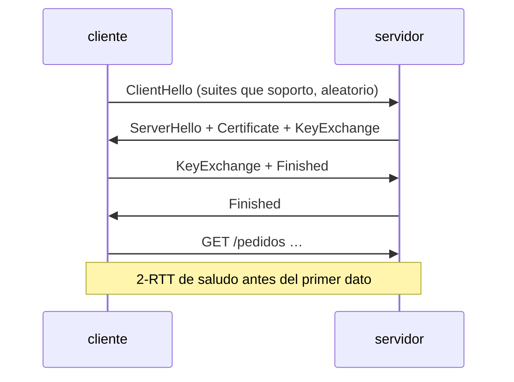
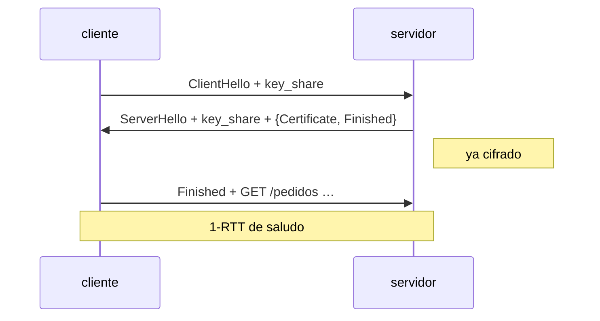
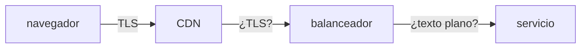

# 05 — TLS y seguridad del transporte

> Qué garantiza exactamente la `s` de HTTPS y qué no garantiza en absoluto; por qué se sigue diciendo
> SSL cuando lleva veinte años muerto; qué pasa en el saludo de TLS 1.3 y por qué es un viaje más
> rápido que el de 1.2; cómo se construye la confianza en un certificado y dónde se rompe; y en qué
> se parece y en qué no se parece SSH.
>
> Los certificados y protocolos que aparecen están **inspeccionados en vivo** con `openssl`.
>
> **Vigencia:** 2026-09-17. · **Requisito:** [`02` — El mensaje](02-el-mensaje-y-los-encabezados.md).

---

## 1. 🎯 El problema

Pregunta de entrevista aparentemente trivial: *"¿qué te da HTTPS?"*. La respuesta habitual —"que
va cifrado"— es un tercio de la respuesta, y el tercio menos interesante.

```text
✅ Confidencialidad   nadie en medio lee el contenido
✅ Integridad         nadie en medio lo modifica sin que se note
✅ Autenticación DEL SERVIDOR   hablas con quien dice el certificado
```

Y lo que **no** da, que es donde están las preguntas de verdad:

```text
❌ No autentica al cliente        salvo mTLS, que es otra cosa y hay que configurarla
❌ No oculta CON QUIÉN hablas     el nombre del servidor viaja en claro en el saludo (SNI)
❌ No oculta el tamaño ni el ritmo del tráfico
❌ No protege nada en los extremos   ni antes de cifrar ni después de descifrar
❌ No dice que el sitio sea legítimo  solo que controla ese dominio
```

Ese último punto es el que más incidentes explica: **un sitio de phishing tiene candado**, porque un
certificado de dominio es gratis y automático desde que existe ACME. El candado nunca significó
"confiable"; significa "cifrado hasta quien controle este nombre".

> **Veredicto:** HTTPS es autenticación del servidor más un canal cifrado. Todo lo demás —quién eres
> tú, qué puedes hacer, si el sitio miente— es problema de otras capas.

---

## 2. 🧱 SSL, TLS y qué está vivo

**La nomenclatura.** SSL fue el protocolo de Netscape; TLS es su sucesor en el IETF desde 1999. **SSL
está muerto en todas sus versiones** —2.0 prohibido, 3.0 deprecado—, pero el nombre sobrevivió en
los productos: "certificado SSL", "terminación SSL", `SSLContext` en Java, `openssl`. Decir SSL por
TLS es aceptable en conversación; en una entrevista, decir **"lo llamamos SSL por costumbre, pero
hoy todo es TLS"** demuestra que sabes la diferencia.

| Versión | Estado hoy | Fuente |
|---|---|---|
| SSL 2.0 | **Prohibido** | RFC 6176 |
| SSL 3.0 | **Deprecado** | RFC 7568 |
| TLS 1.0 / 1.1 | **Deprecados** | RFC 8996, *Best Current Practice* |
| TLS 1.2 | Vigente y mayoritario en servicio a servicio | RFC 5246 |
| **TLS 1.3** | El objetivo, desde 2018 | RFC 8446 |

**Comprobado en vivo** contra un servidor real:

```bash
# Qué versión y qué cifrado se negocian de verdad
echo | openssl s_client -connect www.rfc-editor.org:443 -servername www.rfc-editor.org 2>/dev/null \
  | grep -E "Protocol|Cipher|Verification"
```

- `echo |` cierra la entrada para que `s_client` no se quede esperando: solo queremos el saludo.
- `-connect host:443` abre la conexión TLS; `-servername` envía **SNI**, la sección 3.
- `2>/dev/null` descarta el ruido de diagnóstico, que va por error estándar.

```text
Protocol  : TLSv1.3
Cipher    : TLS_AES_256_GCM_SHA384
Verification: OK
```

Y el intento de forzar TLS 1.0, que ni siquiera sale al cable:

```bash
echo | openssl s_client -connect www.rfc-editor.org:443 -tls1
```

```text
error:0A0000BF:SSL routines:tls_setup_handshake:no protocols available
```

> 📝 **Precisión.** Ese error es **del cliente, no del servidor**: OpenSSL 3.6 ya no compila soporte
> para TLS 1.0 en su configuración por defecto, así que se niega a intentarlo. Es una buena
> ilustración de cómo muere un protocolo: no porque se apague el servidor, sino porque las
> bibliotecas dejan de ofrecerlo.

---

## 3. 🧱 El saludo, y por qué 1.3 es más rápido

**El problema.** Antes de mandar un solo octeto de HTTP hay que acordar algoritmos, verificar
identidad y derivar claves. Eso cuesta viajes de ida y vuelta, y cada viaje es latencia pura.

**TLS 1.2** — dos viajes antes del primer dato:



**TLS 1.3** — uno, porque el cliente **adivina** el grupo de claves y lo envía en el primer mensaje:



Lo que 1.3 cambió, y que se pregunta:

- **Un viaje menos**, que sobre una conexión intercontinental son 100–200 ms menos en la primera
  petición. Es de las mejoras de latencia más baratas que existen.
- **Se eliminaron los algoritmos rotos**, no se desaconsejaron: fuera RC4, fuera 3DES, fuera MD5 y
  SHA-1 para firmas, fuera el modo CBC problemático, fuera la renegociación y fuera la compresión de
  TLS —la que hizo posible CRIME—. La lista de suites pasó de decenas a **cinco**.
- **El certificado del servidor ya viaja cifrado**, cosa que en 1.2 iba en claro.
- **Confidencialidad futura obligatoria** (*forward secrecy*): las claves de sesión son efímeras, así
  que quien grabe el tráfico hoy y robe la clave privada mañana **no puede descifrar lo grabado**. En
  1.2 era opcional y mucha gente la tenía apagada.
- **0-RTT**: reanudar una sesión sin ningún viaje, mandando datos en el primer paquete. **Y no es
  gratis**: esos datos son **reproducibles por un atacante**, porque no hay nada que los ate a una
  sesión fresca. Por eso 0-RTT solo debe llevar peticiones idempotentes — el capítulo `03` conecta
  aquí de forma directa.

**Dos extensiones del saludo que hay que conocer:**

- **SNI** (*Server Name Indication*, RFC 6066): el cliente dice a qué nombre quiere hablar **antes**
  de que el servidor elija el certificado. Sin SNI no habría varios sitios HTTPS en una misma IP. Y
  **viaja en claro**: es la razón por la que TLS no oculta a qué dominio te conectas.
- **ALPN** (RFC 7301): dentro del mismo saludo se acuerda el protocolo de aplicación —`h2`,
  `http/1.1`, `h3`—, sin viajes extra. **HTTP/2 sobre TLS se negocia aquí**, no con `Upgrade`.

---

## 4. 🧱 Certificados: dónde vive la confianza

**Qué es.** Un certificado X.509 (RFC 5280) liga **una clave pública** a **una identidad** —unos
nombres de dominio— mediante **la firma de una autoridad**. Nada más, y ese "nada más" es todo.

**La cadena, inspeccionada de verdad:**

```bash
echo | openssl s_client -connect www.rfc-editor.org:443 -servername www.rfc-editor.org -showcerts 2>/dev/null \
  | grep -E "^ *[0-9] s:"
```

```text
 0 s:CN=rfc-editor.org                                    ← certificado de hoja (el del servidor)
 1 s:C=US, O=Google Trust Services, CN=WE1                ← intermedio
 2 s:C=US, O=Google Trust Services LLC, CN=GTS Root R4    ← raíz
```

- **La raíz no viaja por el cable en la práctica**: ya está en el almacén de confianza del sistema
  operativo o del JDK. Lo que el servidor manda es la hoja y los intermedios; el cliente encadena
  hasta una raíz que ya tenía.
- **El fallo número uno de despliegue es olvidar el intermedio.** Funciona en tu navegador —que lo
  tiene cacheado de otra visita— y falla en `curl`, en el JDK y en el móvil. Si un certificado
  "funciona en Chrome pero no en Java", **es esto**, casi siempre.
- **Los intermedios existen para proteger la raíz**: la clave de la raíz está fuera de línea, en una
  caja fuerte, y solo firma intermedios. Comprometer un intermedio se arregla revocándolo;
  comprometer una raíz obligaría a actualizar todos los dispositivos del mundo.

**Lo que hay que saber de la validación:**

- **El nombre se comprueba contra la extensión SAN**, no contra el `CN`. El `CN` como identidad está
  obsoleto desde RFC 6125 y los navegadores lo ignoran desde hace años. Un certificado con el nombre
  solo en `CN` falla en clientes modernos.
- **Un comodín cubre un solo nivel**: `*.ejemplo.com` vale para `api.ejemplo.com` y **no** para
  `a.b.ejemplo.com`. Es la sorpresa clásica de los subdominios anidados.
- **La caducidad es la causa número uno de caída de un servicio HTTPS**, y es enteramente evitable:
  ACME (RFC 8555) automatiza la emisión y la renovación, y la duración de los certificados no deja de
  acortarse. Un certificado renovado a mano es una incidencia esperando fecha.
- **La revocación funciona a medias.** Las CRL son listas enormes; OCSP (RFC 6960) consulta en línea y
  **filtra al validador qué sitios visitas**; el *OCSP stapling* lo arregla haciendo que el servidor
  adjunte la prueba ya firmada. Los navegadores acabaron usando listas propias. Que la revocación sea
  el punto débil de la infraestructura de clave pública es una respuesta que suma.

**Autenticación del cliente (mTLS).** El servidor puede exigir certificado al cliente en el mismo
saludo, y entonces la autenticación es mutua. Sirve para servicio a servicio y para malla de
servicios, y su coste real es la **gestión del ciclo de vida**: emitir, rotar y revocar miles de
certificados. El patrón y su encaje en arquitectura están en `repaso-arquitectura-entrevistas`.

---

## 5. 🧱 Lo que pasa después de descifrar

**El problema.** Casi ningún servicio en producción termina TLS él mismo. Lo hace el balanceador o el
CDN, y a partir de ahí:



Las consecuencias, que son preguntas de arquitectura además de protocolo:

- **Tu servicio no ve la IP del cliente**, sino la del balanceador. Por eso existe `Forwarded`
  (RFC 7239) y su predecesor de facto `X-Forwarded-For`. **Y esos encabezados son falsificables**: si
  no filtras los que llegan de fuera, cualquiera se inventa su IP de origen, y ahí se cae una lista
  blanca o un limitador de tasa.
- **El tramo interno también necesita protección**, o la "seguridad" del sistema termina en el
  balanceador. Es exactamente el argumento de confianza cero.
- **HSTS** (RFC 6797) le dice al navegador *"a este dominio, solo HTTPS, durante N segundos"*, y así
  elimina la primera petición en claro que un atacante puede secuestrar. La lista de precarga va un
  paso más allá: viene incrustada en el navegador.

```text
Strict-Transport-Security: max-age=31536000; includeSubDomains
```

- **`max-age` en segundos** — un año es el valor habitual, y ojo: **es un compromiso**. Si publicas
  HSTS y luego no puedes servir HTTPS en un subdominio, los navegadores que ya lo recibieron **no te
  dejarán volver** hasta que expire.
- **Redirigir de `http://` a `https://` no basta**: esa primera petición ya viajó en claro.

> 📝 **Frontera.** CORS, CSRF, cabeceras de política de contenido y el diseño de autenticación y
> autorización —OAuth, JWT, sesiones— se tratan en `repaso-arquitectura-entrevistas`. Aquí queda
> **el transporte**.

---

## 6. 🧱 SSH frente a TLS

Se confunden porque ambos cifran y ambos usan criptografía asimétrica. Son protocolos distintos, con
modelos de confianza distintos:

| | TLS | SSH |
|---|---|---|
| Para qué | Proteger cualquier protocolo de aplicación | Acceso remoto a una máquina |
| Puerto típico | 443 | 22 |
| Confianza en el servidor | **Cadena de certificados** y autoridades | **TOFU**: se acepta la huella la primera vez |
| Autenticación del cliente | Opcional (mTLS), poco común | **Central**: par de claves o contraseña |
| Quién lo usa | Todo el tráfico web | Operación, despliegue, `git` |

- **La diferencia de fondo es el modelo de confianza.** TLS delega en terceros —las autoridades—;
  SSH confía en que la primera conexión no estaba interceptada, y a partir de ahí avisa si la huella
  cambia. Ese aviso —`REMOTE HOST IDENTIFICATION HAS CHANGED`— es literalmente la detección de
  intermediario, y casi todo el mundo lo ignora borrando `known_hosts`.
- **En SSH la autenticación del cliente es el caso normal**; en TLS es la excepción.
- **Los dos son transporte seguro para otra cosa**: `git+ssh`, `scp` y los túneles van sobre SSH igual
  que HTTP va sobre TLS.

---

## 7. 📜 Lo que dice la norma

| Afirmación | Fuente | ¿Obliga o es convención? |
|---|---|---|
| TLS 1.0 y TLS 1.1 están deprecados | RFC 8996, *Best Current Practice* | **Norma** |
| SSL 2.0 está prohibido; SSL 3.0, deprecado | RFC 6176 / RFC 7568 | **Norma** |
| TLS 1.3 es el protocolo actual | RFC 8446, *Proposed Standard* | **Norma** |
| TLS 1.3 exige confidencialidad futura | RFC 8446 | **Norma** |
| La identidad se valida contra SAN, no contra `CN` | RFC 6125 | **Norma** |
| Los datos de 0-RTT son susceptibles de reproducción | RFC 8446 §2.3 | **Norma**, advertencia explícita |
| El nombre de servidor (SNI) viaja en el saludo | RFC 6066 | **Norma** |
| El protocolo de aplicación se acuerda con ALPN | RFC 7301 | **Norma** |
| HSTS y su `max-age` | RFC 6797 | **Norma** |
| La emisión automatizada de certificados | RFC 8555 (ACME) | **Norma** |
| Recomendaciones de configuración segura de TLS | RFC 9325, *Best Current Practice* | **Recomendación** |
| `X-Forwarded-For` | Ninguna; el estándar es `Forwarded` (RFC 7239) | **Convención** |
| Llamar "SSL" a TLS | Ninguna | **Costumbre** |

---

## 8. 🔭 Dónde aparece de verdad

En el certificado que caducó un domingo y tumbó la pasarela de pagos; en el `PKIX path building
failed` del JDK que en el navegador no se reproduce porque falta el intermedio; en el `curl -k` que
alguien metió en un script para "arreglarlo" y que desactiva toda la verificación; en la auditoría
que exige desactivar TLS 1.0 y hay que saber qué clientes se quedan fuera; en la decisión de cifrar o
no el tramo entre el balanceador y el servicio; y en la entrevista, donde *"¿qué te da HTTPS?"* y
*"¿cómo verifica el cliente el certificado?"* son la vía directa a saber si el candidato ha operado
sistemas o solo los ha usado.

---

## ⚠️ Errores frecuentes

| Se dice | Lo preciso |
|---|---|
| "HTTPS significa que el sitio es seguro/confiable" | Significa canal cifrado y servidor autenticado. El phishing también tiene candado |
| "SSL y TLS son lo mismo" | SSL está muerto; el nombre sobrevive en los productos |
| "TLS oculta a qué sitio me conecto" | SNI viaja en claro, y también el tamaño y el ritmo del tráfico |
| "El certificado autentica al cliente" | Solo al servidor, salvo mTLS configurado aparte |
| "La identidad está en el `CN`" | Se valida contra **SAN** desde RFC 6125 |
| "`*.ejemplo.com` cubre todos los subdominios" | Solo un nivel: no cubre `a.b.ejemplo.com` |
| "Funciona en el navegador, luego el certificado está bien" | Falta el intermedio: el navegador lo tenía cacheado |
| "0-RTT es TLS 1.3 y ya está, es gratis" | Sus datos son reproducibles; solo para peticiones idempotentes |
| "Con el redirect a HTTPS basta" | La primera petición ya viajó en claro; para eso está HSTS |
| "Dentro de la red no hace falta cifrar" | Es el supuesto que la confianza cero desmonta |
| "`X-Forwarded-For` me da la IP real" | Es falsificable si no la filtras en el borde |

---

## 📚 Para profundizar

- **RFC** — [RFC 8446 — *The Transport Layer Security (TLS) Protocol Version 1.3*](https://www.rfc-editor.org/rfc/rfc8446.html):
  la norma actual. El apéndice D y la sección 2 se leen aunque no se lea el resto.
- **RFC** — [RFC 8996 — *Deprecating TLS 1.0 and TLS 1.1*](https://www.rfc-editor.org/rfc/rfc8996.html)
  (BCP): corto, y es lo que se cita en una auditoría.
- **RFC** — [RFC 9325 — *Recommendations for Secure Use of TLS and DTLS*](https://www.rfc-editor.org/rfc/rfc9325.html)
  (BCP): qué configurar, en la fuente y no en un blog de 2015.
- **RFC** — [RFC 6125 — *Representation and Verification of Domain-Based Application Service
  Identity…*](https://www.rfc-editor.org/rfc/rfc6125.html): por qué SAN y no `CN`.
- **RFC** — [RFC 6797 — *HTTP Strict Transport Security (HSTS)*](https://www.rfc-editor.org/rfc/rfc6797.html)
  y [RFC 8555 — *ACME*](https://www.rfc-editor.org/rfc/rfc8555.html).
- **Libro** — Ivan Ristić, *Bulletproof TLS and PKI* (2ª ed.). El libro de referencia sobre TLS
  operado en producción: cadenas, revocación, rendimiento y configuración real.
- **Herramienta** — [SSL Labs — Server Test](https://www.ssllabs.com/ssltest/): audita un dominio
  público y explica cada hallazgo. Pasar de B a A+ enseña más que cualquier tutorial.
- **Herramienta** — [badssl.com](https://badssl.com/): certificados rotos a propósito —caducado,
  nombre incorrecto, autofirmado, cadena incompleta— para ver **cada error con sus ojos**.
- **Visualización** — [The Illustrated TLS 1.3 Connection](https://tls13.xargs.org/): el saludo byte a
  byte, anotado. La mejor forma de entender el handshake sin leer el RFC entero.

---

## 🧠 Preguntas

Sin respuestas aquí. Todas, con enunciado literal y respuesta en tres capas, en
[`08` — Respuestas](08-respuestas.md).

1. ¿Qué garantiza HTTPS? Nombra las tres propiedades. 🟢
2. ¿Qué diferencia hay entre SSL y TLS? 🟢
3. ¿Qué versiones de TLS están vigentes hoy? 🟢
4. ¿Qué es un certificado X.509 y qué contiene? 🟢
5. ¿Quién firma un certificado y por qué confía el cliente en él? 🟢
6. ¿Qué es SNI y para qué sirve? 🟢
7. ¿Qué es HSTS? 🟢
8. ¿En qué puerto va HTTPS y en cuál SSH? 🟢
9. ¿Autentica HTTPS al cliente? 🟡
10. ¿Por qué un sitio de phishing puede tener candado? 🟡
11. ¿Qué es la cadena de certificados y qué papel juega el intermedio? 🟡
12. ¿Contra qué campo se valida el nombre del servidor? 🟡
13. ¿Qué cubre y qué no cubre un certificado comodín? 🟡
14. ¿Qué es ALPN y qué se negocia con él? 🟡
15. ¿Qué es la confidencialidad futura y por qué importa? 🟡
16. ¿Qué diferencia el modelo de confianza de SSH del de TLS? 🟡
17. ¿Cuántos viajes cuesta el saludo en TLS 1.2 y en TLS 1.3, y por qué? 🟠
18. ¿Qué riesgo tiene 0-RTT y con qué concepto del capítulo `03` se relaciona? 🟠
19. Un certificado funciona en Chrome y falla en el JDK. Diagnostica. 🟠
20. ¿Por qué la revocación es el punto débil de la infraestructura de clave pública? 🟠
21. ¿Qué se pierde y qué se gana al terminar TLS en el balanceador? 🟠
22. ¿Por qué `X-Forwarded-For` no es una fuente fiable de la IP del cliente? 🟠
23. ¿Qué compromiso adquieres al publicar HSTS con `includeSubDomains`? 🟠
24. ¿Por qué TLS 1.3 redujo la lista de suites de cifrado a cinco? 🟠
25. Una auditoría exige desactivar TLS 1.0 y 1.1. Enumera qué comprobarías antes, qué romperías y
    cómo lo desplegarías. 🔴
26. Diseña la seguridad de transporte de una API bancaria de extremo a extremo: navegador, CDN,
    balanceador, servicio y base de datos. Di qué proteges en cada tramo y con qué. 🔴
27. Escribe el procedimiento de renovación de certificados de una plataforma con veinte servicios:
    qué automatizas, qué monitorizas y cuál es la alerta que evita la caída. 🔴
28. Un servicio expone mTLS a sus clientes internos. Enumera los cinco problemas de ciclo de vida
    que aparecerán y cómo los resolverías. 🔴
29. Te dan el informe de SSL Labs de un dominio con nota B. Escribe el orden en que atacarías los
    hallazgos y qué comprobarías antes de tocar nada. 🔴
---

**Anterior:** [`04` — Codificación y formatos](04-codificacion-y-formatos.md) ·
**Siguiente:** [`06` — Versiones, proxies y tiempo real](06-versiones-proxies-y-tiempo-real.md)
