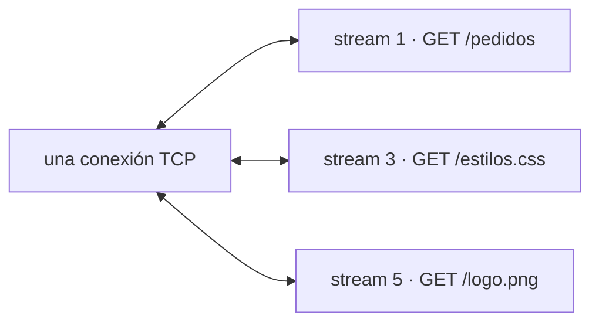
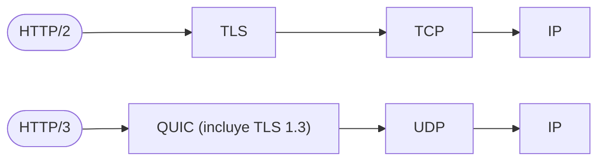
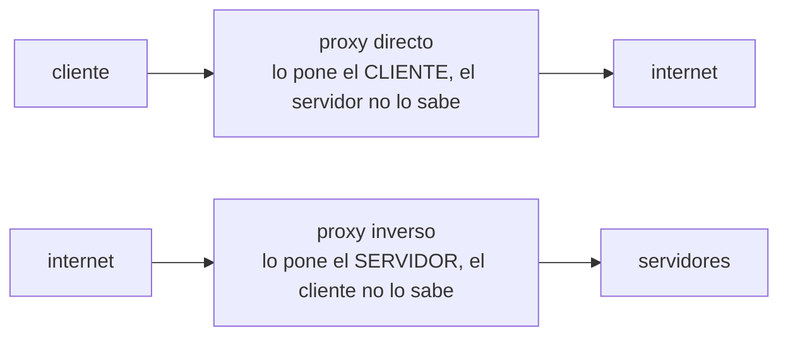

# 06 — Versiones, proxies y tiempo real

> Qué resolvió cada versión de HTTP y qué problema dejó abierto para la siguiente; por qué HTTP/3
> abandonó TCP después de treinta años; cómo funciona la caché que el protocolo te regala y casi
> nadie usa; y las cuatro formas de empujar datos del servidor al cliente, con el criterio para
> elegir entre ellas.
>
> El capítulo donde la semántica de los capítulos `02` a `04` se encuentra con la red real.
>
> **Vigencia:** 2026-09-17. · **Requisito:** [`02` — El mensaje](02-el-mensaje-y-los-encabezados.md).

---

## 1. 🎯 El problema

Una página carga 80 recursos. Con HTTP/1.1 y una sola conexión, van de uno en uno: cada respuesta
tiene que terminar antes de que empiece la siguiente petición. Si la tercera tarda dos segundos, las
77 restantes esperan.

```text
conexión:  [req1][res1][req2][res2][req3][··· 2 s ···][req4]…
                                   └─ todo lo demás espera aquí
```

Eso es **bloqueo de cabeza de línea** (*head-of-line blocking*), y es el hilo que explica las tres
versiones siguientes del protocolo. Cada una lo atacó en una capa distinta:

```text
HTTP/1.1  lo sufre en la conexión    → se parchea abriendo seis conexiones por origen
HTTP/2    lo resuelve en HTTP        → pero lo hereda de TCP
HTTP/3    lo resuelve de verdad      → cambiando TCP por QUIC sobre UDP
```

> **Veredicto:** no hay que memorizar tablas de versiones. Hay que saber contar esta historia: un
> problema, tres intentos, y cada intento revelando dónde estaba el problema de verdad.

---

## 2. 🧱 HTTP/1.1 y su techo

**Qué resolvió respecto a 1.0.** Conexiones persistentes (`keep-alive`) —reutilizar el socket en vez
de abrir uno por recurso, ahorrando el saludo TCP y el de TLS—, el `Host` obligatorio, que permitió
varios sitios por IP, y `Transfer-Encoding: chunked`.

**Lo que no resolvió.** Solo una petición en vuelo por conexión. El *pipelining* —mandar varias sin
esperar— no lo arregló: las respuestas seguían teniendo que volver **en orden** y los proxies lo
implementaban tan mal que los navegadores lo desactivaron. **El pipelining está muerto**, y decirlo
es una respuesta de nivel.

**El parche de la industria**, que definió una década de "buenas prácticas" hoy contraproducentes:

```text
6 conexiones por origen        el límite de facto de los navegadores
sharding de dominios           img1.ejemplo.com, img2… para multiplicar ese límite
sprites CSS                    50 iconos en una imagen para hacer 1 petición
concatenación de JS y CSS      un único archivo gigante
inlining en base64             incrustar para evitar la petición
```

**Todos esos trucos existen porque las peticiones eran caras, y con HTTP/2 y HTTP/3 dejan de serlo.**
De hecho se vuelven dañinos: un solo archivo concatenado invalida la caché entera al cambiar una
línea, y el *sharding* multiplica saludos TLS y rompe la multiplexación. Que una optimización de 2012
sea un antipatrón en 2026 es exactamente lo que se pregunta para ver si alguien entiende el porqué o
solo repite recetas.

---

## 3. 🧱 HTTP/2: multiplexar

**Qué es.** El mismo HTTP —mismos métodos, mismos códigos, mismos encabezados— sobre una capa binaria
de **tramas** y **flujos** (*streams*).



Petición y respuesta de cada flujo viajan en tramas intercaladas: los tres a la vez, sin orden impuesto.

Lo que trajo:

- **Multiplexación real**: decenas de peticiones concurrentes en una conexión, sin orden. Se acabó el
  bloqueo de cabeza de línea **en la capa HTTP**.
- **Compresión de encabezados con HPACK** (RFC 7541). No es gzip: es una **tabla de índices** que
  ambos extremos mantienen, así que a la segunda petición un `User-Agent` de 150 octetos viaja como
  un índice de un octeto. En una API con muchas peticiones pequeñas, **los encabezados eran el grueso
  del tráfico**, y esto es lo que más se nota.
- **Nombres de campo obligatoriamente en minúscula** y pseudo-campos `:method`, `:path`, `:scheme`,
  `:authority` en lugar de la línea de inicio, como vimos en el capítulo `02`.
- **Prioridades** entre flujos, que funcionaron mal y se rediseñaron aparte.
- **Server push**: enviar recursos no pedidos. **Fracasó y está retirado de los navegadores** —el
  servidor no sabe qué tiene ya el cliente en caché—, y lo sustituyó `103 Early Hints`, que solo
  **sugiere**.

Y el problema que **no** resolvió, que es la pregunta de nivel:

- **El bloqueo de cabeza de línea de TCP sigue ahí.** TCP entrega en orden: si se pierde un paquete,
  **todos los flujos se paran** hasta la retransmisión, aunque fuera de otro flujo. Con mala red,
  HTTP/2 puede ir **peor** que HTTP/1.1 con seis conexiones. Es lo que motivó HTTP/3.

`103 Early Hints` en vivo, capturado con `curl -I` contra un sitio real:

```text
HTTP/2 103
link: </fonts/…woff2>; as=font; rel=preload, …

HTTP/2 200
…
```

- **Dos respuestas a una sola petición**: la `103` viaja antes, con pistas de qué ir precargando, y la
  final llega después. Es la única familia de códigos `1xx` que se ve a diario.

---

## 4. 🧱 HTTP/3 y QUIC

**El problema.** Arreglar el bloqueo de TCP es imposible **dentro** de TCP: el orden estricto es parte
de su contrato, y está implementado en el núcleo de cada sistema operativo —evolucionarlo lleva
décadas, y los intermediarios que no entienden lo nuevo lo descartan (*ossificación*).

**La solución.** Reimplementar el transporte **en espacio de usuario, sobre UDP**. Eso es QUIC
(RFC 9000), y HTTP/3 (RFC 9114) es HTTP sobre QUIC.



Lo que cambia de verdad:

- **Flujos independientes en el transporte**: una pérdida de paquete solo detiene **su** flujo. Esto
  es lo que HTTP/2 no podía dar.
- **TLS 1.3 va dentro de QUIC**, no debajo. El saludo de transporte y el criptográfico son el mismo, y
  por eso una conexión nueva cuesta **1-RTT**, y una reanudada **0-RTT** con la advertencia de
  reproducción del capítulo `05`.
- **Identificador de conexión en vez de la tupla IP/puerto**: si el móvil pasa de wifi a datos, la
  conexión **sobrevive** al cambio de IP. En TCP se caía y había que rehacer todo.
- **Compresión de encabezados con QPACK** (RFC 9204), la variante de HPACK que tolera el desorden de
  los flujos independientes.

**Cómo se descubre y cómo se prueba.** Un servidor anuncia HTTP/3 con `Alt-Svc`, y el cliente lo usa
en la siguiente conexión:

```bash
curl -sI https://www.google.com/ | grep -i alt-svc
```

```text
alt-svc: h3=":443"; ma=2592000
```

- `h3=":443"` significa "lo mismo que estás pidiendo está disponible por HTTP/3 en este puerto"; `ma`
  es cuántos segundos recordarlo.
- **Con el `curl` del sistema (8.7.1 en este macOS), `--http3` no funciona**: hay que compilarlo
  contra una biblioteca QUIC. Es un recordatorio útil de que HTTP/3 aún no está en todas partes fuera
  del navegador y los CDN.

**El coste:** UDP está bloqueado o limitado en muchas redes corporativas, el procesamiento en espacio
de usuario consume **más CPU** que el TCP del núcleo, y el diagnóstico ve menos porque hasta los
números de paquete van cifrados. Por eso todo cliente serio mantiene la caída a HTTP/2.

---

## 5. 🧱 Caché: lo que el protocolo regala

HTTP trae una caché completa, especificada en su propio documento —RFC 9111, **STD 98**—, y la
mayoría de las APIs la desaprovechan entera.

**Dos mecanismos, y la diferencia es la que se pregunta:**

```text
FRESCURA      "no preguntes hasta dentro de N segundos"   → 0 peticiones
VALIDACIÓN    "pregunta, pero quizá te ahorres el cuerpo" → 1 petición, respuesta vacía
```

```text
Cache-Control: max-age=300, public        frescura: 5 minutos sin preguntar
ETag: "a3f9c1"                            identificador de esta versión
If-None-Match: "a3f9c1"                   el cliente la ofrece al revalidar
304 Not Modified                          "la tuya vale"; sin cuerpo
```

Las directivas que hay que distinguir, porque se usan mal a diario:

| Directiva | Qué significa de verdad |
|---|---|
| `max-age=N` | Fresca N segundos |
| `no-cache` | **Sí se guarda**, pero se revalida siempre antes de usarla |
| `no-store` | No se guarda en ningún sitio. Lo que casi todo el mundo quería decir con `no-cache` |
| `private` | Solo la caché del navegador, nunca una compartida |
| `public` | Puede guardarla una caché compartida aunque normalmente no lo haría |
| `must-revalidate` | Caducada, **prohibido** servirla; hay que revalidar |
| `s-maxage=N` | Como `max-age`, pero solo para cachés compartidas (CDN) |
| `stale-while-revalidate=N` | Sirve la caducada y revalida de fondo. La directiva más rentable |

- **`no-cache` no significa "no cachear".** Significa "cachea, pero valida siempre". Para "no guardes
  esto" existe `no-store`, y es lo que debe llevar una respuesta con datos personales.
- **El `ETag` fuerte cambia con cualquier byte; el débil (`W/"…"`) solo con cambios semánticos.**
  Comprimir una respuesta cambia el `ETag` fuerte, y eso ha roto más de una integración.
- **`Vary` es obligatorio en cuanto hay negociación**, como vimos en los capítulos `02` y `04`.
- **La validación condicional también sirve para escribir**: `If-Match` con el `ETag` da bloqueo
  optimista sobre HTTP —si alguien modificó el recurso entre tu lectura y tu escritura, recibes `412
  Precondition Failed` en vez de pisar el cambio. **Es el mejor uso de `ETag` en una API** y casi
  nadie lo aprovecha.

---

## 6. 🧱 Proxies, directos e inversos



- **Un proxy inverso** —nginx, un balanceador, un CDN, una pasarela de API— es el que te concierne a
  diario: termina TLS, reparte carga, cachea, limita tasa y corta el tráfico malo.
- **Un CDN es un proxy inverso distribuido geográficamente**, y su valor no es solo la caché: es
  **terminar TLS cerca del usuario**, con lo que el saludo cuesta decenas de milisegundos menos.
- **`Via` deja rastro de los intermediarios; `Forwarded` (RFC 7239) transporta la información del
  cliente original**, y `X-Forwarded-For` es su versión de facto previa —con la salvedad del capítulo
  `05`: es falsificable si no la filtras en el borde.
- **Lo que un proxy consume y no reenvía** son los encabezados *hop-by-hop* del capítulo `02`: el
  origen de la mitad de las sorpresas al depurar detrás de un balanceador.

---

## 7. 🧱 Tiempo real: las cuatro opciones

**El problema.** HTTP es petición-respuesta: el servidor no puede hablar primero. Cuando el dato nace
en el servidor —una notificación, un precio, el avance de un proceso— hay cuatro caminos.

| Opción | Cómo | Cuándo es la correcta |
|---|---|---|
| **Sondeo** (*polling*) | El cliente pregunta cada N segundos | Latencia tolerable de segundos y pocos clientes. Simple y depurable |
| **Sondeo largo** | La petición queda abierta hasta que haya dato | Compatibilidad máxima sin infraestructura nueva |
| **SSE** | Una respuesta que nunca termina, `text/event-stream` | **Servidor → cliente**, que es el 80 % de los casos |
| **WebSocket** | Cambio de protocolo, canal bidireccional | Hace falta **cliente → servidor** con baja latencia |

**SSE**, el más infravalorado:

```text
GET /pedidos/PED-00042/eventos
Accept: text/event-stream

HTTP/1.1 200 OK
Content-Type: text/event-stream
Cache-Control: no-store

data: {"estado":"EN_PREPARACION"}

data: {"estado":"ENVIADO"}
```

- **Es HTTP normal**: atraviesa proxies, cachés y balanceadores sin configuración especial, y
  **reconecta solo** —el navegador reintenta y envía `Last-Event-ID` para continuar donde se quedó—.
  Está en la especificación HTML, no en un RFC.
- Su límite es que va en **una sola dirección**, y que sobre HTTP/1.1 consume una de las seis
  conexiones por origen —lo que deja de importar con HTTP/2.

**WebSocket** (RFC 6455) empieza como una petición HTTP y deja de serlo:

```text
GET /chat HTTP/1.1
Upgrade: websocket
Connection: Upgrade
Sec-WebSocket-Key: dGhlIHNhbXBsZSBub25jZQ==

HTTP/1.1 101 Switching Protocols
```

- **Tras el `101` ya no hay HTTP**: ni métodos, ni códigos de estado, ni caché, ni los encabezados de
  cada mensaje. **Todo eso lo pierdes**, y lo que ganas es un canal bidireccional de baja latencia.
- **Y hereda problemas nuevos**: la conexión es con estado, así que el balanceo necesita afinidad o
  un bus detrás; la reconexión y los latidos se implementan a mano; y muchos proxies corporativos lo
  cortan.
- Sobre HTTP/2 se arranca con `CONNECT` extendido (RFC 8441) en vez de `Upgrade`.

> 💡 **La respuesta que distingue.** *"Por defecto SSE: es HTTP, atraviesa toda la infraestructura,
> reconecta solo y cubre el caso de servidor a cliente. WebSocket solo cuando el cliente tiene que
> empujar con baja latencia —chat, colaboración, juegos—, porque a cambio pierdo la caché, los
> códigos de estado y el balanceo sin estado."*

---

## 8. 📜 Lo que dice la norma

| Afirmación | Fuente | ¿Obliga o es convención? |
|---|---|---|
| HTTP/2 es binario, con flujos multiplexados | RFC 9113 | **Norma** |
| Los nombres de campo van en minúscula en HTTP/2 y HTTP/3 | RFC 9113 | **Norma** |
| La compresión de encabezados es HPACK / QPACK | RFC 7541 / RFC 9204 | **Norma** |
| HTTP/3 va sobre QUIC, no sobre TCP | RFC 9114 / RFC 9000 | **Norma** |
| QUIC integra TLS 1.3 en su propio saludo | RFC 9000 | **Norma** |
| Una conexión QUIC sobrevive a un cambio de IP | RFC 9000 | **Norma** |
| `no-cache` significa revalidar, no "no guardar" | RFC 9111 §5.2.2 | **Norma** |
| `304` no lleva cuerpo | RFC 9110 §15.4.5 | **Norma** |
| `If-Match` da control de concurrencia optimista | RFC 9110 §13.1.1 | **Norma** |
| `Alt-Svc` anuncia versiones alternativas | RFC 7838 | **Norma** |
| `103 Early Hints` | RFC 8297 | **Norma** |
| WebSocket y su `101 Switching Protocols` | RFC 6455 | **Norma** |
| SSE (`text/event-stream`) | Especificación HTML de WHATWG, **no un RFC** | **Norma**, de otro organismo |
| Seis conexiones por origen en HTTP/1.1 | Ninguna | **Convención** de los navegadores |
| Server push de HTTP/2 | Definido, pero **retirado** de los navegadores | **Obsoleto en la práctica** |

---

## 9. 🔭 Dónde aparece de verdad

En la migración a HTTP/2 que no mejoró nada porque el equipo mantuvo el *sharding* de dominios; en la
API móvil que va peor en 4G con HTTP/2 que con HTTP/1.1, por el bloqueo de TCP; en el `no-cache` que
alguien puso creyendo que era `no-store` y dejó datos personales en una caché intermedia; en el CDN
que sirve contenido caducado porque nadie configuró la revalidación; en el WebSocket que funciona en
local y muere tras el balanceador; y en la entrevista, donde *"¿SSE o WebSocket?"* y *"¿qué aporta
HTTP/3?"* separan a quien ha desplegado sistemas de quien ha leído sobre ellos.

---

## ⚠️ Errores frecuentes

| Se dice | Lo preciso |
|---|---|
| "HTTP/2 es HTTP más rápido" | Es el mismo HTTP con otra codificación; lo que gana es concurrencia |
| "HTTP/2 elimina el bloqueo de cabeza de línea" | Lo elimina en HTTP; **lo hereda de TCP**. Para eso está HTTP/3 |
| "HTTP/3 es HTTP/2 sobre UDP" | Es HTTP sobre **QUIC**, que trae su propio transporte y TLS 1.3 |
| "Concatenar y hacer sprites es buena práctica" | Lo era con HTTP/1.1; con HTTP/2 y HTTP/3 estorba |
| "Con HTTP/2 uso server push" | Está retirado de los navegadores. Lo vivo es `103 Early Hints` |
| "`no-cache` impide cachear" | Permite guardar y obliga a revalidar. Lo otro es `no-store` |
| "Un `304` trae el recurso" | No lleva cuerpo: ese es el ahorro |
| "`ETag` sirve solo para caché" | Con `If-Match` da bloqueo optimista al escribir |
| "Para tiempo real, WebSocket" | Si solo va del servidor al cliente, SSE cuesta mucho menos |
| "WebSocket es HTTP" | Solo el saludo; tras el `101` no hay HTTP |
| "Un CDN sirve para cachear imágenes" | También termina TLS cerca del usuario, que suele importar más |

---

## 📚 Para profundizar

- **RFC** — [RFC 9111 — *HTTP Caching*](https://www.rfc-editor.org/rfc/rfc9111.html) (STD 98): la sección 5
  define cada directiva. Leer solo esa sección ya cambia cómo configuras una API.
- **RFC** — [RFC 9113 — *HTTP/2*](https://www.rfc-editor.org/rfc/rfc9113.html) y
  [RFC 9114 — *HTTP/3*](https://www.rfc-editor.org/rfc/rfc9114.html).
- **RFC** — [RFC 9000 — *QUIC: A UDP-Based Multiplexed and Secure Transport*](https://www.rfc-editor.org/rfc/rfc9000.html):
  la sección 1 explica el porqué mejor que cualquier resumen.
- **RFC** — [RFC 6455 — *The WebSocket Protocol*](https://www.rfc-editor.org/rfc/rfc6455.html) y
  [RFC 8441 — *Bootstrapping WebSockets with HTTP/2*](https://www.rfc-editor.org/rfc/rfc8441.html).
- **Libro** — [Ilya Grigorik, *High Performance Browser Networking*](https://hpbn.co/) — **gratis y
  completo en línea**. Los capítulos de TCP, TLS, HTTP/2 y WebSocket son el mejor material que existe
  sobre este temario.
- **Referencia** — [MDN — Server-Sent Events](https://developer.mozilla.org/en-US/docs/Web/API/Server-sent_events):
  el formato del flujo, la reconexión y `Last-Event-ID`.
- **Referencia** — [MDN — HTTP caching](https://developer.mozilla.org/en-US/docs/Web/HTTP/Guides/Caching):
  las directivas con ejemplos y los errores típicos.
- **Vídeo** — [*HTTP/1 to HTTP/2 to HTTP/3* — ByteByteGo](https://www.youtube.com/watch?v=a-sBfyiXysI):
  la evolución en seis minutos, con los diagramas de multiplexación.

---

## 🧠 Preguntas

Sin respuestas aquí. Todas, con enunciado literal y respuesta en tres capas, en
[`08` — Respuestas](08-respuestas.md).

1. ¿Qué es el bloqueo de cabeza de línea? 🟢
2. ¿Qué aportó `keep-alive` en HTTP/1.1? 🟢
3. ¿Cuántas conexiones por origen abre un navegador con HTTP/1.1? 🟢
4. ¿Qué es la multiplexación de HTTP/2? 🟢
5. ¿Sobre qué transporte va HTTP/3? 🟢
6. ¿Qué diferencia hay entre `no-cache` y `no-store`? 🟢
7. ¿Qué es un `ETag`? 🟢
8. ¿Qué es un proxy inverso? 🟢
9. ¿Qué es SSE y qué tipo de medio usa? 🟢
10. ¿Por qué el *pipelining* de HTTP/1.1 fracasó? 🟡
11. ¿Por qué concatenar archivos era buena práctica y ya no lo es? 🟡
12. ¿Qué es HPACK y por qué importa en una API de muchas peticiones pequeñas? 🟡
13. ¿Qué pasó con el server push de HTTP/2 y qué lo sustituye? 🟡
14. Diferencia frescura y validación en la caché de HTTP. 🟡
15. ¿Qué hace `stale-while-revalidate`? 🟡
16. ¿Qué diferencia un `ETag` fuerte de uno débil? 🟡
17. ¿Qué es `Alt-Svc`? 🟡
18. ¿Qué pierdes al pasar a WebSocket tras el `101`? 🟡
19. ¿Por qué HTTP/2 puede ir peor que HTTP/1.1 en una red con pérdidas? 🟠
20. ¿Por qué QUIC se implementó sobre UDP en vez de mejorar TCP? 🟠
21. ¿Qué permite el identificador de conexión de QUIC que TCP no permitía? 🟠
22. ¿Cuál es el coste de HTTP/3 y por qué se mantiene la caída a HTTP/2? 🟠
23. ¿Cómo se usa `ETag` para control de concurrencia optimista al escribir? 🟠
24. ¿SSE o WebSocket para el seguimiento del estado de un pedido? Justifica. 🟠
25. Un WebSocket funciona en local y falla tras el balanceador. Diagnostica. 🟠
26. Diseña la estrategia de caché completa de una API con datos públicos, datos por usuario y datos
    que cambian cada segundo. Di las directivas exactas y por qué. 🔴
27. Un equipo migra a HTTP/2 y no mejora nada. Enumera las cinco causas más probables, en orden. 🔴
28. Diseña el mecanismo de seguimiento en vivo del estado de mil pedidos simultáneos: transporte,
    reconexión, qué pasa si el cliente estuvo desconectado y cómo escala tras el balanceador. 🔴
29. Un CDN sirve contenido caducado a unos usuarios y fresco a otros, de forma intermitente.
    Da tres hipótesis ordenadas y el experimento que distingue cada una. 🔴
---

**Anterior:** [`05` — TLS y seguridad del transporte](05-tls-y-seguridad-del-transporte.md) ·
**Siguiente:** [`07` — Simulación de entrevista](07-simulacion-de-entrevista.md)
